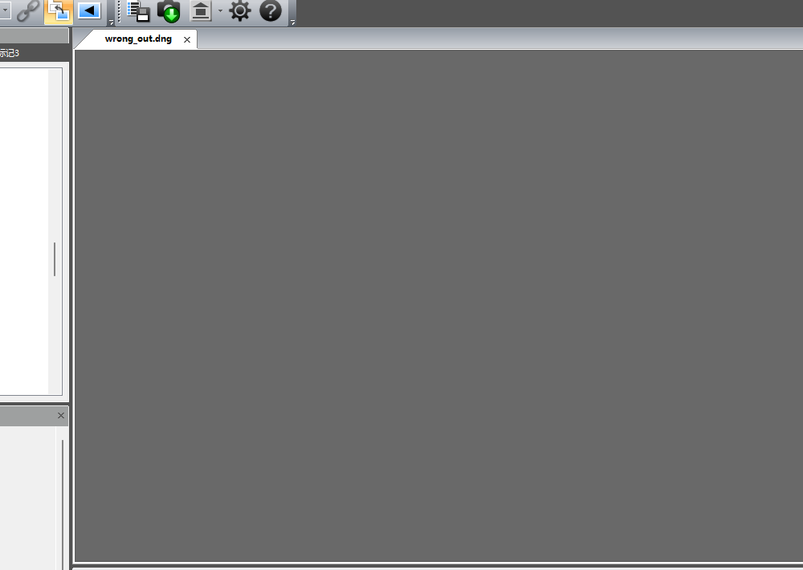
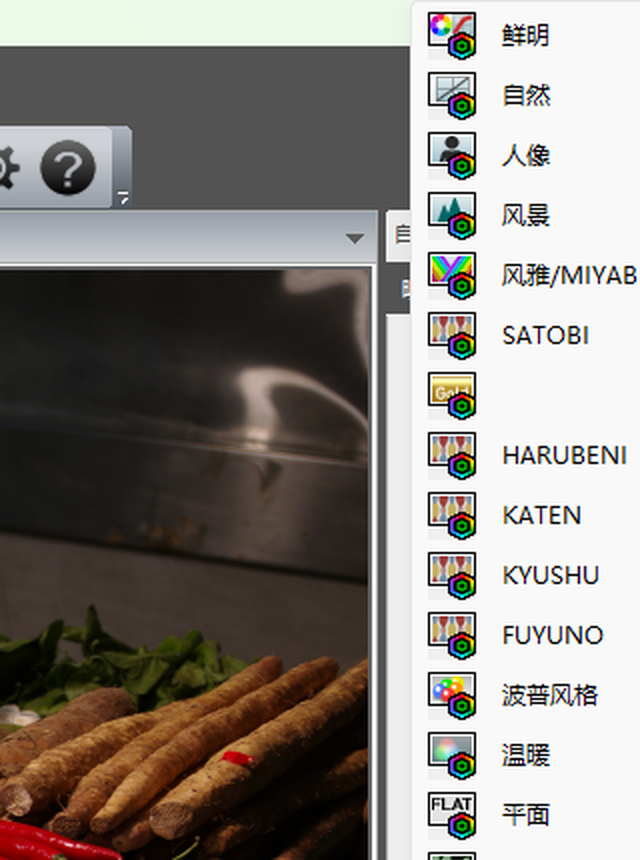

# PDCU 打不开 DCU 转出的 DNG：0x0005 机型 ID 被当成预览偏移重定位

日期：2026-11-03

| 项目 | 文件 |
|---|---|
| 样本 | `sample/wrong/K1ii.dng`（40,781,034 B，PENTAX K-1 Mark II，DCU 5.10.2.2 由 PEF 转出） |
| 复现命令 | `python tools\dng_season_params.py --target sample\wrong\K1ii.dng --builtin k1ii --out .tmp\wrong_out.dng --overwrite` |
| 修复产物 | `.tmp/wrong_fix.dng`（40,859,510 B，SHA-256 `230264917ED7BBC49D83E437B004ACE37BCC5800D01E9C709B3387DA8EA41259`） |
| 受影响版本 | v2.8 – v2.10（MakerNote 整块搬到文件尾的通道） |
| 修复版本 | v2.11 |

## 0. 结论

1. **不是 DNG 本身坏，也不是 PDCU 的 DNG 支持问题**：这份 DCU 转出的 DNG
   在 PDCU 5.10.2.2 里显示完全正常；**是打完四季补丁之后 PDCU 才不出图**。
2. **根因是把 Pentax 机型 ID 当成了"预览偏移"重定位**。AOC MakerNote 整块搬到
   文件尾时，`_preview_offsets()` 会把 0x0004 / 0x0005 两个标签的值当成绝对文件
   偏移，只要这个值**恰好落在块内**就整体加位移。这两个标签其实是**机型 ID**；
   这份文件的 0x0005 = `0x13240`（78,400）刚好落在 0x927C 块
   `0x84C..0x1355C` 里，于是被改成 `0x26F6EE0`——PDCU 认不出机型，
   标签页打得开、相机信息也读得到，但画面永远不显影（灰底）。
3. **修复**：只有目标字节以 `FF D8`（JPEG SOI）开头才认定是预览偏移；
   同时把 0x0004 / 0x0005 纳入"搬块后必须逐字节不变"的校验，并要求任何被重定位的
   预览标签在输出里必须仍指向 JPEG。
4. **影响面**：只有"0x927C 容器 + 块内排满必须整块搬家"的文件可能中招，而且
   0x0005 的值必须落在这个块的范围里。K-7（0x12DB8 / 34,002 B）、K20D
   （0x12CD2 / 24,280 B）、\*ist DL（0x12B1A / 12,408 B）的机型 ID 都远在块外，
   所以 v2.8–v2.10 的实测都没暴露；K-1 Mark II 由 DCU 转出的这份块有 77,072 B，
   才第一次撞上。机内写出的 K-1 Mark II DNG 走 `0xC634` 原地改，不受影响。

## 1. 症状

同一份 DNG，补丁前后在 PDCU 5.10.2.2 里：

| | 补丁前 | 补丁后（v2.10） |
|---|---|---|
| 标签页 / 相机信息 | 正常，PENTAX K-1 Mark II | 正常，PENTAX K-1 Mark II |
| 画面 | 正常显影 | **整片灰底，15 / 30 / 50 s 都不变** |
| 直方图 | 正常 | 空 |
| 底部胶片条缩略图 | 有 | 无（只剩 DNG 图标） |

画布实测（同机同窗口，均值 / 标准差，RGB 0–255）：

| 文件 | 均值 | 标准差 |
|---|---|---|
| 补丁前 `wrong/K1ii.dng` | 110.1 / 87.1 / 67.3 | 73.7 / 68.1 / 65.2 |
| 补丁后（v2.10） | **105.0 / 105.0 / 105.0** | **0.0 / 0.0 / 0.0** |
| 补丁后（v2.11 修复） | 110.1 / 87.1 / 67.3 | 73.7 / 68.1 / 65.2 |



## 2. 根因

这份文件的结构（`--list`）：

```
文件            40,781,034 B
容器            EXIF MakerNote 0x927C，文件 0x84C..0x1355C（77,072 B），绝对偏移
0x021A          808 B，12 参数 / 26 B / 30 条记录
0x021B          418 B，23 个矩阵
缺             29/HARUBENI、30/KATEN、31/KYUSHU、32/FUYUNO
```

块内是满的（最大空隙 0），所以工具走 `plan_rebuild_makernote()`：整块复制到文件尾
（`0x26E44EC`），把每个越界标签的值按位移 `delta = 0x26E3CA0` 重定位，再在块尾追加
新的 0x021A（912 B / 34 条）与 0x021B（490 B / 27 个矩阵）。

问题出在这一步的"预览偏移"特例：

```python
for tag, value in _preview_offsets(target).items():      # 0x0004 / 0x0005
    if not (target.priv_off <= value < target.priv_end):
        continue                                          # 只按"落在块内"筛选
    ... value + delta
```

0x0004 / 0x0005 **不是偏移**，是 Pentax 的机型标识：

| 机型 | 0x0005 | 私有块 | 块范围 | 值是否落在块内 |
|---|---:|---:|---|---|
| PENTAX 645D | 0x12E08 | 102,400 | `0xC634` | 是（但走原地改造，不搬家） |
| PENTAX K-1 | 0x13092 | 159,876 | `0xC634` | 是（同上） |
| PENTAX K-1 Mark II（机内） | 0x13240 | 160,372 | `0xC634` | 是（同上） |
| PENTAX K-1 Mark II（DCU 转出） | **0x13240** | **77,072** | `0x927C` `0x84C..0x1355C` | **是，且必须整块搬家 → 中招** |
| PENTAX K-7（DCU 转出） | 0x12DB8 | 34,002 | `0x927C` `0x80E..0x8CE0` | 否 |
| PENTAX K20D（DCU 转出） | 0x12CD2 | 24,280 | `0x927C` | 否 |
| PENTAX \*ist DL（DCU 转出） | 0x12B1A | 12,408 | `0x927C` `0x82E..0x38A6` | 否 |

（0x0005 的取值是一台机身一个常数，与文件大小无关：K-1 = 0x13092、
K-1 Mark II = 0x13240、K-3 = 0x12FC0、K-70 = 0x13222、KP = 0x1322C、
645Z = 0x13010、K-30 = 0x12F52、Q7 = 0x12F7A …… 逐台都对得上 Pentax 的机型码。）
0x0004 是同一族的第二个机型/版本码，也不是偏移：按它算出来的位置在样本里全是零
或随机字节，从来不是 JPEG。

于是这份文件搬家时：

```
0x0005  0x13240 → 0x13240 + 0x26E3CA0 = 0x26F6EE0
```

PDCU 拿到这个 ID 认不出机身：EXIF 里的 Make/Model 还在（所以"相机信息"面板正常），
但显影管线选不到对应机型，画面就停在灰底。这也解释了为什么是"**PDCU 无法识别**"
而不是"文件损坏"——TIFF 结构本身完全合法。

## 3. 修复

`tools/dng_season_params.py`：

1. `_preview_offsets()` 收紧：值落在块内 **并且** 目标字节以 `FF D8` 开头才算预览
   偏移，其余一律不动。（和 `_precise_preview_ranges()` 判定真预览的口径一致。）
2. `_private_tag_digest(dng, skip=())` 改成"只跳过 0x021A / 0x021B 和本次真正重定位
   的标签"，0x0004 / 0x0005 默认进入"搬块后必须逐字节不变"的指纹；这样任何别的值被
   改动都会让 `verify_output()` 直接报错，而不是静默写出去。
3. `_verify_rebuilt_makernote()` 增加一条不变量：被重定位的预览标签，在输出文件里
   指向的位置必须仍是 JPEG。用 v2.10 的旧逻辑重跑时，现在会停在
   `verification failed: preview tag 0x0005 was rebased to 0x26F6EE0, which is not a JPEG`。

输出本身只差这一次重定位：修复后 0x0005 保持 `0x13240`，其余字节与 v2.10 相同
（0x021A / 0x021B 的新数据、记录顺序、矩阵编号都没变）。

## 4. 验证（PDCU 5.10.2.2）

修复产物 `.tmp/wrong_fix.dng`：

- 画面正常显影，As Shot 与补丁前**逐像素一致**（均值 110.1 / 87.1 / 67.3，
  标准差 73.7 / 68.1 / 65.2，两者完全相同）——补丁没有动默认显影；
- "自定义影像"列表在 SATOBI 之后出现 **HARUBENI / KATEN / KYUSHU / FUYUNO**；
- 四项都能选中并改变画面（画布均值）：

| 模式 | 均值 R/G/B |
|---|---|
| As Shot | 108.5 / 85.5 / 65.6 |
| HARUBENI | 103.5 / 85.2 / 73.6 |
| KATEN | 111.8 / 85.1 / 62.0 |
| KYUSHU | 114.0 / 79.2 / 59.8 |
| FUYUNO | 108.8 / 84.1 / 61.7 |



四季矩阵索引：29 → #23、30 → #24、31 → #25、32 → #26（原有 23 个矩阵，方案 28 / 33
分别用 #21 / #22，不受影响）。

## 5. 回归

修复只影响"0x0004 / 0x0005 的值落在 0x927C 块内、且需要整块搬家"的文件。把全部
样本重跑一遍（`--builtin` 按机型、`--allow-cross-model`），修复前后输出**逐字节相同**：

```
645D 645Z K01 K1 K10D K1ii K20D K3 K30 K3ii K50 K7 K70 KP KS2 MX1 Q7  → identical
```

其中机内 K-1 Mark II 的 `--selftest-k1ii` 输出仍是
`33FCCDF4D3DC42B0ED242673C9F0A7DCDABB5A07F247D86287B0058696971493`，
与 v2.4 文档记录一致；CLI 与 GUI（`--selftest-k1ii`）对这份 DCU 文件给出的输出也
逐字节相同（`230264917ED7…`）。`pytest tests` 7 项通过。

## 6. 复现与检查

```powershell
# 复现 v2.10 的问题版本（旧代码）
python tools\dng_season_params.py --target sample\wrong\K1ii.dng --builtin k1ii --out .tmp\wrong_out.dng --overwrite

# 修复后
python tools\dng_season_params.py --target sample\wrong\K1ii.dng --builtin k1ii --out .tmp\wrong_fix.dng --overwrite
Get-FileHash .tmp\wrong_fix.dng -Algorithm SHA256
# 230264917ED7BBC49D83E437B004ACE37BCC5800D01E9C709B3387DA8EA41259

# 结构检查：0x0005 应仍是 0x13240（不是 0x26F6EE0）
python -c "import sys;sys.path.insert(0,'tools');import dng_season_params as m;d=m.Dng(r'.tmp\wrong_fix.dng');print(hex(m._u32(d.data,d.priv_entries[0x0005]['value_off'],d.priv_endian)))"
```

## 7. 边界

- 只验证 PDCU 5.10.2.2；其它软件（Lightroom / dcraw 等）本来就不读这些标签，
  重定位错的是 Pentax 私有 ID，对它们没有影响，因此这个问题只在 PDCU 上现形。
- 0x0004 在样本里从没指向过 JPEG，所以现在一律不重定位；如果将来遇到真有
  "0x0004 指向块内 JPEG 预览"的机身，新逻辑仍然会把它一起搬走（`FF D8` 判定）。
- 已随 v2.11 重新打包：`dist/PDCU-Season-Params.exe`（19,391,300 B，SHA-256
  `D43CEF6DD1E20CCFA6E5688CBF5FF980F3AAF86E26A152D8D46F6B51D4D29747`）与
  `dist/PDCU-Season-ParamsV2.11.zip`（19,136,906 B）；打包版对这份 DCU DNG 的输出与
  源码版逐字节相同。详见 readme 的「v2.11 打包记录」。

---

版权所有 © 2026 KimHoLau X deepseek harness
