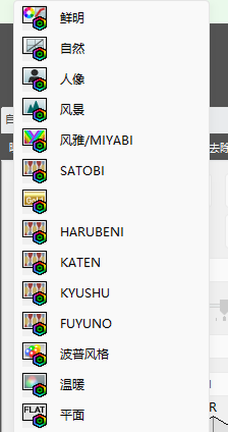
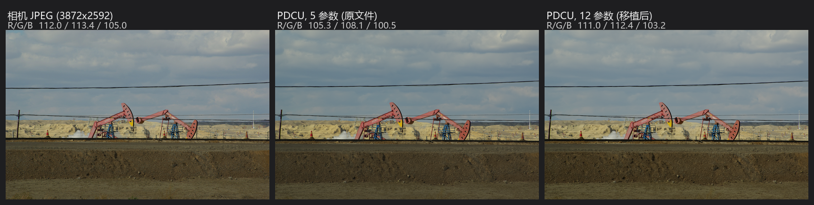
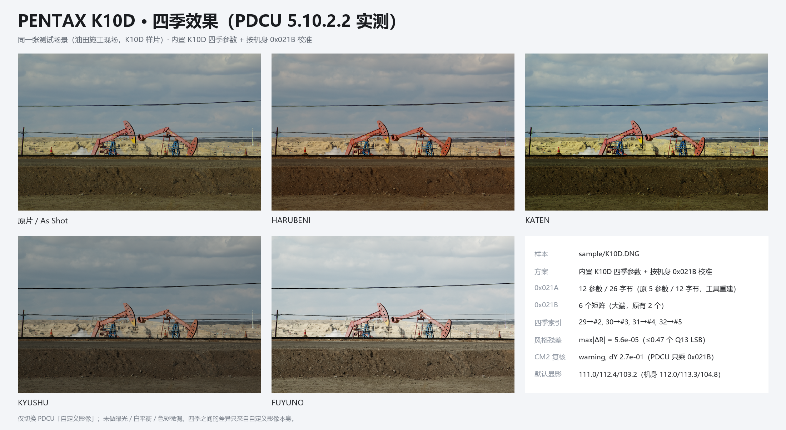

# PENTAX K10D 四季移植（KF 风格表）

日期：2026-11-02

样本：`sample/K10D.DNG`（16,895,324 B，PENTAX K10D，3872×2592，DNG 1.1.0.0）。
产物：`sample/K10D_all.DNG`（**同尺寸**，SHA-256
`A763819668E6F5B9514C432D15697F01CB156F82E3303DE94907A8BDECC0254B`），
由 v2.9 的 `--builtin k10d` 生成（与“内置 KF + 运行时校准”的产物逐字节相同），
GUI 里选“内置 K10D”即可。
PDCU 5.10.2.2 实测通过。

## 0. 结论

1. **可以照 K20D 的“方法”，但不能照搬它的“空间方案”。** 色彩那一步完全同构：
   `Y = inv(M_KF[0])·M_K10D[0]`，四季矩阵 `M(季节) = M_KF(季节)·Y`，
   量化后 `R = M·inv(M_base)` 与 KF 的最大差 **5.6×10⁻⁵（≤0.47 个 Q13 LSB）**。
2. **记录布局要走同一条 5 → 12 参数的重建**，而且缺得比 K20D 更多：
   K10D 只有 **5 个参数 / 12 字节**（K20D 是 8 / 18）。2 条记录 → 6 条，
   表 38 → 184 B，矩阵 40 → 112 B。
3. **K10D 不需要整块搬迁**：私有块里有一段 **19,048 B 全零的空闲区**
   （0xE4C8..0x12F30，预览 JPEG 之后），两张新表直接放进去。
   产物 **文件大小 +0 B**，原文件只改 **6 个字节**（0x021A/0x021B 两个条目的
   count 与 offset），raw / 全尺寸预览 / 缩略图逐字节未动。
   这是与 K20D（+25,280 B、整块搬到文件尾）最本质的区别，也是 K20D 方案里
   **唯一不该照抄的一节**。
4. **PDCU 5.10.2.2 实测**：原文件（5 参数）的“自定义影像”里**没有**四季；
   重建成 12 参数后，**HARUBENI / KATEN / KYUSHU / FUYUNO 四项出现在 SATOBI
   与“波普风格”之间**。marker 测试（把四个季节矩阵换成纯 R / 纯 G / 纯 B /
   单位矩阵）→ 画面变成红 / 绿 / 蓝 / 明显偏亮的中性，证明 PDCU 读的就是
   我们写进 0x021B 的矩阵。
5. **副作用是正面的**：5 参数下 PDCU 的默认显影偏暗（105.3/108.1/100.5），
   机身 JPEG 是 112.0/113.3/104.8；升级到 12 参数后是 **111.0/112.4/103.2**，
   基本贴合机身 JPEG。与 645D 的情况同类（升级 = 修好 PDCU 读不懂旧布局），
   与 K20D 那次“改完反而偏”的填充 bug 方向相反。
6. **CM2 互证不通过（dY = 0.27）**，但这不影响 PDCU：本样本的 DNG
   ColorMatrix1/2 与它自己的 0x021B 不一致，而
   [`PDCU-AsShot基准矩阵验证.md`](PDCU-AsShot基准矩阵验证.md) 用四份只改一处的
   DNG 证明了 **PDCU 的 As Shot 只乘 0x021B，不读 `0xC621`/`0xC622`**
   （改 CM1/CM2 输出 0 个像素变化）。四季同理。

一句话：**能参考，而且比 K20D 更省**——同一套 Y 校准 + 12 参数重建，
不需要搬块，代价从 +25 KB 降到 0 B，默认显影还变准了。



## 1. 样本解剖

### 1.1 文件身份

| 项目 | 值 |
|---|---|
| 机型 / 唯一机型 | `PENTAX K10D` / `PENTAX K10D` |
| 尺寸 / 传感器 | 3872×2592（raw 3936×2624，DefaultCrop 3872×2592） |
| 写入者字段 | `Software = K10D Ver 1.31`（机身固件串，**不是** PDCU） |
| DNG 版本 | 1.1.0.0（`0xC612` = 01 01 00 00） |
| 文件大小 | 16,895,324 B |
| 镜头（私有块） | DA★50-135mmF2.8 ED [IF] SDM |
| ISO / 快门 / 光圈 | 100 / 1/500 s / F8.0 |

这份 DNG **不是 PDCU 5 写的**：容器是 `0xC634`（`PENTAX \0` + 相对偏移），
不是 K20D 那种 `0x927C`（`AOC\0` + 绝对偏移）；DNG 版本是 1.1，
IFD0 里没有 `BlackLevel`/`WhiteLevel`（它们在 SubIFD0 里），
EXIF IFD 被放在文件靠后的位置。更像是旧版 Pentax 转换器或第三方
PEF→DNG 的产物。**这决定了 K20D 的整块重建分支在代码层面也不适用**
（`plan_rebuild_makernote()` 对非 `makernote` 容器直接拒绝）。

### 1.2 私有块

| 项目 | K10D | K20D（对照） | KF（对照） |
|---|---:|---:|---:|
| 容器 | `0xC634`（DNGPrivateData） | `0x927C`（AOC） | `0xC634` |
| 位置 / 长度 | 0x312..0x13312，77,824 B | 0x80E..0x66E6，24,280 B | 151,428 B |
| 私有字节序 | **大端** `MM` | 大端 | 小端 |
| 私有 IFD 条目 | 90 | 96 | 119 |
| 偏移基准 | **相对块首** | 绝对文件偏移 | 相对块首 |
| `0x021A` | 38 B，nParams=**5**，nRecords=**2**，12 B/条 | 434 B，8，20，18 B | 912 B，12，34，26 B |
| 参数 id | `1,2,3,128,129` | `1..6,128,129` | `1..10,128,129` |
| `0x021B` | 40 B，**2** 个 18 B 矩阵 | 274 B，15 个 | 490 B，27 个 |
| `0x021A` 之后空隙 | 2 B | 0 B | 0 B（长度已含 390 B 预留） |
| `0x021B` 之后空隙 | 0 B | 0 B | 2 B |
| 原生四季 | 无 | 无 | 有 |

### 1.3 文件级布局

| 范围 | 内容 | 长度 |
|---|---|---:|
| 0x8..0x312 | IFD0（35 条目）+ 其数据（含 `0xC621`/`0xC622`） | 778 B |
| **0x312..0x13312** | **DNGPrivateData（90 条目，大端，相对偏移）** | **77,824 B** |
| 0x13312..0x1348C | SubIFD0 的 IFD + 小标签 | 378 B |
| 0x1348C..0x135E2 | SubIFD1 的 IFD | 342 B |
| 0x135E6..0x13724 | EXIF IFD + 数据 | 318 B |
| 0x13724..0x21824 | IFD0 缩略图（160×120 RGB，120 条 strip） | 57,600 B |
| 0x21824..0xEE7C24 | SubIFD0 单条 strip = **raw**（3936×2624，12 bit 打包） | 15,492,096 B |
| 0xEE7C24..0x101CD5C | SubIFD1 单条 strip = **全尺寸 JPEG**（3872×2592） | 1,265,976 B |
| 0x101CD5C | 文件尾 | — |

私有块固定 77,824 B（0x13000），靠预览 JPEG 与一个 930 B 的尾段收尾，
中间留出这段空白（转换器预留的空间），正好给新表用。
私有块内部除两张表外都是紧排的，**只有两段空闲**：
`0xE4C8..0x12F30`（19,048 B，全 0）与 `0x12F70..0x13312`（930 B，全 0）。
前者在私有预览 JPEG（640×480，0x7F2E..0xE4C8）之后、`0x0005` 守卫区之前，
正好够放新表。

### 1.4 模式表内容

2 条记录，id 0 与 id 1（K10D 的“鲜明 / 自然”两档影调）：

| 记录 | 原始（5 参数 / 12 B） | 矩阵索引 |
|---|---|---:|
| id 0 | `000000010001000100000000` | 0 |
| id 1 | `000100010001000100010001` | 1 |

`0x021B` 只有 2 个矩阵，都归这两条记录用；四季追加后占 #2–#5。

## 2. 色彩

### 2.1 基准矩阵与 Y

```
M_K10D[0] = Q13 (12576, -3872, -512, -896, 11328, -2240, -96, -2080, 10368)
          = [ 1.53516 -0.47266 -0.06250 ]
            [-0.10938  1.38281 -0.27344 ]
            [-0.01172 -0.25391  1.26562 ]

M_KF[0]   = Q13 (12800, -5248, 640, -1664, 12256, -2400, 320, -3648, 11520)
          = [ 1.56250 -0.64062  0.07812 ]
            [-0.20312  1.49609 -0.29297 ]
            [ 0.03906 -0.44531  1.40625 ]

Y = inv(M_KF[0]) · M_K10D[0]
  = [ +1.00812 +0.08484 -0.09296 ]
    [ +0.06040 +0.95948 -0.01988 ]
    [ -0.01721 +0.12092 +0.89629 ]
```

`max|Y−I| = 0.121`，非对角项合计 0.396——K10D 的输入色彩空间与 KF 差得
比 K20D（0.097 / 0.36）还要远一点（K10D 是 CCD，K20D/KF 是 CMOS）。

注意两台的 mode-0 矩阵**每行都精确归一**（行和 = 1.0，即白点映射到 1,1,1），
这是 Pentax 0x021B 的一贯做法；`Y` 因此保留了这一性质。

### 2.2 CM2 互证：本样本不通过，但不影响 PDCU

用两台各自的 DNG `ColorMatrix2` 构造 `T = diag(1/(CM2·W_D65))·CM2`，
再算 `T(KF)·inv(T(K10D))`，与 0x021B 得到的 Y 差 **2.67×10⁻¹**：

```
CM2 check: WARNING - the target's 0x021B base and its ColorMatrix2 imply
                     different Y (dY 2.7e-01); using the 0x021B base
```

这个数比已知例外（K-S2 1.3×10⁻²、645Z 2.7×10⁻³）大一个数量级，
说明**这份 DNG 的 ColorMatrix1/2 与 Pentax 内部矩阵不是同一套标定**（1.1 版
DNG、第三方转换器，都指向“元数据不是 PDCU 写的”）。

它不影响移植，理由不是“相信 0x021B”这种口头判断，而是有实测：

- [`PDCU-AsShot基准矩阵验证.md`](PDCU-AsShot基准矩阵验证.md) 里，把 K-S2 的
  `0xC621`/`0xC622` R/B 行对调，PDCU 输出**逐像素零变化**；改 `0x021B[0]`
  则立即生效。结论：**PDCU 的渲染只走 0x021B**，ColorMatrix 只是元数据。
- 本样本侧证：K10D 的默认显影在 12 参数布局下与机身 JPEG 只差
  1.0/0.9/1.6（§5.3），说明 0x021B 这条链在 PDCU 里是自洽的。

边界：Lightroom / RawTherapee 之类会用 ColorMatrix，对它们的色彩而言这份
DNG 本来就“名不副实”——但那类软件不读四季，与本方案无关。

### 2.3 风格表是旧一代

K10D 与 KF 只有 2 个同名模式（0、1）。mode 0 恒等于基准，mode 1 的相对风格
`R = M·inv(M_base)` 与 KF 的差是 **8.6×10⁻²**：

| 模式 | \|R_K10D − R_KF\| |
|---|---:|
| 0（鲜明） | 0（定义上） |
| 1（自然） | 8.6×10⁻² |

与 K20D（7.7×10⁻²）、645D（7.3×10⁻²）同一量级，即**旧一代风格表**，
不是 K-3/KP/K-S2 那种 10⁻⁵ 的“同一张表”。所以跨机型移植要带 Y 校准；
工具会因此要求 `--allow-cross-model`（GUI 里勾“允许使用其他机型的 DNG”）。

### 2.4 写出的四季矩阵

| 季节 | 矩阵索引 | Q13（行优先，大端 int16） | 量化残差 | max\|R−R_KF\| |
|---|---:|---|---:|---:|
| HARUBENI | #2 | 13679, −2389, −3098, −2215, 14546, −4139, −2276, 2628, 7840 | 0.25 LSB | 2.2×10⁻⁵ |
| KATEN | #3 | 14588, −5608, −788, −786, 13449, −4471, 668, −3520, 11045 | 0.47 LSB | 5.6×10⁻⁵ |
| KYUSHU | #4 | 13892, −6723, 1023, 1255, 7329, −392, −219, 1451, 6960 | 0.47 LSB | 3.4×10⁻⁵ |
| FUYUNO | #5 | 8872, −102, −578, −281, 9381, −908, 306, 1494, 6392 | 0.41 LSB | 3.3×10⁻⁵ |

相对风格 `R = M·inv(M_base)`（与 KF 的解析值一致到 10⁻¹⁶，上表右列是**量化后**的差）：

| 季节 | R |
|---|---|
| HARUBENI | `[[1.0948, 0.1233, -0.2181], [-0.0897, 1.2280, -0.1383], [-0.1512, 0.3309, 0.8202]]` |
| KATEN | `[[1.1519, -0.1092, -0.0427], [0.0188, 1.1607, -0.1795], [0.0539, -0.1002, 1.0463]]` |
| KYUSHU | `[[1.0912, -0.2005, 0.1092], [0.1522, 0.7221, 0.1257], [0.0070, 0.2643, 0.7287]]` |
| FUYUNO | `[[0.7231, 0.2442, 0.0327], [0.0397, 0.8601, 0.1002], [0.0489, 0.2731, 0.6780]]` |

与 645D、K20D 写出的四条 R 逐项一致（差在 10⁻⁵），即 KF 的四季签名。

**反例**：不乘 Y、把 KF 四季矩阵原样写进 K10D 的 0x021B，

| 季节 | 直抄的 max\|R−R_KF\| |
|---|---:|
| HARUBENI | 1.01×10⁻¹ |
| KATEN | 1.30×10⁻¹ |
| KYUSHU | 1.35×10⁻¹ |
| FUYUNO | 6.7×10⁻² |

所以“参考 K20D”里的校准那一步是必须的，不能省。

## 3. 记录布局：5 → 12 参数

### 3.1 参数 id 是子集关系

```
K10D:  1 2 3                        128 129        (5)
K20D:  1 2 3 4 5 6                  128 129        (8)
KF:    1 2 3 4 5 6 7 8 9 10         128 129        (12)
```

按**参数 id** 映射（不是按位置）。K10D 缺的 4–10 号槽按目标布局的默认值填：

```
4 号 = 0   5 号 = 0   6 号 = 0   7 号 = 0   8 号 = 0   9 号 = 0   10 号 = 0xFFFF
```

10 号是“未设置”槽（KF 自己也写 `0xFFFF`）；4–9 写 0 是“中性”。
这里与 K20D 的教训有关：K20D 第一版把 7–10 全填 `0xFFFF`，PDCU 的默认显影
被抬亮变平，改成 `0,0,0,0xFFFF` 才复原。K10D 的 4–6 号槽用同样办法验证过：
**填 `0,0,0` 与填 `1,0xFFFF,0xFFFF`（其它机身的常见组合）在 PDCU 里
逐像素完全相同**（§5.5），所以这里没有 K20D 那种坑。

### 3.2 往返校验

把新表里的 2 条老记录按参数 id 压回 5 参数，与原始记录**2/2 逐字节相同**：

| 记录 | 原始（5 参数 / 12 B） | 重建（12 参数 / 26 B） |
|---|---|---|
| id 0 | `000000010001000100000000` | `0000000100010001000000000000000000000000ffff00000000` |
| id 1 | `000100010001000100010001` | `0001000100010001000000000000000000000000ffff00010001` |

四季记录直接沿用 KF 的 12 参数记录（大端，矩阵索引改成 2–5）：

| 模式 | 名称 | 记录（hex） | 索引 |
|---:|---|---|---:|
| 29 | HARUBENI | `001d000100020003ffffffffffff00000000fffe000400020000` | 2 |
| 30 | KATEN | `001e0001000800040001ffffffff00000003fffdffff00030000` | 3 |
| 31 | KYUSHU | `001f0001000400010001ffffffffffff0000ffffffff00040000` | 4 |
| 32 | FUYUNO | `00200001000800040001ffffffff0003fffc0004ffff00050000` | 5 |

（与 `season_common.K30_SERIES_RECORDS` 相同，也就是 645D/K20D 内置数据用的那四条。）

### 3.3 12 参数是硬要求（实测）

同一台 PDCU 5.10.2.2，同一张图：

| 文件 | 0x021A 布局 | 结构检查 | 自定义影像菜单 |
|---|---|---|---|
| 原始 `K10D.DNG` | 5 参数 / 12 B（2 条） | 2 条记录 / 2 矩阵 | **看不到四季**（通用风格列表照常显示） |
| `K10D_all.DNG` | 12 参数 / 26 B（6 条） | 六项齐全 | **HARUBENI / KATEN / KYUSHU / FUYUNO 全部出现** |

与 645D（11 → 12）、K20D（8 → 12）的结论一致：PDCU 的四季判定走 12 参数
这条解析路径，5 / 8 / 11 参数的表在它眼里都读不出 29–32。

## 4. 空间：块内空闲区，不用搬

### 4.1 需要多少

| 表 | 旧 | 新 | 差 |
|---|---:|---:|---:|
| `0x021A` | 2 + 2×5 + 2 + 2×12 = **38 B** | 2 + 2×12 + 2 + 6×26 = **184 B** | +146 B |
| `0x021B` | 4 + 2×18 = **40 B** | 4 + 6×18 = **112 B** | +72 B |
| 合计（含 2 B 对齐） | 78 B | **298 B** | +220 B |

### 4.2 现有可用空间

| 位置 | 空隙 |
|---|---:|
| `0x021A` 尾 0x8A8 → `0x021B` 首 0x8AA | 2 B |
| `0x021B` 尾 0x8D2 → `0x021C` 首 0x8D2 | 0 B |
| 私有预览 JPEG 之后 0xE4C8 → `0x0005` 守卫 0x12F30 | **19,048 B（全 0）** |
| `0x0005` 守卫之后 0x12F70 → 块尾 | 930 B（全 0） |
| 块外 | 无（§1.3 首尾相接） |

298 B 对 19 KB，**余量 64 倍**，所以两张表一起放进第一段空闲区：

```
mode table     : 38 -> 184 B (+146), nRecords 2 -> 6
record layout  : 5 params / 12 B -> 12 params / 26 B
mode move      : file 0x882 -> 0xE4C8 (0x021A gap was 2 B; table moved to free space)
matrix table   : 40 -> 112 B, matrices 2 -> 6
matrix move    : file 0x8AA -> 0xE580
file growth    : +0 B
```

### 4.3 改动面

| 项目 | 结果 |
|---|---|
| 文件大小 | 16,895,324 B **不变** |
| 原文件里被改的字节 | **6 B**：`0x021A` 的 count（0x6C1/0x6C4-5）与 offset（0x6CD/0x6D0-1），`0x021B` 同理 |
| 新表写入的字节 | 201 B 差异里其余 195 B 都落在原本全 0 的空闲区 |
| 旧 `0x021A` / `0x021B` 区 | 原样保留（无引用，死区） |
| raw（15,492,096 B） | 逐字节相同 |
| 全尺寸 JPEG 预览（1,265,976 B） | 逐字节相同 |
| 缩略图（57,600 B） | 逐字节相同，strip 偏移/长度未变 |
| 私有块内其它 88 个标签 | 逐字节相同（位置也没动） |
| 新表位置 | `0x021A` 0xE4C8..0xE580，`0x021B` 0xE580..0xE5F0 |

对比 K20D：那边 24,280 B 的块最大空隙 1 B，只能整块复制到文件尾、
重定位块内绝对偏移、改 `0x927C`，文件 +25,280 B；K10D 的块有 19 KB 空洞，
且偏移是相对的，**两者都不需要**。

## 5. PDCU 实测（5.10.2.2）

### 5.1 菜单

打开 `K10D_all.DNG`，Laboratory 的“自定义影像”下拉里，四项按
`HARUBENI → KATEN → KYUSHU → FUYUNO` 排在 **SATOBI 之后、波普风格之前**
（见文首截图）。原文件同一位置是 SATOBI 直接接波普风格。

注意 PDCU 对 K10D 展示的是一张**通用风格列表**（鲜明…SATOBI/波普/温暖/平面/
留银冲洗/反转片/单色/正负逆冲 + 图像/场景组），与机身只有两档影调无关；
四季是插进这张列表里的，所以菜单位置与 K20D / 645D 相同。

### 5.2 marker 验证：PDCU 读的是我们写的矩阵

把产物里四个季节矩阵换成纯 R / 纯 G / 纯 B / 单位矩阵，
同一 PDCU 里点这四项：

| 点击位置 | 渲染均值 R/G/B | 说明 |
|---|---|---|
| 第 7 行（HARUBENI） | 115.5 / **0.0** / 0.0 | 纯红 → 矩阵 #2 生效 |
| 第 8 行（KATEN） | 0.0 / 111.3 / 0.0 | 纯绿 → 矩阵 #3 |
| 第 9 行（KYUSHU） | 0.0 / 0.0 / 95.4 | 纯蓝 → 矩阵 #4 |
| 第 10 行（FUYUNO） | 154.7 / 153.1 / 144.2 | 单位矩阵 → 明显偏亮的中性 |

说明 PDCU 既读 `0x021A` 的记录（决定菜单项），也读 `0x021B` 的矩阵
（决定画面），而且索引对得上。行号用第 6 行校准：点它得到
125.3 / 112.1 / 77.9 的暖褐，也就是 SATOBI；第 7 行起才是四季，
所以上表的行号没有错位（第一次实验少算了一行，已按 marker 修正）。

### 5.3 默认显影：升级后更贴近机身 JPEG



| 渲染 | R | G | B | 与机身 JPEG 的差 |
|---|---:|---:|---:|---:|
| 机身 JPEG 预览（3872×2592） | 112.0 | 113.3 | 104.8 | — |
| PDCU，5 参数（原文件） | 105.3 | 108.1 | 100.5 | −6.7 / −5.2 / −4.3 |
| PDCU，12 参数（本方案） | **111.0** | **112.4** | **103.2** | **−1.0 / −0.9 / −1.6** |

也就是：**5 参数下 PDCU 读不懂这张表，默认显影偏暗；重建成 12 参数后
基本贴合机身 JPEG**。方向与 645D 一致（升级 = 修好 PDCU 读不懂的旧布局）；K20D 在填充值修正后
默认显影与原名一致，没有这种偏移。

### 5.4 四季相对 As Shot 的变化



同一张图、只切换“自定义影像”，抓同一视口（33.37%，1219×789）取 R/G/B 均值：

| 季节 | K10D 均值 | K10D Δ% (R/G/B) | KF 均值（同 PDCU，KF 机身） | KF Δ% | 方向 |
|---|---|---|---|---|---|
| HARUBENI | 116.3 / 109.7 / 100.8 | **+4.9 / −2.4 / −2.4** | 105.5 / 94.2 / 85.8 | +5.1 / −6.2 / −4.1 | 暖（B 降）✅ |
| KATEN | 109.8 / 114.0 / 103.5 | −1.0 / +1.5 / +0.3 | 93.2 / 92.9 / 82.5 | −7.2 / −7.5 / −7.8 | 略暖、应略暗 ⚠️ |
| KYUSHU | 98.9 / 100.3 / 96.1 | **−10.9** / −10.7 / −6.8 | 88.4 / 91.9 / 86.5 | −12.0 / −8.5 / −3.4 | 冷 / 低饱和 ✅ |
| FUYUNO | 155.3 / 153.8 / 146.4 | +39.9 / +36.9 / **+41.9** | 139.7 / 133.9 / 130.9 | +39.1 / +33.4 / +46.3 | 明显提亮 ✅ |

KF 那一列的绝对值来自另一张 KF 样张，**不可跨照片比较**，能比的只有 Δ% 和
“哪个通道变化最大”。四条里三条与 KF 同向；**KATEN 在 K10D 上几乎是中性**
（KF 是整幅 −7.5%）。矩阵层面 KATEN 的 R 与 KF 完全一致（§2.4），所以不是矩阵
移植误差；更可能的解释是 PDCU 对 K10D 的机身色调曲线让整幅响应更平，或这张
场景的色调分布把暖偏抵消掉了——两者都在矩阵之外，要坐实需要同场景多图或
直方图对比，整幅均值本身也只看得到平均。

### 5.5 新槽填充值 A/B

同一张图，只把两条老记录的 4–6 号槽从 `0,0,0` 改成 `1,0xFFFF,0xFFFF`
（其它机身 mode 0 的常见写法），PDCU 的 As Shot 抓图：

| 文件 | As Shot R/G/B | 与 `0,0,0` 版本的逐像素差 |
|---|---|---|
| `fill 0,0,0` | 111.0 / 112.4 / 103.2 | — |
| `fill 1,FFFF,FFFF` | 111.0 / 112.4 / 103.2 | **0 个像素**（PNG SHA 相同） |

结论：这三个槽在 PDCU 里不参与渲染，K20D 那种“填错就把默认显影抬亮”的
问题在这里不存在。（与 645D 的参数 10 实验同类：补出来的槽不参与运算。）

## 6. 与 K20D 方案逐项对照

| K20D 方案的做法 | K10D | 说明 |
|---|---|---|
| `0x021A` 重建成 12 参数 / 26 B | **照搬，且更必要** | 5 → 12，缺 7 个槽（4–10） |
| `Y = inv(M_KF[0])·M_body[0]`，四季矩阵乘 Y | **照搬** | R 残差 ≤0.47 LSB |
| 专用内置数据（`season_k20d_data.py`，Y=I） | **已实现（`season_k10d_data.py`）** | v2.9 新增 `--builtin k10d`；它与 `--builtin kf` + 运行时校准的产物逐字节相同，只是让 GUI 自动选中、日志不再要求跨机型 |
| `0x021A`/`0x021B` 搬出原位 | **照搬（换位置）** | 旧位只有 2 B / 0 B，必须搬；但搬进块内空闲区即可 |
| 整块复制到文件尾 + 重定位绝对偏移 + 改 `0x927C` | **不需要，也不适用** | K10D 是 `0xC634` + 相对偏移，且块内有 19 KB 空闲；代码里该分支会拒绝 |
| 文件 +25,280 B | **+0 B** | 只改 6 B 的条目字段 |
| 逐字节校验 raw / 预览 / 缩略图 | **照搬，全部通过** | §4.3 |
| PDCU 菜单 + 四项渲染 + 方向 + As Shot | **照搬，结论更好** | 菜单出现；As Shot 由偏暗变准 |
| 新增槽 `0,0,0,0xFFFF`（K20D 的修正） | **照搬 10 号 = FFFF；4–6 号填 0 或其它都行** | A/B 逐像素相同 |

## 7. 工具与复现

**v2.9 已内置**：新增 `tools/season_k10d_data.py`（BASE_MATRIX = K10D 的
mode-0，四季矩阵已经是 K10D 色彩空间，目标 `Y=I`），并在
`dng_season_params.py` 里注册了 `MODEL_TO_DONOR_KIND['PENTAX K10D'] = 'k10d'`、
`BUILTIN_SOURCES['builtin_k10d']`（“内置 K10D”）、`AUTO_SELECT_GROUPS`、
`_BUILTIN_DATA_MODULES`、`--selftest-k10d` 与 `--builtin` 帮助文本；
GUI 的来源行是数据驱动，自动多出第 6 行。窗口高度 940 → 974 容纳这一行。

生成路径本身没有新代码：`plan_patch` → `find_free_space` → 块内搬表
（`plan_rebuild_makernote` 只对 `makernote` 容器生效，K10D 不会走到）。

```powershell
# 结构检查（5 参数 / 12 B、2 条、2 矩阵、缺 29-32）
python tools\dng_season_params.py --target sample\K10D.DNG --list

# 生成（自动重建为 12 参数，两张表搬进块内空闲区，文件不增长）
python tools\dng_season_params.py --target sample\K10D.DNG --builtin k10d ^
    --out sample\K10D_all.DNG --overwrite

# 隐藏自检（与发布版同一入口）
python tools\dng_season_gui.py --selftest-k10d sample\K10D.DNG out.dng
```

`--builtin kf --allow-cross-model` 也仍然可用，产物与 `--builtin k10d` **逐字节相同**
（前者在运行时算 Y，后者把 Y 烤进矩阵），可以作为交叉校验。

产物 SHA-256：
`A763819668E6F5B9514C432D15697F01CB156F82E3303DE94907A8BDECC0254B`
（16,895,324 B，与上面 PDCU 实测用的是同一份）。

本次分析脚本（`.tmp` 未入库）：

```powershell
python .tmp\k10d_probe.py      # 结构探针
python .tmp\k10d_cal.py        # Y、CM2、风格差、四季矩阵
python .tmp\k10d_make.py       # 生成 + verify_output
python .tmp\k10d_verify.py     # 逐字节完整性 / 记录往返
python .tmp\k10d_shot2.py      # PDCU 抓图（As Shot + 四季）
python .tmp\k10d_mk_run.py     # marker 验证
python .tmp\k10d_fill1.py      # 4–6 号槽填充值 A/B（构建变体）
python .tmp\k10d_f1_run.py     # 同上（PDCU 抓图对比）
python .tmp\k10d_fig2.py       # 本文四季效果图（与 645D 图同一版式）
```

## 8. 边界与未验证

1. **单样本**：只有一张 K10D DNG，且是**第三方/旧版转换器**产物
   （DNG 1.1、`Software = K10D Ver 1.31`、`0xC634` 相对偏移）。
   机内 PEF 经 PDCU 5 转出的 DNG 是另一条路径（`0x927C` + 绝对偏移），
   布局与空闲区都可能不同；工具全部运行时探测，没有硬编码 0xE4C8 / 19 KB。
2. **PDCU 版本**：只测 5.10.2.2。它与 K20D/645D 用的是同一个“12 参数才认四季”的
   解析路径，所以结论应当跨版本稳定，但没有逐版本验证。
3. **CM2 失配（0.27）是这个文件的元数据问题**，不是移植问题；如果拿这份 DNG 去
   Lightroom，色彩会与 PDCU 不一致。四季只对 PDCU 有意义。
4. **KATEN 的整幅均值在 K10D 上接近中性**（KF/K20D 都是 −7…−24%）。矩阵 R 精确，
   差异来自 PDCU 对该机身的色调曲线；需要更多场景才能说清幅度。
5. **再另存未测**：`K10D_all.DNG` 经 PDCU 另存 DNG/JPEG 后四季是否保留，
   与 K20D/K5iis 一样是未知项（另存 JPEG 时 PDCU 只是把当前风格烘进去，
   与是否保留记录无关）。
6. **没测把改过的 DNG 写回相机或在机身回放**（K10D 不支持 DNG 回放）。
7. 新表放在私有预览 JPEG 之后的空闲区，如果某个 K10D 文件的预览长度不同、
   空闲区不足 298 B，工具会回落到“另找位置”，再不行就报错（不会覆盖预览）。

---

版权所有 © 2026 KimHoLau X deepseek harness
