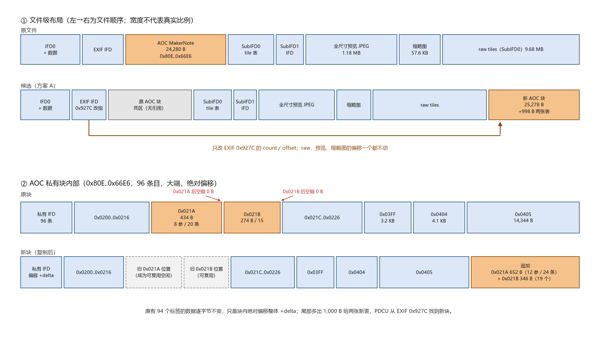
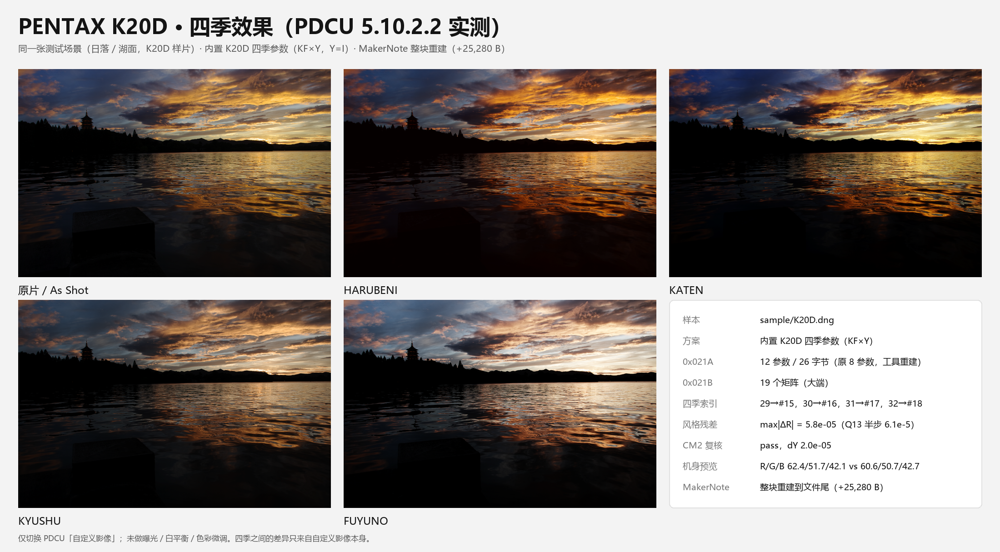

# PENTAX K20D 四季移植（KF 风格表）

日期：2026-11-01（2026-11-02 补 PDCU 实测与填充值修正）

样本：`sample/K20D.dng`（11,056,094 B，`Software = Digital Camera Utility 5 Ver.5.10.2`，
由 PDCU 从 PEF 转换而来）。产物：`sample/K20D_all.dng`，
工具 v2.8 的 `--builtin k20d` 输出，与 PDCU 实测通过的文件**逐字节相同**。



## 0. 结论

1. **K20D 可以补四季，且已在 PDCU 5.10.2.2 里列出并渲染。** 但前提是把
   `0x021A` 从**8 参数 / 18 字节**重建成 **12 参数 / 26 字节**；
   8 参数候选（`sample/K20D_p8.dng`）在同一个 PDCU 里**看不到**四季。
   四项的画面方向与 KF 原生机身一致，默认显影保持不变（§5.4 实测）。
2. **AOC 私有块是满的，必须整块搬走。** 24,280 B 的块最大空隙只有 1 B
   （合计 5 B），`0x021A`/`0x021B` 之后都是 0 B；12 参数方案需要 1,000 B。
   工具把整个块复制到文件尾、按位移重定位块内绝对偏移、在块尾追加两张新表、
   改 EXIF `0x927C` 的 offset/count——**raw、1.18 MB 预览、缩略图一个字节没动**，
   原文件只有 5 B 变化（就是那个条目）。代价是文件 +25,280 B，旧块留作死区。
3. **色彩是精确移植**：`Y = inv(M_KF[0])·M_K20D[0]`，
   `M_K20D(季节) = M_KF(季节)·Y`。Y 由两条独立路径互证：
   0x021B 基准与 ColorMatrix2 只差 **2.0×10⁻⁵**（645Z 是 2.7×10⁻³、
   K-S2 是 1.3×10⁻²），是机身真值。
4. **四季矩阵与 KF 的相对风格 R 一致到量化极限**：最大差 ≤5.8×10⁻⁵，
   ≤0.46 个 Q13 LSB。不乘 Y 直接照抄 KF 矩阵，R 会偏 6.1×10⁻²～1.3×10⁻¹，
   色卡差平均 ΔE 2.4–6.0、最大 29（0–255 单位）。
5. **K20D 自己的风格表是旧一代**（20 个同名模式的中位差 7.7×10⁻²，
   645D 是 7.3×10⁻²），所以用专门的内置数据 `season_k20d_data.py`
   （同 645D 的做法），而不是靠“风格表一致”自动放行跨机型。

## 1. 样本解剖

### 1.1 文件身份

| 项目 | 值 |
|---|---|
| 机型 / 唯一机型 | `PENTAX K20D` / `PENTAX K20D` |
| 写入者 | `Digital Camera Utility 5 Ver.5.10.2` |
| 文件时间 / 拍摄时间 | 2026-11-01 13:22:45 / 2025-07-19 18:56:56 |
| ISO | 100 |
| 尺寸 | 11,056,094 B |
| SHA-256 | `549105D0715E5AAB19E599A7C884C476AFF865B0897678E3EF8FA9C69B79E5E9` |

K20D 是 2008 年的机身，出厂只写 PEF（机内 DNG 是 K-7 之后才有），
所以 **K20D 的 `.dng` 基本都是 PDCU 转换产物**，MakerNote 落在
EXIF `0x927C` 的“AOC”容器里、内部偏移是**绝对文件偏移**——正是 v1.9
已经支持的 DCU 分支，容器逻辑不需要改，只有“块内没有空位”这件事是新的。

### 1.2 私有块

| 项目 | K20D | KF（对照） |
|---|---:|---:|
| 容器 | EXIF MakerNote `0x927C`（`AOC\0`） | DNGPrivateData `0xC634`（`PENTAX \0`） |
| 位置 / 长度 | 0x80E..0x66E6，24,280 B | 151,428 B |
| 私有字节序 | **大端** `MM` | 小端 `II` |
| 私有 IFD 条目 | 96 | 119 |
| 偏移基准 | 绝对文件偏移 | 相对块首 |
| `0x021A` | 434 B，nParams=**8**，nRecords=**20**，**18 B/条** | 912 B，12，34，26 B/条 |
| 参数 id | `1,2,3,4,5,6,128,129` | `1..10,128,129` |
| `0x021B` | 274 B，**15** 个 18 B 矩阵 | 490 B，27 个 |
| `0x021A` 之后空隙 | **0 B**（紧接 `0x021B`） | 0 B（长度已含 390 B 预留） |
| `0x021B` 之后空隙 | **0 B**（紧接 `0x021C`） | 2 B |
| 原生四季 | 无 | 有 |

`0x021A` 的 434 B 里有 54 B 是记录区之后的保留填充（记录区
0xDA4+20+20×18 = 0xF20，标签到 0xF56），但这 54 B 不够 4 条 26 B 的新记录
（需要 104 B），更不够把 20 条记录从 18 B 拉长到 26 B。

### 1.3 文件级布局（没有一处空隙）

| 范围 | 内容 |
|---|---|
| 0x8..0x6AC | IFD0 + 其数据（含 `0xC621`/`0xC622` 颜色矩阵） |
| 0x6AC..0x80E | EXIF IFD + 其数据 |
| **0x80E..0x66E6** | **AOC MakerNote（被整块搬走的那块）** |
| 0x66E6..0x681C | SubIFD0 的 IFD 与它的小标签数据 |
| 0x681C..0x701C | SubIFD0 的 256 个 tile 偏移 + 256 个 tile 长度（各 1,024 B） |
| 0x701C..0x703C | SubIFD0 剩余的小标签数据（含 ColorMatrix） |
| 0x703C..0x7100 | SubIFD1 的 IFD |
| 0x7100..0x126706 | SubIFD1 单条 JPEG（**1,177,094 B，4672×3104**，全尺寸预览） |
| 0x126706..0x134806 | IFD0 缩略图（160×120 RGB，120 条 strip × 480 B） |
| 0x134806..0xA8B3DE | SubIFD0 的 256 个 tile = **raw 像素**（4864×3136，CFA，9.68 MB） |
| 0xA8B3DE | 文件尾 |

块尾 0x66E6 与 SubIFD0 首字节重合，SubIFD0/raw/预览/缩略图首尾相接一直顶到
EOF。**文件里没有可借用的空闲区**，这是本机型与 K-30 / MX-1 / K5iis
（都能在块内找到空位）最本质的区别，也是 v2.8 新增“整块重建”路径的原因。

### 1.4 模式表内容

20 条记录、id 为 `0,1,16,17,18,19,2..15`；矩阵索引（记录的倒数第二个 u16，
即参数 128）只用到 **#0–#5**：

| 记录 id | 0 | 1 | 2 / 11 / 16 | 3 / 17 | 4 / 14 | 5 / 6..10 / 12 / 13 / 15 | 18 | 19 |
|---|---:|---:|---:|---:|---:|---:|---:|---:|
| 矩阵索引 | 0 | 1 | 2 | 3 | 0 | 1 | 4 | 5 |

矩阵 **#6–#14 没有被任何记录引用**，而且它们的三行几乎相同（#6–#8 三行完全
相同），属于数码滤光镜一类的矩阵。本方案**不碰**它们，只在表尾追加
#15–#18 给四季用。

## 2. 色彩：为什么可以精确移植

### 2.1 基准矩阵与 Y

```
M_K20D[0] = Q13 (12448, -3584, -672, -1440, 11168, -1536, 192, -4320, 12320)
          = [ 1.51953 -0.43750 -0.08203 ]
            [-0.17578  1.36328 -0.18750 ]
            [ 0.02344 -0.52734  1.50391 ]

M_KF[0]   = Q13 (12800, -5248, 640, -1664, 12256, -2400, 320, -3648, 11520)
          = [ 1.56250 -0.64062  0.07812 ]
            [-0.20312  1.49609 -0.29297 ]
            [ 0.03906 -0.44531  1.40625 ]

Y = inv(M_KF[0]) · M_K20D[0]
  = [ +0.978621 +0.096215 -0.074836 ]
    [ +0.014195 +0.906549 +0.079256 ]
    [ -0.006022 -0.090599 +1.096621 ]
```

`max|Y−I| = 0.097`，非对角项合计 0.36——K20D 的输入色彩空间与 KF 差得不少，
所以“直接照抄 KF 矩阵”在这个机身身上会明显偏色（见 §2.4）。

### 2.2 CM2 互证

用两台各自的 DNG ColorMatrix2（`0xC622`）构造
`T = diag(1/(CM2·W_D65))·CM2`，再算 `T(KF)·inv(T(K20D))`，
与 0x021B 得到的 Y 最大只差 **2.0×10⁻⁵**：

```
CM2 check: pass (0x021B base vs ColorMatrix2, dY 2.0e-05)
```

| 机身 | 0x021B 与 CM2 的 Y 差 |
|---|---:|
| K-3 / K-3 II / K-70 / KP | ≤1.8×10⁻⁵ |
| 645D | 4.0×10⁻⁵ |
| **K20D** | **2.0×10⁻⁵** |
| 645Z / K-S2（已知例外） | 2.7×10⁻³ / 1.3×10⁻² |

结论：K20D 的 0x021B 基准就是它自己的输入变换，Y 可以放心用。

### 2.3 风格表不同——所以用专门的内置数据

20 个同名模式（id 0–19）的 `R = M·inv(M_base)` 中位差 **7.7×10⁻²**、
最大 1.8×10⁻¹（645D 是 7.3×10⁻²；K-3 / 645Z / K-S2 / KP 都在 10⁻⁵ 量级）。
说明 K20D 用的是旧一代风格表，与 KF 不是同一张。

这不妨碍移植：移植的定义就是“把 KF 的四季风格放到 K20D 的基准矩阵上”，
`R` 按构造保持不变；K20D 自己的普通模式仍用它原来的表。
所以和 645D 一样，K20D 用一份专用内置数据（`season_k20d_data.py`），
`BASE_MATRIX` 就是 K20D 的 mode-0，目标跑起来 `Y=I`，
既不触发“风格表不一致”，也不需要运行时校准。

### 2.4 写出的四季矩阵

| 季节 | 矩阵索引 | Q13（行优先，大端 int16） | 量化残差 | max\|R−R_KF\| |
|---|---:|---|---:|---:|
| HARUBENI | #15 | 13409, −1605, −3612, −2912, 14634, −3530, −2201, 694, 9698 | 0.42 LSB | 4.7×10⁻⁵ |
| KATEN | #16 | 14488, −5163, −1133, −1472, 13671, −4007, 1017, −5832, 13008 | 0.46 LSB | 5.2×10⁻⁵ |
| KYUSHU | #17 | 13893, −6622, 921, 879, 6975, 338, −154, −222, 8567 | 0.46 LSB | 5.8×10⁻⁵ |
| FUYUNO | #18 | 8656, −6, −458, −725, 9030, −113, 346, −54, 7900 | 0.42 LSB | 3.1×10⁻⁵ |

相对风格 `R = M · inv(M_base)`：

| 季节 | R |
|---|---|
| HARUBENI | `[[1.0948, 0.1233, -0.2181], [-0.0897, 1.2280, -0.1383], [-0.1512, 0.3309, 0.8202]]` |
| KATEN | `[[1.1519, -0.1092, -0.0427], [0.0188, 1.1607, -0.1795], [0.0540, -0.1002, 1.0463]]` |
| KYUSHU | `[[1.0912, -0.2005, 0.1093], [0.1522, 0.7220, 0.1258], [0.0070, 0.2642, 0.7287]]` |
| FUYUNO | `[[0.7231, 0.2442, 0.0327], [0.0397, 0.8601, 0.1002], [0.0489, 0.2731, 0.6780]]` |

与 645D 写出的四条 R 逐项一致（差异在 10⁻⁵ 量级），也就是 KF / K-1 的四季签名。

**反例（为什么不校准不行）**：把 KF 四季矩阵原样写进 K20D 的 0x021B，

| 季节 | 直抄的 max\|R−R_KF\| | 直抄的色差（sRGB 线性，0–255 单位，24 色卡） |
|---|---:|---|
| HARUBENI | 1.19×10⁻¹ | 平均 5.97 / 最大 22.3 |
| KATEN | 1.34×10⁻¹ | 平均 6.01 / 最大 29.2 |
| KYUSHU | 1.27×10⁻¹ | 平均 3.97 / 最大 18.9 |
| FUYUNO | 6.08×10⁻² | 平均 2.36 / 最大 6.8 |

乘 Y 之后这两列变成 10⁻⁵ / 0.00（只剩量化误差）。

## 3. 记录布局：8 → 12 参数

### 3.1 参数 id 是子集关系

```
K20D:  1 2 3 4 5 6                    128 129     (8)
KF:    1 2 3 4 5 6 7 8 9 10           128 129     (12)
```

按**参数 id**映射（不是按位置）。K20D 没有的 7–10 号槽按**目标布局的默认值**填：

```
7 号 = 0    8 号 = 0    9 号 = 0    10 号 = 0xFFFF
```

这正是 KF 自己的记录用的约定（参数 10 是“未设置”槽，7–9 是中性 0）。
第一版曾把 7–10 全填 `0xFFFF`，实测会让 PDCU 的默认显影抬亮、变平
（均值 57.3/46.7/37.6，机身预览是 60.6/50.7/42.7）；改成 `0,0,0,0xFFFF` 后
默认显影与原名一致（62.4/51.7/42.1）。详见 §5.4。

实测往返：把新表里的 20 条老记录重新压回 8 参数，与原始记录**20/20 逐字节相同**。

| 记录 | 原始（8 参数 / 18 B） | 重建（12 参数 / 26 B） |
|---|---|---|
| id 0 | `00000001000100030001ffffffff00000000` | `00000001000100030001ffffffff000000000000ffff00000000` |
| id 19 | `0013ffff00010003ffff0000000400050000` | `0013ffff00010003ffff00000004000000000000ffff00050000`

四季记录直接沿用 KF 的 12 参数记录（大端，矩阵索引改成 15–18）：

| 模式 | 名称 | 记录（hex） | 索引 |
|---:|---|---|---:|
| 29 | HARUBENI | `001d000100020003ffffffffffff00000000fffe000400000000` | 15 |
| 30 | KATEN | `001e0001000800040001ffffffff00000003fffdffff00010000` | 16 |
| 31 | KYUSHU | `001f0001000400010001ffffffffffff0000ffffffff00020000` | 17 |
| 32 | FUYUNO | `00200001000800040001ffffffff0003fffc0004ffff00030000` | 18 |

（与 `season_common.K30_SERIES_RECORDS` 完全相同，也就是 645D 内置数据用的那四条。）

### 3.2 12 参数是硬要求（已实测）

两张候选文件在同一个 PDCU 5.10.2.2 里的表现：

| 文件 | 0x021A 布局 | 结构检查 | PDCU 自定义影像 |
|---|---|---|---|
| `sample/K20D_p8.dng` | 8 参数 / 18 B（追加四季记录） | 四项齐全 | **看不到四季** |
| `sample/K20D_all.dng` | 12 参数 / 26 B（重建整表） | 四项齐全 | **HARUBENI / KATEN / KYUSHU / FUYUNO 全部出现** |

这与 645D 的 11 → 12 参数结论一致：PDCU 的四季判定走 12 参数这条解析路径，
8 参数（乃至 11 参数）的表在它眼里读不出 29–32。`K20D_p8.dng` 保留下来
作为反证，不再作为产物。

## 4. 空间：为什么要整块搬

### 4.1 需要多少

| 方案 | 新 `0x021A` | 新 `0x021B` | 合计（含 2 B 对齐） |
|---|---:|---:|---:|
| 12 参数（采用） | 28 + 24×26 = **652 B** | 4 + 19×18 = **346 B** | **1,000 B** |
| 8 参数（不采用） | 20 + 24×18 = **452 B** | 4 + 19×18 = **346 B** | **800 B** |

### 4.2 现有可用空间

| 位置 | 空隙 |
|---|---:|
| `0x021A` 标签尾 0xF56 → `0x021B` 首 0xF56 | **0 B** |
| `0x021B` 标签尾 0x1068 → `0x021C` 首 0x1068 | **0 B** |
| 私有 IFD 结尾 → 首个数据标签 | 0 B（96×12+8+4 正好到 0xC9A） |
| 块内 1 B 对齐缝（5 处） | 合计 **5 B** |
| 块尾 → SubIFD0 | 0 B |
| 文件其它位置 | 无（见 §1.3） |

v2.7 的工具在这里直接失败：

```
ERROR: not enough free space to move 0x021A: need 1000 bytes in the private block;
       refusing to overwrite preview or other tags
```

### 4.3 采用方案：整块重建到文件尾

| 方案 | 做法 | 文件增量 | 改动面 | 结论 |
|---|---|---:|---|---|
| **整块重建**（v2.8 实现） | 复制 24,280 B 的 AOC 块到 EOF，按 `delta = 新址−0x80E` 重定位块内所有绝对偏移，在块尾追加两张新表，改 EXIF `0x927C` 的 offset/count | +25,280 B | 原文件只有 **5 B** 变化 | 已实现、已验证、PDCU 接受 |
| 块尾插入 + 全局重定位 | 在 0x66E6 插入 1,000 B，把其后所有 TIFF 偏移整体 +`delta`（IFD0 的 120 个 StripOffsets、SubIFD0 的 256 个 TileOffsets、SubIFD1 的 StripOffset、SubIFD 指针……） | +998 B | 约 400 个偏移字段 | 省 24 KB，但漏改一处就是静默坏图；只在尺寸敏感时考虑 |
| 数据放文件尾、只改两个条目 | 追加 1,000 B，把两个条目指过去 | +1,000 B | 2 个条目 | tag 数据落在 `0x927C` 声明范围外；工具解析器直接拒绝（`private tag 0x021A data outside block`），不采用 |

### 4.4 实现细节

1. `new_off = align_up(len(file), 4)`，`delta = new_off − priv_off`；
2. 复制 `priv_off..priv_end`；
3. 每个**非 inline** 私有条目 `value += delta`；`0x0004/0x0005`（JPEG 预览偏移，
   值本身是 u32 数据）若落在块内也同样加 `delta`（K20D 没有，DCU 其它文件可能有）；
4. 在 `rel = len(block)` 追加新 `0x021A`，`rel_blocks = align2(rel + len(table))`
   追加新 `0x021B`，写回两个条目的 count/offset（绝对地址）；
5. 改 EXIF `0x927C` 的 count（24,280 → 25,278）与 offset（0x80E → 0xA8B3E0）；
6. 旧块原样保留（无引用）。

对齐结果：块长 24,280 → 25,278 B（+998），文件 11,056,094 → 11,081,374 B（+25,280）。

## 5. 产物与验证

### 5.1 产物

| 文件 | 大小 | 块位置/长度 | `0x021A` | `0x021B` | SHA-256 |
|---|---:|---|---|---|---|
| `sample/K20D_all.dng` | 11,081,374 B（+25,280） | 0xA8B3E0 / 25,278 B | 652 B，24 条，0xA912B8 | 346 B，19 个，0xA91544 | `5E3C201B9D814894D930F5AAEB123594160B3A9B2435AF15EAD8D153143165E9` |
| `sample/K20D_p8.dng`（反证） | 11,081,174 B（+25,080） | 0xA8B3E0 / 25,078 B | 452 B，24 条 | 346 B，19 个 | `8B24DECFB64125AD76AFD76499C5A8B41BA8FCFAA901F1D8C434449CFA2B4A16` |

四季索引：29→#15、30→#16、31→#17、32→#18。`K20D_all.dng` 由工具
`--builtin k20d` 生成，`--selftest-k20d` 的输出与它逐字节相同。

### 5.2 已验证

| 检查 | 结果 |
|---|---|
| PDCU 5.10.2.2 自定义影像 | 列出 HARUBENI / KATEN / KYUSHU / FUYUNO（12 参数）；8 参数版本不列 |
| 工具重新解析输出 | 24 条记录 / 19 矩阵 / `missing: none` |
| 老记录往返（12 参数压回 8 参数） | **20/20 逐字节相同** |
| 老矩阵 #0–#14 | 与源文件逐字节相同 |
| raw（SubIFD0 的 256 个 tile，9.68 MB） | 逐字节相同 |
| 全尺寸预览（SubIFD1，1,177,094 B） | 逐字节相同 |
| 缩略图（IFD0 的 120 条 strip） | 逐字节相同，strip 偏移/长度未变 |
| 私有块内其它 94 个标签的数据 | 逐字节相同（只是绝对偏移随块搬移） |
| 原文件前 11,056,094 B 的差异 | **只有 5 B**：0x736、0x737（`0x927C` count）、0x73A–0x73C（`0x927C` offset） |
| 14 组旧机型自检 | 逐字节不变（v2.7 参考值） |

### 5.4 PDCU 实测（2026-11-02）

用 PDCU 5.10.2.2 的 Laboratory 打开文件，只切换“自定义影像”，截取同一视口的
27.74% 预览画面（1219×789）取 R/G/B 均值。**PDCU 会记住每个文件上次的编辑
状态**，同一文件名再次打开会恢复上次选择，所以每次测“As Shot”都用新文件名。



同一张图只切换“自定义影像”的四项效果；上方是工具输出的 As Shot，四项与它相比
分别偏暖（HARUBENI）、偏暖而略暗（KATEN）、偏冷低饱和（KYUSHU）、明显提亮（FUYUNO）。
修复前后 As Shot 的逐幅对照见 [PDCU-K20D-PDCU实测.png](PDCU-K20D-PDCU实测.png)。

**默认显影（As Shot）**

| 渲染 | R | G | B | 与机身预览的差 |
|---|---:|---:|---:|---:|
| 机身 JPEG 预览（4672×3104） | 60.6 | 50.7 | 42.7 | — |
| 原始 `K20D.dng`（8 参数，PDCU） | 62.5 | 51.4 | 41.9 | +1.9 / +0.7 / −0.8 |
| 修复后 `K20D_all.dng`（12 参数，PDCU） | 62.4 | 51.7 | 42.1 | +1.8 / +1.0 / −0.6 |

也就是说：**布局升级本身不改变默认显影**（与 645D 的副作用不同——645D 只缺
10 号槽、填 `0xFFFF` 正好正确，升级后反而更贴近机身预览，见
[`PDCU-645D-KF四季移植.md`](PDCU-645D-KF四季移植.md) §4.2），
前提是新增槽位按 `0,0,0,0xFFFF` 填。第一版全填 `0xFFFF` 时是
57.3/46.7/37.6（约 −9%，阴影被抬起、画面变平）。

**四季相对 As Shot 的变化（同一张 K20D 图）与 KF 原生机身的对照**

| 季节 | K20D 均值 | K20D Δ% (R/G/B) | KF 均值 | KF Δ% (R/G/B) | 方向 |
|---|---|---|---|---|---|
| HARUBENI | 64.5 / 43.9 / 32.5 | **+3.4 / −15.1 / −22.8** | 105.5 / 94.2 / 85.8 | **+5.1 / −6.2 / −4.1** | 暖（B 降最多）✅ |
| KATEN | 57.1 / 44.3 / 31.9 | −8.5 / −14.3 / **−24.2** | 93.2 / 92.9 / 82.5 | −7.2 / −7.5 / −7.8 | 暖而略暗 ✅ |
| KYUSHU | 54.3 / 44.7 / 37.9 | **−13.0** / −13.5 / −10.0 | 88.4 / 91.9 / 86.5 | **−12.0** / −8.5 / −3.4 | 冷 / 低饱和 ✅ |
| FUYUNO | 74.7 / 65.4 / 60.4 | +19.7 / +26.5 / **+43.5** | 139.7 / 133.9 / 130.9 | +39.1 / +33.4 / **+46.3** | 明显提亮 ✅ |

四条的方向与 KF 一致（“哪个通道变化最大”也一致）；K20D 的幅度更大，
因为它这张是暗场、色饱和度更高，而 KF 的样本以亮部为主。

**矩阵确实生效（marker 验证）**：把产物里的四个季节矩阵换成红/绿/蓝/单位
矩阵，再在 PDCU 里选对应四项，画面分别变成红、绿、蓝、略提亮——说明
PDCU 读的就是我们写进 `0x021B` 的矩阵和 `0x021A` 里的索引，不是它自己的
内置数据。这也解释了 8 参数版本为什么看不到四季：**12 参数布局是菜单
出现四项的必要条件**（用户实测：8 参数不列、12 参数列出）。

**小结**：PDCU 5.10.2.2 下，K20D 的四项与 KF 原生机身同向，默认显影保持不变。

### 5.5 尚未验证

- ExifTool / Lightroom / RawTherapee 对“MakerNote 在文件尾”的文件怎么读；
- 把 `K20D_all.dng` 再经 PDCU 另存后四季是否保留（K5iis 文档提过同类未知）；
- 四季在暗场 / 高饱和以外场景的幅度（均值只反映整幅平均，不代表局部）。

## 6. 工具实现（v2.8）

### 6.1 内置数据 `tools/season_k20d_data.py`

与 `season_645d_data.py` 同构：四季记录/矩阵已经是 K20D 色彩空间，
所以 K20D 目标 `Y=I`；别的机身拿它当 donor 时也能反算。

```python
MODEL = 'PENTAX K20D'
UNIQUE_MODEL = 'PENTAX K20D'
BLOCK_COUNT = 4
PRIV_ENDIAN = '>'
BASE_MATRIX = (12448, -3584, -672, -1440, 11168, -1536, 192, -4320, 12320)
CM2 = (1.138107, -0.346939, -0.148712,
       -0.476700, 1.345383, 0.098969,
       -0.145813, 0.312790, 0.671280)
RECORDS = dict(K30_SERIES_RECORDS)          # KF 四季记录，大端，索引 0..3
MATRICES = {0: '3461f9bb…', 1: '3898ebd5…', 2: '3645e622…', 3: '21d0fffa…'}
```

### 6.2 核心改动（`tools/dng_season_params.py`）

1. 注册：`MODEL_TO_DONOR_KIND['PENTAX K20D'] = 'k20d'`、
   `BUILTIN_SOURCES['builtin_k20d']`（“内置 K20D”）、`AUTO_SELECT_GROUPS`、
   `_BUILTIN_DATA_MODULES['k20d']`、`--selftest-k20d`、`--builtin` 帮助文本。
2. 新落位分支 `plan_rebuild_makernote()`：块内找不到空闲区、且容器是
   `makernote` + 绝对偏移时启用；生成 `new_block`、新偏移、两张表的绝对地址、
   以及“其它私有标签的 SHA-1 指纹”（供校验）。
3. `plan_patch()` 的两个 `find_free_space() is None` 分支不再抛错，改为回落到
   整块重建；`0xC634` 容器（相对偏移）仍按老逻辑报错。
4. `write_patch()` 新增分支：补齐 4 字节对齐、追加新块、改 EXIF `0x927C`
   的 count/offset。
5. `verify_output()` 新增分支：新块位置/长度、文件尾正好是新块末尾、
   其它私有标签指纹一致、预览偏移按 `delta` 重定位。
6. `dng_report.plan_report()` 新增计划行，例如：

   ```
   mode table     : 434 -> 652 B (+218), nRecords 20 -> 24
   record layout  : 8 params / 18 B -> 12 params / 26 B (PDCU needs the 12-parameter layout …)
   maker note     : rebuild at 0xA8B3E0 (old 0x80E, 24280 -> 25278 B, +998); block is packed …
   tag data       : 0x021A at 0xA912B8, 0x021B at 0xA91544
   matrix table   : 274 -> 346 B, matrices 15 -> 19
   file growth    : +25280 B (append only; raw, preview and thumbnail offsets unchanged)
   ```

7. `convert_file()` 返回值新增 `makernote_rebuilt` / `new_makernote_off` /
   `old_makernote_off` / `makernote_growth` / `file_growth`。

### 6.3 GUI（`tools/dng_season_gui.py`）

- “季节参数来源”新增第 5 行 **内置 K20D**；添加 K20D 文件时自动选中；
- 转换日志新增 `提示：MakerNote 整块已重建到文件尾（0x…，+998 B）；原块 0x… 保留为死区，raw / 预览 / 缩略图未移动。`
- **预览**：K20D 的 AOC 块没有 `0x0003/0x0004`，v2.7 的文件选择器对它取不到
  预览；v2.8 给 `Dng.preview_jpeg()` 加了回落到 SubIFD 单条 JPEG 的分支，
  K20D 现在显示 4672×3104 的全尺寸预览（K-1 / 645D / K-30 / MX-1 仍用各自的
  私有块预览，行为不变）。

### 6.4 自检与发布

- `--selftest-k20d` 的输出参考 SHA-256：
  `5E3C201B9D814894D930F5AAEB123594160B3A9B2435AF15EAD8D153143165E9`
  （就是 PDCU 实测通过的那份文件）；
- 14 组旧机型自检全部与 v2.7 记录逐字节相同；
- 版本 v2.8；readme 的适配表新增 K20D（第 13 行，A 档；按 18 台机型计是第 18 台）。

## 7. 复现

```powershell
# 结构检查（8 参数 / 18 B、20 条、15 矩阵、缺 29-32）
python tools\dng_season_params.py --target sample\K20D.dng --list

# 生成（自动整块重建 MakerNote）
python tools\dng_season_params.py --target sample\K20D.dng --builtin k20d ^
    --out sample\K20D_all.dng --overwrite

# 隐藏自检（与发布版同一入口）
python tools\dng_season_gui.py --selftest-k20d sample\K20D.dng out.dng

# 本次分析脚本（.tmp 未入库）
python .tmp\k20d_proto.py     # 候选生成 + 三种落位对照
python .tmp\k20d_verify.py    # 结构/完整性校验
python .tmp\k20d_cal.py       # Y、CM2 互证、风格差
python .tmp\k20d_direct.py    # 直抄 vs 校准的偏差
```

## 8. 边界

- **只处理 AOC + 绝对偏移的 MakerNote**；`0xC634` 容器仍走块内找空闲区的老路径。
- **单样本**：只验证了一张 DCU 5.10.2 转换的 K20D 文件；不同 DCU 版本、不同
  拍摄设置的块大小/偏移可能不同，实现全部走运行时探测，没有硬编码
  0x80E / 24,280 / 96 条目。
- **每个文件 +25 KB 死区**（旧块保留为无引用数据）；如果要省，可以换成
  “插入 + 全局重定位”，但要补一套逐偏移校验。
- **记录布局升级可能改变 PDCU 的默认显影**（645D 前例），未在 K20D 上记录；
  如果不希望默认显影变化，等拿到 8 参数也能列出四季的 PDCU 版本再评估。
- K20D 只有 PEF，相机不直出 DNG；其它转换器产出的 DNG 可能没有 AOC 块，
  不在本方案范围内。
- 再另存：`K20D_all.dng` 经 PDCU 另存后四季是否保留，未测。

---

版权所有 © 2026 KimHoLau X deepseek harness