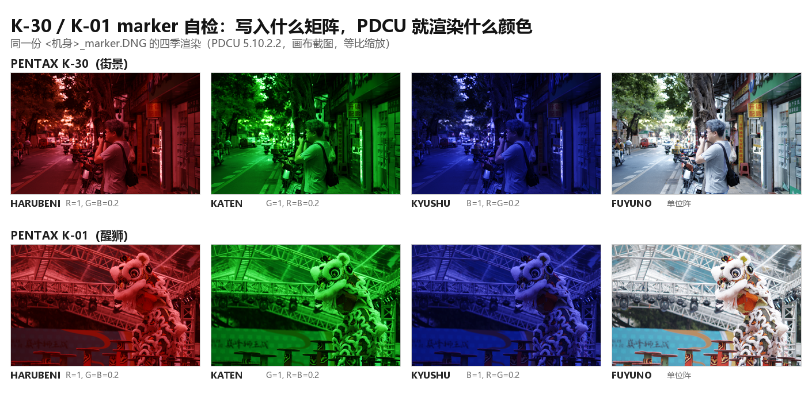

# K-30 / K-01 四季移植：沿用 K-50 的优化思路

日期：2026-11-04

| 项目 | 文件 |
|---|---|
| 目标 1 | `sample/K30.DNG`（PENTAX K-30，固件 1.06，街景） |
| 目标 2 | `sample/K01.DNG`（PENTAX K-01，Ver 1.05，醒狮） |
| 参照 | `sample/K50.dng`（同构机身，已完成 P0/P1/P2）、[`PDCU-K50-四季方案优化分析.md`](PDCU-K50-四季方案优化分析.md) |
| 工具 | `tools/dng_season_params.py --builtin k30 / k01` |
| 结论 | 数据自检与透明度已接入；marker 实测两台都通过；隐含基准落在同一带内，但样本不同场景，证据强度弱于 K-50 |



## 0. 结论

K-30、K-01 与 K-50 是**同构**的三台：都没有 `0x021A` / `0x021B`，私有块都是大端，
都用 4 条 KF 四季记录、隐含基准都量化到 K-3 的基准矩阵。所以 K-50 那套优化可以
原样搬过来，效果如下：

1. **P1 数据一致性**：两个模块各加了 `CM2`（校准输入）与 `CALIBRATED_FROM = 'kf'`
   （风格来源）；运行期 `baked_calibration()` 会用**文件自己的** ColorMatrix2 重算
   Y，核对 4 个矩阵与隐含基准。K-30 实测矩阵差 **0 LSB**、基准差 4.2×10⁻⁵；
   K-01 是 0 LSB / 1.8×10⁻⁵。
2. **P2 透明度**：`--builtin k30 / k01` 现在会打印隐含基准与重算结论，GUI 日志
   同步显示“离线校准自检：pass …”。把 ColorMatrix2 改 1% 会立刻变成 WARNING。
3. **P0 验证**：marker 实测两台都通过（写入 R/G/B/单位阵，画面就出 R/G/B/本色）；
   隐含基准残差 K-30 6.39、K-01 4.94 ΔE76，与 K-50（4.53）、K-70 对照（5.77）
   在同一带内。
4. **输出字节不变**：K-30 `328E52A6…`、K-01 `06B87D74…`，与 README 记录一致。

唯一的降级：K-30 与 K-01 的样本不是 K-50 那张棚拍图，**没有同场景参照机身**，
所以做不了 K-50 那种 0.24% 的跨机身差分，隐含基准只能做“同带”判断（见 §5）。

## 1. 为什么值得做

三个模块的矩阵都是**离线算好的冻结表**：`M(KF 季节) × Y`，Y 由各自的 DNG
ColorMatrix2 推出。运行时不重算，所以一旦 KF 表更新、样本换了、或有人手改字节，
表会**静默过期**——菜单照样能列出四项，颜色悄悄偏掉。K-50 那边已经证明这种
“能渲染但不对”的状态最难发现，因此给同构的 K-30 / K-01 上了同一套自检。

## 2. P1：数据一致性

两个模块各自新增：

    # DNG ColorMatrix2 (0xC622) of the sample these seasons were calibrated on
    CM2 = (0.8908843994140625, -0.26922607421875, ..., 0.660430908203125)   # K-30
    CM2 = (0.8853607177734375, -0.2675628662109375, ..., 0.657135009765625)  # K-01

    # Style table the four season matrices were derived from.
    CALIBRATED_FROM = 'kf'

`baked_calibration()` 的判定（实跑）：

| 机身 | 矩阵差 | 隐含基准差 | ColorMatrix2 差 | 判定 |
|---|---:|---:|---:|---|
| K-30 | 0 LSB | 4.2×10⁻⁵ | 0 | pass |
| K-01 | 0 LSB | 1.8×10⁻⁵ | 0 | pass |
| K-50 | 0 LSB | 5.8×10⁻⁵ | 0 | pass |

矩阵差为 0 LSB 说明内置表**完全可以**由 `KF 表 × 本机 ColorMatrix2` 复现——不是
另一套凭经验调出来的数；基准差的量级就是 Q13 取整误差。

`tests/test_season_data.py` 从“只测 K-50”扩成**五台**参数化（后续又加了 Q7 / MX-1，
见 [`PDCU-Q7-MX1-四季自检.md`](PDCU-Q7-MX1-四季自检.md)），七组用例：

| 用例 | 覆盖 |
|---|---|
| declarations | 每个离线机身必须声明 `CM2`（9 个数）与 `CALIBRATED_FROM`，且来源是已知内置表 |
| rebuild | 每台重算 Y、逐系数比对（0 LSB）与隐含基准（≤1 LSB） |
| records | 4 条记录 = KF 记录，只差矩阵索引 |
| neutral | 每个矩阵每行和 = 8192 ±1 |
| drift | ColorMatrix2 首项 +1% 必须判不过 |
| guards | 没有 `baked_from` 的 donor、已有 `0x021B` 的 target 直接跳过 |

## 3. P2：透明度

`--builtin k30` 的实际输出：

    == calibration ==
    target base    : (none - this body writes no 0x021B)
    donor base     : [+1.52734 -0.53125 +0.00391] ...  (implied base of the bundle)
    result         : pre-calibrated offline: Y = T(KF) * inv(T(target)),
                     baked into the bundled matrices
    recompute      : pass - bundled matrices equal KF-style * Y recomputed from
                     this file's ColorMatrix2 (dY 0.0e+00, dBase 4.2e-05, dCM2 0.0e+00)

GUI 的转换日志里同样多一行“离线校准自检：pass …”。人为把 ColorMatrix2 改 1% 后
立刻变成 `WARNING … (matrices dY 1.4e-02, base dBase 1.2e-02, ColorMatrix2 dCM2 8.9e-03)`。

## 4. P0-a：marker 实测 —— 两台都通过

把补后文件的 4 个季节矩阵换成“纯 R / 纯 G / 纯 B / 单位阵”（交叉项 0.2），其余
字节不动，用 PDCU 5.10.2.2 逐项渲染：

| 机身 | HARUBENI | KATEN | KYUSHU | FUYUNO（单位阵） |
|---|---|---|---|---|
| K-30 主通道 | R（81/16/17） | G（10/79/13） | B（17/19/80） | 场景本色（108/120/121） |
| K-01 主通道 | R（110/24/26） | G（17/111/21） | B（25/27/107） | 场景本色（144/153/158） |

四项与写入的矩阵一一对应，说明 **PDCU 读的就是这 4 个 3×3 矩阵**。FUYUNO 那一列
写的是单位阵，画面保留场景本色（K-30 的街景本身偏蓝、K-01 的醒狮背景也是蓝幕），
所以均值偏蓝是**场景**，不是换算错。

同一机身的 marker 文件与 base 文件，As Shot 逐字节相同（K-30 `c037c0eb…`、
K-01 `9ff6192b…`），再次确认改写 `0x021B` 不动默认显影。

## 5. P0-b：隐含基准 —— 同带，但无同场景参照

把 HARUBENI 的矩阵换成隐含基准 `M_KF(base)·Y`（风格 = 单位阵），其余三个季节不动：

| 机身 / 场景 | ΔE76 | ΔL* | ΔC* | ΔH* |
|---|---:|---:|---:|---:|
| K-30（街景） | 6.39 | −1.96 | −3.24 | −0.37 |
| K-01（醒狮） | 4.94 | −0.09 | −1.62 | +0.25 |
| K-50（棚拍，参照） | 4.53 | −1.40 | +1.13 | +0.24 |
| K-70 对照（矩阵已知正确） | 5.77 | −2.19 | +2.69 | +0.85 |

这 4.5–6.4 的残差主要来自**四季记录自带的收尾参数**：K-70 那一行用的矩阵是机身
自己的 mode-0，矩阵项为 0，残差 5.77 全是参数差异。K-30 / K-01 落在同一带内，
没有“矩阵错位”那种成倍的偏离。

**但这不是 K-50 那种 0.2% 的强证据。** K-50 能压到 0.2% 是因为 K-3 有一张同场景
（同棚拍、同色卡）的样片，可以用跨机身差分把参数项消掉；K-30 的街景与 K-01 的
醒狮都没有同场景参照机身，只能做到“与已知正确的 K-70 对照同带”。要把这两台也
压到 0.1 ΔE00 量级，需要同场景样片（或一次参数可控的 PDCU 探针）。

旁证：三台的隐含基准都量化到同一组 Q13 整数（12512, −4352, 32, …），Y 两两相差
3×10⁻⁵ 量级；K-50 的 0.2% 结论对“K-30 系列”这个家族成立，但**不能替每台机身
担保**它们的引擎与 CM2 同样贴合。

## 6. 回归

| 检查 | 结果 |
|---|---|
| K-30 输出 SHA-256 | `328E52A671C26AA5E8524003E51F78A2F55475AA9665E4C6EECA5EB648A25AEC`（与 README 一致） |
| K-01 输出 SHA-256 | `06B87D743391237AC54EDC847CA8FA97982EDF87BC568F3311E5415B813B3745`（与 README 一致） |
| K-50 输出 | 仍为 `D45021DE…F75F1A`，未受影响 |
| K-70 / K-S2 等有 `0x021B` 的机身 | 走原有 `plan_calibration()`，日志与输出不变 |
| `tests/test_season_data.py` | 七组用例、五台机身全过 |

## 7. 复现

```powershell
# 生成/校验（输出与 README 哈希一致）
python tools\dng_season_params.py --target sample\K30.DNG --builtin k30 ^
    --out .tmp\k50opt\K30_new.DNG --overwrite
python tools\dng_season_params.py --target sample\K01.DNG --builtin k01 ^
    --out .tmp\k50opt\K01_new.DNG --overwrite

# 数据自检
python tests\test_season_data.py

# P0 探针（会启动 PDCU 并抓画布）
python .tmp\k50opt\build_probes_k30k01.py
python .tmp\k50opt\p0_render2.py K30_marker.DNG K30_base.DNG K01_marker.DNG K01_base.DNG
python .tmp\k50opt\p0_analyze_k30k01.py
```

本次生成物（不覆盖 `sample/`）：`.tmp/k50opt/K30_marker.DNG`、`K30_base.DNG`、
`K01_marker.DNG`、`K01_base.DNG`；PDCU 截图在 `.tmp/k50opt/p0/`。

## 8. 边界

- **没有同场景参照**：这是与 K-50 分析最大的差距，§5 的结论是“同带”，不是“等价”。
- 只覆盖 PDCU 5.10.2.2；Lightroom / Capture One / dcraw 不读 Pentax 四季。
- 未做 K-50 的 P3（补完整表）：三台都没有原表可保留，补表属于未验证的行为变更。
- Q7 / MX-1 已经用同一套补齐（自检 + marker + 隐含基准差分），见
  [`PDCU-Q7-MX1-四季自检.md`](PDCU-Q7-MX1-四季自检.md)。

---

版权所有 © 2026 KimHoLau X deepseek harness
