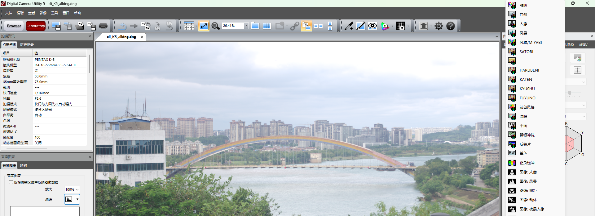
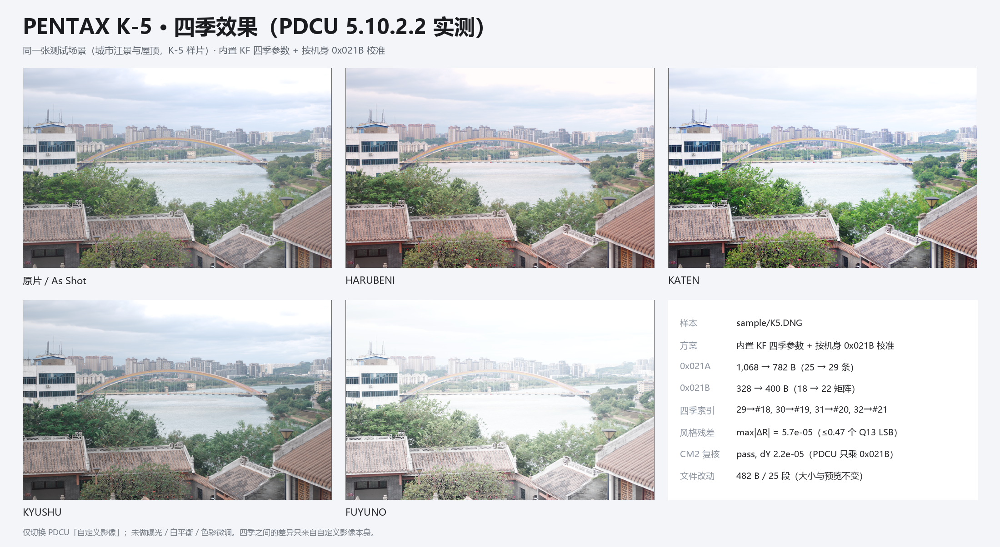

# PENTAX K-5 四季移植：能否直接照搬 K-5 II 方案

日期：2026-11-06

样本：

- `sample/K5.DNG`（PENTAX K-5，25,953,685 B）
- `sample/K5ii.DNG`（PENTAX K-5 II，23,803,520 B；仓库里没有 K-5 II s 样本，但 K52 文档已证 II 与 II s 的 `0x021A` / `0x021B` 逐字节相同）
- 对照：`sample/K3.dng`、内置 `season_kf_data.py`
- 本次产物：`.tmp/K5_all.dng`（SHA-256 `67C112F0…B4F841`，与 CLI 输出逐字节相同）



---

## 0. 结论

**能照搬的是“配方”，不能照搬的是“文件偏移”。**

- **数据层：可以。** K-5 的 `0x021A` 25 条记录、`0x021B` 18 个矩阵与
  `sample/K5ii.DNG` **逐字节相同**；基准 #0 也与 K-3 的 #0 相同，所以
  `Y = inv(M_KF[0]) · M_K5[0]` 与 K-5 II / K-3 完全相同。四季矩阵可以直接用
  同一套 `M_KF季节 · Y`，不需要为 K-5 单独建数据模块。
- **写入层：不能照抄偏移。** K-5 是 `DNGPrivateData 0xC634`、大端、相对偏移，
  私有块在 894..103294；K-5 II 的对应偏移整体 **+4 B**（898..103298）。
  `PDCU-K5iis-K1-四季对比.md` §2.1 里那套“记录写 4412、矩阵写 4516”的步骤是
  **DCU 另存 DNG 的 EXIF `0x927C` 容器**，K-5 根本不走这条路径，不能套。
  真正对应 K-5 文件形态的是 `PDCU-K52-K52s-四季三方案对比.md` 里的 K-5 II 相机 DNG 路径。
- **PDCU：实测可用。** PDCU 5.10.2.2 打开补丁后的 K-5 DNG，菜单列出
  HARUBENI / KATEN / KYUSHU / FUYUNO 四项；选任一项后画面都改变（相对
  As Shot 的平均像素差 6.46–37.43，0–255 刻度），说明写入的记录和矩阵
  都参与了渲染，不只是“菜单能列出来”。
- **落地：按 A 档（有 `0x021B`）处理，数据源 `kf`，与 K-5 II 同表。**
  CLI 与 GUI 都已登记（`MODEL_TO_DONOR_KIND` / `AUTO_SELECT_GROUPS`），
  不需要新数据模块；输出与登记前逐字节相同。

一句话：**照搬 K-5 II 的“表 + Y + 四季映射”，不要照搬它的“文件偏移”和
K-5 II s 的 DCU MakerNote 步骤。**

---

## 1. 两张表到底有多像

### 1.1 结构对照

| 项目 | K-5（`sample/K5.DNG`） | K-5 II（`sample/K5ii.DNG`） |
|---|---|---|
| 机型字符串 | `PENTAX K-5` | `PENTAX K-5 II` |
| 容器 | `DNGPrivateData 0xC634`，相对偏移 | 同 |
| 私有块 | 0x37E..0x1937E（102,400 B） | 0x382..0x19382（102,400 B，+4） |
| 私有块字节序 | 大端 | 大端 |
| `0x021A` | 0xA32..0xE5E，1,068 B，nParams=12，nRecords=25，26 B/条，390 B 填充 | 0xA36..0xE62，同尺寸/条数 |
| `0x021B` | 0xE5E..0xFA6，328 B，18 个矩阵 | 0xE62..0xFAA，同尺寸/矩阵数 |
| 四季 | 无 | 无 |
| `0x0004` / `0x0005` | 0x87E2 / 0x12E76 | 0x87DE / 0x12F70 |

两个 `0x021A` 标签的 SHA-256 不同
（K-5 `3b77ca72…`，K-5 II `7bb1b147…`），但差异**全部在
390 B 填充区**：K-5 的填充不是空的（61 种字节值），K-5 II 的填充以 `0xAA` 为主（390 B 里只有 4 种字节值）。
记录区 0–24 逐字节相同。

### 1.2 数据对照

| 检查 | 结果 |
|---|---|
| `0x021A` 25 条记录 | **25/25 逐字节相同** |
| `0x021B` 18 个矩阵 | **逐字节相同（max diff = 0）** |
| 基准矩阵 #0 | K-5、K-5 II、K-3 三者逐字节相同 |
| `Y` | 与 K-5 II / K-3 完全相同 |
| `0x021A` 记录顺序 | 相同（0,1,16,…,22） |
| ColorMatrix2 | 数值不同：K-5 第一行 `0.840363 / -0.253967 / -0.112549`，K-5 II `0.827637 / -0.250107 / -0.110840`；归一化输入变换 `T` 只差 `9.4×10⁻⁵` |

> K-5 II s 的情况：K52 文档已经验证 K-5 II 与 K-5 II s 的 `0x021A` /
> `0x021B` 逐字节相同，两者 ColorMatrix2 只差按行缩放。因此本文对
> “K-5 II”的结论同样覆盖 K-5 II s；下文不再区分。

---

## 2. 为什么同一套 Y 对 K-5 成立

```
Y = inv(M_KF[0]) · M_K5[0]
  = [ 0.973741   0.095850  -0.069591 ]
    [-0.009796   1.068062  -0.058266 ]
    [-0.005150   0.041113   0.964038 ]
```

这个 Y 与 K-5 II、K-3 用的 Y 完全相同（三台 #0 相同）。四季矩阵按
`M_季节 = M_KF季节 · Y` 量化后写入，风格变换
`R = M_季节 · inv(M_K5[0])` 与 KF 原生的差：

| 季节 | max\|ΔR\| |
|---|---:|
| HARUBENI | 5.5×10⁻⁵ |
| KATEN | 5.7×10⁻⁵ |
| KYUSHU | 2.9×10⁻⁵ |
| FUYUNO | 5.1×10⁻⁵ |

Q13 的 1 个 LSB 是 `1.22×10⁻⁴`，四季全部落在 1 个 LSB 以内。

25 个共有模式的风格变换 `R` 中位残差是 `8.2×10⁻⁵`；两个例外（矩阵空间）：

- **#2**：偏离 `0.2535`，是 K-3 / K-5 II 共用的特例矩阵，服务模式 2/6/11/16；
- **#8**：矩阵空间偏离 `1.413`（R 空间 `0.153`），K-5 II 也完全一样。

四季使用新增的 #18–#21，不经过 #2 / #8，所以这两个例外不影响四季。

ColorMatrix2 这条替代路径也对得上：K-5 的 `T` 与 K-5 II 的 `T` 只差
`9.4×10⁻⁵`，由 CM2 反推的 Y 与 0x021B 的 Y 只差 `2.2×10⁻⁵`。也就是说，
即使不读 0x021B、改走 ColorMatrix2，结论也相同；工具实际走 0x021B，更直接。

---

## 3. K-5 的实际写入方案

| 标签 | 原 | 新 | 位置 |
|---|---|---|---|
| `0x021A` | 1,068 B / 25 条 | **782 B / 29 条** | 0xA32..0xD40（原址，标签长度缩短） |
| `0x021B` | 328 B / 18 矩阵 | **400 B / 22 矩阵** | 0xE5E → **0xD40**（搬到 0x021A 尾部腾出的空间） |

四季映射：

| 季节 | record id | 矩阵索引 |
|---|---:|---:|
| HARUBENI | 29 | #18 |
| KATEN | 30 | #19 |
| KYUSHU | 31 | #20 |
| FUYUNO | 32 | #21 |

实现细节：

1. 前 25 条记录、前 18 个矩阵**逐字节保留**；4 条新记录插在记录 24 之后
   （record 25–28），矩阵追加为 #18–#21。
2. `0x021A` 的 390 B 填充足够放下 4 条记录（104 B），所以标签从 1,068 B
   缩到 782 B；`0x021B` 后面**没有空隙**（下一段数据 0x021C 紧接 4006），
   因此矩阵表重定位到 0x021A 尾部腾出的 0xD40。
3. 旧 `0x021A` 的 0xD40..0xE5E 和旧 `0x021B` 的 0xE5E..0xED0 被新数据覆盖；
   0xED0..0xFA6 这一段旧矩阵残留不再被任何标签引用。

逐字节验证：

| 检查 | 结果 |
|---|---|
| 文件大小 | 25,953,685 B，**不变** |
| 改动字节 | **482 B，25 段**，全部在私有块 0x72C..0xED0 |
| 私有块外 | 前缀、后缀逐字节相同 |
| 内嵌预览 JPEG | 36,549 B，SHA-256 不变 |
| 其它私有标签 | 99 个标签的 SHA-1 全部不变 |
| `0x0004` / `0x0005` | 机型 ID，未动 |
| 前 25 条记录 / 前 18 个矩阵 | 逐字节相同 |

### 3.1 唯一需要说明的结构差异：K-5 的填充不是空的

K-5 II 的 390 B 填充以 `0xAA` 为主，K-5 的填充是 61 种字节值的非空数据。工具默认
把 4 条记录写进填充前 104 B，再把 0x021B 写进剩余 286 B + 旧 0x021B 前 114 B，
等于把这 390 B 填充全部覆盖掉。**PDCU 5.10.2.2 实测没有影响**（见 §4），
但这是本文唯一没有历史先例的字节：K-5 II 的同一位置以 `0xAA` 为主，K-3 以
`0xFF` 为主，K-5 却是 61 种字节值的非空数据。

如果希望保守处理，可以把 `0x021A` 标签长度保持 1,068 B（只改 nRecords 和
记录区），把 400 B 的新 `0x021B` 放到私有块尾部 0x8B56（35,670）之后的
大空闲区。这个变体没有做 PDCU 实测，属于“更少改动、但未验证”的选项；
当前工具默认路径是前面那种紧凑布局，本文的实测结论也只覆盖紧凑布局。

---

## 4. PDCU 5.10.2.2 实测

打开 `.tmp/K5_all.dng` 后：

- 拍摄资讯显示 **PENTAX K-5**；
- “自定义影像”菜单在 SATOBI 之后、波普风格之前列出
  **HARUBENI / KATEN / KYUSHU / FUYUNO**（见文首图）；
- **HARUBENI**：相对 As Shot 的平均像素差 **6.46**（0–255），97.8% 的像素差 > 2；
- **KATEN**：平均像素差 **15.69**，92.4% 的像素差 > 2；
- **KYUSHU**：平均像素差 **6.96**，90.0% 的像素差 > 2；
- **FUYUNO**：平均像素差 **37.43**，92.5% 的像素差 > 2（四式中最强）；
- 状态栏从“未更改”变成“已更改”。



> 截图方法：四季分别用独立文件从 As Shot 起算（避免 PDCU 残留上一次的选择），
> 并在 PDCU 菜单里逐项核对——HARUBENI / KATEN / KYUSHU / FUYUNO 分别对应
> 菜单第 8 / 9 / 10 / 11 个可选项（HOME 后连按 DOWN 的计数），不是最早的 6–9。

这说明 PDCU 确实读取了追加的 29–32 记录和 #18–#21 矩阵并参与渲染。
**不是“只把名字列出来”**。

As Shot 的说明：本次没有单独做 As Shot 的逐像素对比；但 mode 0 记录和
矩阵 #0 在补丁前后逐字节相同，且除 `0x021A` / `0x021B` 外的 99 个私有标签
全部未变。As Shot 的显影走 mode 0 / 矩阵 #0，这两者在补丁前后逐字节相同；
新增的 29–32 记录只影响菜单和四季选项，因此结构上没有改变 As Shot 的输入。

---

## 5. 能照搬 / 不能照搬

| 层面 | 结论 | 说明 |
|---|---|---|
| 数据配方（KF×Y、4 条记录、#18–#21） | **可以** | K-5 与 K-5 II 的表/Y 完全相同 |
| K-5 II 的 `0x021A` / `0x021B` 字节内容 | **可以** | 25 条记录、18 个矩阵逐字节相同 |
| K-5 II 的文件偏移 | **不可以** | 整体 +4 B；必须按目标文件重新计算 |
| K-5 II s 的 DCU DNG 手工步骤（4412 / 4516） | **不可以** | 那是 EXIF `0x927C` 容器；K-5 是 `0xC634` |
| PDCU 菜单 / 渲染路径 | **可以** | 5.10.2.2 实测菜单 + 画面均生效 |
| K-5 II 的 ColorMatrix2 | **不可以照抄数值** | K-5 的 CM2 与 K-5 II 数值不同；但工具用 0x021B，不影响 |
| `0x021A` 的 390 B 填充 | **需决策** | K-5 填充非空；默认紧凑布局已实测，保守布局未实测 |
| 机型 ID / UniqueCameraModel | **不能动** | `0x0004` / `0x0005` / `0xC614` |

---

## 6. 工具落地清单

### 6.1 CLI 今天就能跑

```bat
python tools\dng_season_params.py --target sample\K5.DNG --builtin kf ^
    --out .tmp\K5_all.dng --force
```

工具会打印：

```
style check    : pass (25 common modes, median 8.2e-05)
CM2 check      : pass (0x021B base vs ColorMatrix2, dY 2.2e-05)
mode table     : 1068 -> 782 B (-286), nRecords 25 -> 29
matrix table   : 328 -> 400 B, matrices 18 -> 22
season records : 29/HARUBENI, 30/KATEN, 31/KYUSHU, 32/FUYUNO
```

CLI 能直接通过，是因为 `check_cross_model()` 看到 K-5 与 KF 的
`style_ok = True`，把 KF 当作已校准的跨机型 donor。

### 6.2 GUI 登记（已加入）

GUI 的 `_start()` 会用 `builtin_source_allows()` 检查机型；`source_for_models()`
负责自动选中来源。现在 K-5 已登记：

```
donor_kind_for_model('PENTAX K-5')        -> 'kf'
source_for_models({'PENTAX K-5'})         -> BuiltinSource('builtin_kf', ...)
builtin_source_allows('builtin_kf','K-5') -> True
```

改动只有两处：`MODEL_TO_DONOR_KIND` 加 `"PENTAX K-5": "kf"`，
`AUTO_SELECT_GROUPS` 的 KF 校准组加入 `"PENTAX K-5"`，让单文件也能自动选中
“内置 KF / K-70”。不需要新建 `season_k5_data.py`：K-5 是有 `0x021B` 的 A 档机型，
运行时用 `season_kf_data.py` + Y 即可；也不应把 K-5 加进 B 档的 CM2 冻结表自检。

### 6.3 文档 / 测试

- README 适配表已加一行：**PENTAX K-5 | A | KF×Y | 5.7×10⁻⁵ | PDCU 5.10.2.2 菜单 + 渲染实测**。
- 回归测试至少断言：输出 29 条 / 22 矩阵、四季 → #18–#21、前 25 条记录和
  前 18 个矩阵与源文件逐字节相同。
- 如果以后要防“K-5 的 0x021A 填充被误改”，可以在测试里加一条：补丁后
  `0x021A` 标签长度必须是 782（或显式选择保守布局时的 1,068）。

---

## 7. 风险与边界

1. **只测了 PDCU 5.10.2.2。** 其它 PDCU 版本、Lightroom / Capture One /
   dcraw 等不保证；PDCU 本身对 K-5 的 As Shot 路径是否完全不看新增记录，
   只做了结构论证，没有逐像素对比。
2. **K-5 的 0x021A 填充含义未知。** 它不是 0xAA/0xFF，可能是相机写入时的
   残留数据，也可能是某种未公开表。当前紧凑布局把它覆盖掉，PDCU 实测无影响；
   如果未来发现 K-5 固件/其它软件用到这段，应改用 §3.1 的保守布局。
3. **四季记录的 12 个参数字段沿用 KF。** K-5 自己的模式表与 KF 在模式
   0x13 / 0x14 等位置有差异（K52 文档已列出），四季记录是否存在 K-5 专属
   取值，没有 K-5 官方四季样本可对照。
4. **“正确”的定义是“与 KF/K-5 II 风格一致”**，不是“官方 K-5 四季”。
   K-5 没有官方四季固件样本。
5. **ColorMatrix2 不是 K-5 II 的那张。** 但归一化 T 只差 9.4×10⁻⁵，
   且 PDCU 读 0x021B，所以不影响四季；如果别的软件读 CM2，它看到的是
   K-5 原值（未改动），也不会有回归。
6. **不要把 K-5 II 的输出文件按偏移复制。** K-5 的私有块起点比 K-5 II
   早 4 B；K-5 II 的输出在 K-5 上会整体错位 4 B。正确做法是复制“配方”，
   让工具按目标文件的 `priv_off` / `table_off` / `blocks_off` 重算。

---

## 8. 复现

| 脚本（`.tmp`） | 作用 |
|---|---|
| `tools/dng_season_params.py` | 主工具；`--builtin kf` 即可产出 `.tmp/K5_all.dng` |
| `k5_probe.py` | 读 K-5 / K-5 II / K-3 的容器、表结构、矩阵 |
| `k5_cmp.py` | 逐条记录 / 逐矩阵对比，算 Y 与残差 |
| `k5_plan.py` | 走 `plan_patch()` / `write_patch()` / `verify_output()`，打印计划 |
| `k5_verify.py` | 改动范围、预览哈希、其它标签 digest |
| `k5_season_r.py` | 四季 R 残差 |
| `k5_cm2.py` | ColorMatrix2 路线与 0x021B 路线的 Y 对比 |
| `k5_uia.ps1` / `k5_menu.ps1` / `k5_select2.ps1` | PDCU 菜单与选择实测（坐标式 UI 自动化） |
| `k5_newpath_test.py` / `k5_newpath_cd.py` | 逐季独立文件、从 As Shot 起算，抓取正确的四季画面 |
| `k5_mk_*.py` | marker 色块核对 PDCU 菜单索引（#18 红 / #19 绿 / #20 蓝 / #21 白） |

产物哈希：

```
K5.DNG        0D7377E5A2C1BDAA2FDE18E633D9D9237025DA52F9B9A8DD401CCBA30F8BCC87
K5ii.DNG      AE9F591E9A0F98205C60416920C90E83A640BF843DC78EA6D40271BF96992693
K5_all.dng    67C112F0B7A0E9989FE64AF764A8E3FFBEFFC1E7A3E89A83F5ABD4D73EB4F841
```

---

版权所有 © 2026 KimHoLau X deepseek harness
