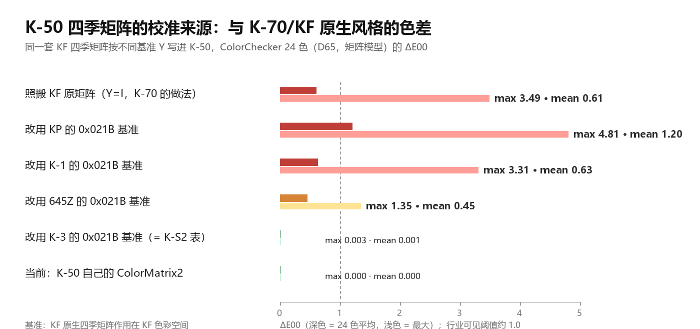
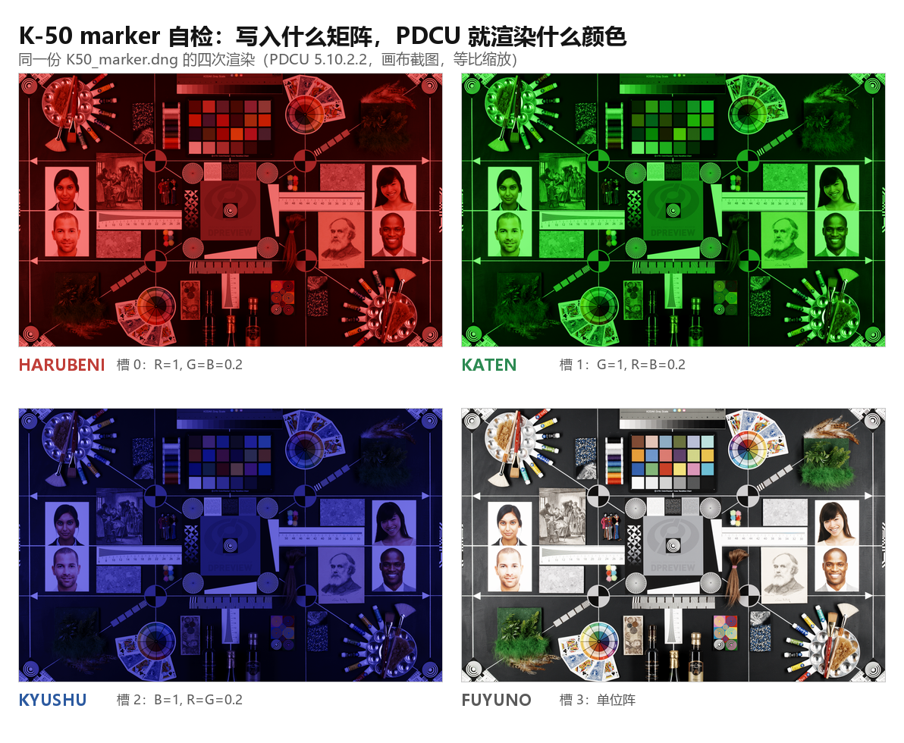

# K-50 四季移植方案的优化空间（以 K-70 为基准）

日期：2026-11-04

| 项目 | 文件 |
|---|---|
| 目标 | `sample/K50.dng`（PENTAX K-50，2013-11-26，50 mm f/5.6 1/40 ISO100，4928×3264） |
| 基准 | `sample/K70.dng`（PENTAX K-70，2016-08-23，55 mm f/5.6 1/40 ISO100，6000×4000） |
| 对照基准 | K-3 / K-1 / KP / 645Z / K-S2 的 `0x021B` 基准矩阵 |
| 工具 | `tools/dng_season_params.py --builtin k50`（v2.1 内置表） |
| 结论 | **颜色层没有优化空间；结构/验证层有 6 条可做项** |



## 0. 结论

**先回答“能不能照 K-70 那么办”：不能，而且 K-70 方案里最显眼的那一步，正好是 K-50 唯一不能借的。**

K-70 之所以能把 KF 的四季矩阵**原样**写进去（Y = I，523 B / 24 段），前提是
K-70 与 KF 共用同一组 21 个基准矩阵——矩阵已经在同一色彩空间里。K-50 的
`0x021B` 根本不存在，没有“同一空间”这回事；照搬 KF 原矩阵，等于把 K-70 的色彩
空间当成 K-50 的用。按 ColorChecker 24 色估算，这一步会带来 **ΔE00 平均 0.61、
最大 3.49**，远超可见阈值（约 1.0）。所以工具现在做的
`S = M(KF 季节)·Y，Y = T(KF)·inv(T(K-50))` 不是可选项，而是必需项。

四个层次分开看：

1. **风格层（用户看到的“季节味道”）**：已经是量化极限。四个季节的
   `R = S·inv(B)` 与 K-70 的最大差为 0.46 / 0.47 / 0.23 / 0.27 个 Q13 LSB
   （≤5.7×10⁻⁵），半个 LSB 都不到。这一层**没有优化空间**。
2. **绝对色层（季节颜色落在 K-50 自己色彩空间的哪一边）**：现状是
   ColorMatrix2 推算，与 K-3 的 `0x021B` 基准只差 3.65×10⁻⁵；换成任何别的
   现成基准（K-1 / KP / 645Z）都会退化到 ΔE00 0.45–1.20。这一层**已经被现有
   证据钉死**，剩下的不确定性只有一个：K-50 的 PDCU 引擎是否真的等于它的
   ColorMatrix2。8 台有基准表的机身里，6 台的 CM2 与 `0x021B` 一致到
   1.6–5.1×10⁻⁵，只有 K-S2、645Z 例外（K-S2 的 `0x021B` 与 K-3 的 20 个矩阵逐字节相同）。
   没有证据表明 K-50 属于例外。
3. **结构层**：K-70 是“在原生 28 条 / 21 矩阵上加 4 条 / 4 矩阵”，K-50 是
   “从零新建 4 条 / 4 矩阵”。这一层**不能靠借鉴补齐**——K-50 没有原表可保留；
   硬补一张完整表属于未验证的行为变更（§9 P3）。
4. **验证层**：这才是真正有空间的地方。K-50 在 PDCU 层面目前只有“菜单能列出四项”
   和“As Shot 逐像素不变”两条证据，没有 K-10D / K-7 那样的 marker 自检，也没有
   “内置表是否仍等于 KF 表 × 本机 CM2”的漂移断言。

## 1. 两套方案的逐项对照

| 维度 | K-70（基准） | K-50（被评判） | 能否借鉴 |
|---|---|---|---|
| 数据来源 | KF 原生表，逐字节等价 | KF 表 × 本机 ColorMatrix2 推算 | 不能：没有共同基准矩阵 |
| `0x021A` 结构 | 28 条 → 追加 4 条 → 32 条 | 原本没有 → 新建 4 条 | 不能：无原表 |
| `0x021B` 结构 | 21 个 → 追加 4 个 → 25 个 | 原本没有 → 新建 4 个 | 同上 |
| 校准 | Y = I（精确等同） | Y = T(KF)·inv(T(K-50)) | **必须做**，见 §3 |
| 字节改动 | 523 B / 24 段 | 347 B / 100 段 | K-50 反而更少，但更分散 |
| 需要移动其它标签 | 不需要 | 需要（`0x0200`/`0x0201`/`0x0205`） | 结构所限 |
| 非颜色参数 | KF 原值 | KF 原值（逐字段相同） | 已一致 |
| 验证方式 | 逐字节 + PDCU 实测 | 逐字节 + PDCU 实测（无 marker） | **可补**（§9 P0） |

## 2. 两个样本的结构事实（实测）

| 项目 | K-70 原片 | K-70 补后 | K-50 原片 | K-50 补后 |
|---|---:|---:|---:|---:|
| 文件大小 | 33,587,710 | 不变 | 16,589,474 | 不变 |
| 私有块 | 151,164 B | 不变 | 102,400 B | 不变 |
| 私有 IFD 条目 | 119 | 119 | 100 | **102** |
| `0x021A` | 1146 B / 28 条 | 860 B / 32 条 | 无 | **132 B / 4 条** |
| `0x021B` | 382 B / 21 矩阵 | 454 B / 25 矩阵 | 无 | **76 B / 4 矩阵** |
| 改动字节 | — | 523 B（24 段） | — | **347 B（100 段）** |
| 被移动的标签 | — | 无 | — | `0x0200`/`0x0201`/`0x0205` |
| 字节序 | 小端 | 小端 | **大端** | 大端 |

K-50 的 4 条四季记录与 KF 的 4 条**逐字段相同**，唯一差别是矩阵索引：

| 季节 | KF 索引 | K-50 索引 | 记录中其余 11 个参数 |
|---|---:|---:|---|
| 29 HARUBENI | 22 | 0 | 完全相同 |
| 30 KATEN | 23 | 1 | 完全相同 |
| 31 KYUSHU | 24 | 2 | 完全相同 |
| 32 FUYUNO | 25 | 3 | 完全相同 |

所以 K-50 的季节观感**只由那 4 个矩阵决定**，而矩阵 = KF 矩阵 × Y。问题因此收敛
成一个：Y 对不对。

## 3. 实验一：把 K-70 的做法原样搬过来（Y = I）

把 KF 的四季矩阵不经校准直接写进 K-50（就是 K-70 的写法的字面照搬），再用
ColorChecker 24 色在矩阵模型下估算它与“KF 原生四季”的色差：

| 季节 | ΔE00 平均 | ΔE00 最大 |
|---|---:|---:|
| HARUBENI | 0.695 | 3.489 |
| KATEN | 0.682 | 3.322 |
| KYUSHU | 0.529 | 1.582 |
| FUYUNO | 0.520 | 1.656 |
| **24 色合计** | **0.607** | **3.489** |

对照可见阈值 1.0：**平均 0.61 已到阈值附近，最大 3.49 是三倍多**。具体到矩阵系数，Y = I 与
正确校准最多差 0.096（矩阵元素），换算成 Q13 是 785 个 LSB——不是“差一点”，
是差一整个机型。

这条实验的意义：**K-70 的“精确移植”只在“两台共用基准矩阵”时成立**。把它当作
通用做法套到没有基准表的机身，会得到肉眼可见的偏色。

## 4. 实验二：换一个“现成基准”行不行

既然 K-50 没有基准表，能不能借一台有表的机身的基准？把各机身的 `0x021B`
mode-0 矩阵反推成 Y，再算写进 K-50 后的色差：

| 基准来源 | max\|Y − Y(K-50 CM2)\| | ΔE00 平均 | ΔE00 最大 |
|---|---:|---:|---:|
| **K-50 自己的 ColorMatrix2（现状）** | — | **0** | **0** |
| K-3 的 `0x021B` | 3.65×10⁻⁵ | 0.0006 | 0.0026 |
| 645Z 的 `0x021B` | 2.97×10⁻² | 0.451 | 1.35 |
| K-1 的 `0x021B` | 4.44×10⁻² | 0.631 | 3.31 |
| KP 的 `0x021B` | 1.25×10⁻¹ | 1.203 | 4.81 |
| 照搬 KF 原矩阵（Y = I） | 9.58×10⁻² | 0.607 | 3.49 |

只有 K-3 的基准是等价的——因为 K-50 的 ColorMatrix2 推出的 Y 与 K-3 的基准
本来就只差 3.65×10⁻⁵。补充一个事实：**K-S2 的 20 个 `0x021B` 矩阵与 K-3
逐字节相同**，所以“K-S2 基准”与“K-3 基准”是同一个参照，不是第二个证据。

### 4.1 为什么相信 ColorMatrix2 这一次没骗人

工具会对同时有 `0x021B` 和 `0xC622` 的机身做交叉核对（两条路算出的 Y 差多少）：

| 机身 | max\|Y(0x021B) − Y(CM2)\| | 工具行为 |
|---|---:|---|
| K-70 | 1.62×10⁻⁵ | ok |
| K-3 | 1.82×10⁻⁵ | ok |
| KP | 1.80×10⁻⁵ | ok |
| K-1 | 3.03×10⁻⁵ | ok |
| 645D | 3.95×10⁻⁵ | ok |
| K-1 Mark II | 5.05×10⁻⁵ | ok |
| 645Z | 2.65×10⁻³ | WARNING |
| K-S2 | 1.26×10⁻² | WARNING |

对“表是真表”的机身，ColorMatrix2 与 `0x021B` 一致到 10⁻⁵ 量级。K-S2 的
`0x021B` 与 K-3 的 20 个矩阵逐字节相同，所以它的 CM2 才对不上——这是“表不是自己的”
造成的，不是“CM2 不可信”造成的。K-50 的 CM2 与 K-3 的基准只差 3.65×10⁻⁵，
落在“正常机身”的分布里。

### 4.2 残余风险有多大

若 K-50 的 PDCU 引擎像 K-S2 那样偏离自己的 CM2（1.26×10⁻²），四季的绝对色误差
大致是 ΔE00 平均 0.66 / 最大 2.55：

| Y 的误差 | ΔE00 平均 | ΔE00 最大 |
|---|---:|---:|
| 1×10⁻⁵ | 0.0005 | 0.002 |
| 1×10⁻⁴ | 0.005 | 0.020 |
| 1×10⁻³ | 0.053 | 0.201 |
| 2.6×10⁻³（645Z 量级） | 0.137 | 0.523 |
| 1.26×10⁻²（K-S2 量级） | 0.658 | 2.551 |

这是 K-50 方案**唯一**可能存在的颜色误差来源；要排除它，只有做一次
“把隐含基准矩阵当季节矩阵写进去，看 PDCU 渲染是否与 As Shot 逐像素相同”的
marker 实验（§9 P0）。在那之前，没有证据支持“K-50 属于 K-S2 那一类”。

## 5. 实验三：量化与取整还有没有空间

- 内置表与运行时重算 `M_KF·Y` 的差：**0 LSB**（四个矩阵、36 个系数全部相同）。
  也就是说 `season_k50_data.MATRICES` 完全可以由 KF 表 + K-50 的 ColorMatrix2
  复现，不是另一套数。
- 未量化值到 Q13 的取整误差：0.41–0.50 LSB，已是 round() 的下限。
- 行和：写出的矩阵是 8191/8193（HARUBENI 第三行 8191，KATEN 第二、三行 8193），
  精确值是 8192。试着改成“行和恒为 8192”的取整，KATEN 的最大误差反而从
  0.48 LSB 涨到 0.87 LSB——**标准 round() 已经是最优**，不要动。
- 与 K-3 的补后矩阵对比：36 个系数里 29 个完全相同，7 个差 1 个 LSB。

结论：量化层没有空间。

## 6. 实验四：记录参数有没有空间

K-50 的 4 条记录与 KF 的 4 条记录（`season_kf_data.RECORDS`）逐 u16 相同，
只有矩阵索引不同（§2 表）。所以 PDCU 用在 K-50 上的锐度/对比/饱和度等**收尾
参数**与 K-70 完全一致——这一层没有“K-70 的参数更适合 K-70”的问题。

## 7. 渲染层复核

用 2026-10-28 那批 PDCU 5.10.2.2 截图（`.tmp/k50eval/render/`，本次未重跑
PDCU）重算，同一场景下“季节 ÷ As Shot”的归一化色彩方向差：

| 季节 | K-50 vs K-70 | **K-50 vs K-3** | K-3 vs K-70 |
|---|---:|---:|---:|
| HARUBENI | 2.30% | **0.18%** | 2.29% |
| KATEN | 2.22% | **0.37%** | 1.85% |
| KYUSHU | 2.28% | **0.48%** | 1.81% |
| FUYUNO | 2.86% | **0.99%** | 1.88% |

（分箱统计的口径见 `PDCU-K50-K70四季对比.md` §5，结论与排序相同。）

各季节相对 As Shot 的平均色差（ΔE76，同批截图重算）：

| 机身 | HARUBENI | KATEN | KYUSHU | FUYUNO |
|---|---:|---:|---:|---:|
| K-50 | 5.09 | 6.76 | 5.60 | 10.38 |
| K-3（精确表） | 5.04 | 6.76 | 5.60 | 10.52 |
| K-70 | 6.40 | 9.20 | 4.97 | 8.43 |

K-50 与 K-3 的四季强度几乎逐项重合（最大差 0.14 ΔE76），K-70 的差异来自
机身/曝光/镜头而不是四季表——这与 `PDCU-K50-K70四季对比.md` §5 的结论一致。

注意这层比较用的是**比值**，它验证的是“风格”，不验证“绝对色”。绝对色只能由
§4 的 Y 论证与 §9 P0 的 marker 实验回答。

## 8. 与 K-70 的真实差距

1. **表结构**：K-70 保留 28 条原生记录 / 21 个基准矩阵；K-50 只有 4 条 / 4 个，
   没有基准块。PDCU 的内建影像走自己的内置表（补丁前后 As Shot 逐像素相同可证），
   所以这“不影响四季”，但文件本身不是一张完整的模式表。
2. **可对照性**：K-70 的四季可以逐字节对照 KF；K-50 只能对照“推算出来的隐含
   基准”，误差链更长。
3. **数据来源**：K-70 是官方原生表，K-50 是推算表——这一点再怎么优化也变不了，
   除非拿到带四季的 K-50 固件样本。
4. **验证力度**：见 §9 P0。

## 9. 优化清单

> P0 / P1 / P2 已于 2026-11-04 执行，结果见 §12；下面保留原始提案。

### P0 验证力度（不改颜色、不改字节）✅

1. **补一次 K-50 marker 自检**：把四个季节槽分别写成单位矩阵 / 纯 R / 纯 G /
   纯 B，用 PDCU 打开确认渲染色与矩阵一致（K-10D、K-7 已做过同样的实验）。
   它证明的是“PDCU 读的就是我们写的 4 个矩阵”，而不是“碰巧能渲染”。
2. **隐含基准自检**：把 HARUBENI 的矩阵换成 `M_KF(base)·Y`（风格 = 单位阵），
   PDCU 渲染应与 As Shot 逐像素相同。若不同，差异就是 §4.2 的校准误差，可直接
   量化并修正 Y——这是唯一能把 K-50 从“推算”推进到“实测校准”的实验。

### P1 数据一致性（防漂移）✅

3. **加断言**：`round(M_KF·Y_cm2)` 与 `season_k50_data.MATRICES` 逐系数相等
   （容差 1 LSB）。当前实测 0 LSB。将来 KF 表更新或 K-50 的 ColorMatrix2 变化时，
   这条断言会立刻暴露“内置表没跟上”。
4. **统一口径**：`season_k50_data.py` 的 docstring 写 “Y differs by 1.4e-5”，
   但实测对不上：对 K-3 的 `0x021B` 是 3.65×10⁻⁵，对 K-3 的 ColorMatrix2 是
   3.24×10⁻⁵；README 与对比文档用的是 3.7×10⁻⁵。建议统一成 3.65×10⁻⁵ 并注明
   “对 K-3 的 `0x021B` 基准”。

### P2 透明度 ✅

5. `--builtin k50` 时打印隐含基准与 Y，以及“无 0x021B，按 ColorMatrix2 校准”。
   现在有表机身会打印 `按目标机身校准：Y = …`，K-50 什么都不打印，用户看不到
   这四个矩阵是怎么来的。

### P3 可选：补一张“完整表”（需 PDCU A/B，默认不做）

6. 把 K-3 的 20 个基准矩阵（= `M_KF·Y`，量化后与 K-3 逐字节相同）+ 4 个季节
   矩阵写成 24 矩阵表，并把 K-3 的 27 条模式记录按大端重编码进去，让 K-50 的
   文件结构与原生表同形（预计改动约 700 B）。收益是第三方工具能读到一张完整
   模式表；风险是**如果 PDCU 对“有表的 K-50”改为按表取 mode 0**，默认显影会从
   “K-50 内置引擎”切到“K-3 色彩空间”。按 §4 两者理论差 3.7×10⁻⁵（不可见），
   但这是一次未验证的行为变更。**在拿到 PDCU A/B 结果前不要默认开启。**

### 不推荐

- 照搬 KF 原矩阵（Y = I）：ΔE00 平均 0.61 / 最大 3.49。
- 借用 K-1 / KP / 645Z 的基准：ΔE00 0.45–1.20。
- 把 0x021F、0x022A 等 K-70 独有的大块补进 K-50：它们是每张图自己的影调/
  白平衡数据，与四季无关，补进去只会改变单张照片的显影。

## 10. 复现

```powershell
# 现状输出（与 README 的 selftest 哈希一致：D45021DE…F75F1A）
python tools\dng_season_params.py --target sample\K50.dng --builtin k50 ^
    --out .tmp\k50opt\K50_cur.dng --overwrite

# K-70 对照
python tools\dng_season_params.py --target sample\K70.dng --builtin kf ^
    --out .tmp\k50opt\K70_all.dng --overwrite

# 三种校准变体（Y=I / Y(K-3) / Y(ColorMatrix2)）
python .tmp\k50opt\build_variants.py
# 校准来源与 ΔE00
python .tmp\k50opt\de00.py
# 量化与风格残差
python .tmp\k50opt\quant2.py
# 渲染层比值（读 .tmp/k50eval/render 里的旧 PDCU 截图）
python .tmp\k50opt\ratios.py

# §12 的 P0 探针：marker / 隐含基准 / K-3 对照（会启动 PDCU 并抓画布）
python .tmp\k50opt\build_probes.py
python .tmp\k50opt\p0_render2.py K50_marker.dng K50_base.dng K70_base.dng K3_base.dng
python .tmp\k50opt\p0_analyze.py
python .tmp\k50opt\p0_diff2.py
```

本次生成物（不覆盖 `sample/`）：`.tmp/k50opt/K50_cur.dng`、`K50_yI.dng`、
`K50_yK3.dng`、`K70_all.dng`、`K50_marker.dng`、`K50_base.dng`、`K70_base.dng`、
`K3_base.dng`；PDCU 截图在 `.tmp/k50opt/p0/`。

| 文件 | SHA-256 |
|---|---|
| K50_cur | `D45021DE23B86628A4D3D3E862782C4149C06614AAD07E53017B044CB4F75F1A` |
| K50_yI | `BE29FD14010450596332466C5DBD2C7947DD4DD92776CB6AE8F3FDBB6B4A4F85` |
| K50_yK3 | `740D3E36872218974F5512A57E54521DA48C7CAE3DD15FEE89749A1FF2DCD602` |
| K70_all | `5B44C9C1E9970C50928232255F74385FE15841345D8278E47BC77AFE422570D6` |

## 11. 边界

- §7 的渲染比值用的是 2026-10-28 那批 PDCU 5.10.2.2 截图重算；§12 的 P0 实验
  是 2026-11-04 在同一台机器、同一版 PDCU 上新跑的。§3–§6 是矩阵模型推算
  （不是逐像素渲染），§12 的 marker / 隐含基准是真实渲染。
- 颜色差按 D65、ColorChecker 24 色、线性 RGB→XYZ→Lab 的简化模型估算，不含
  PDCU 的色调曲线与局部适应；它适合比较“两个矩阵差多少”，不适合预测绝对出片。
- 只覆盖 PDCU 5.10.2.2；Lightroom / Capture One / dcraw 不读 Pentax 四季。
- K-50 没有官方带四季的固件样本，本文的“正确”始终指“与 KF/K-70 风格一致、
  落在 K-50 ColorMatrix2 色彩空间里”，不是“官方 K-50 四季”。


## 12. P0 / P1 / P2 执行结果（2026-11-04）

### 12.1 P0-a：marker 自检 —— 通过

把 K-50 补后文件的 4 个季节矩阵分别换成“纯 R / 纯 G / 纯 B / 单位阵”
（交叉项 0.2，避免溢出），其余字节不动，用 PDCU 5.10.2.2 逐项渲染并抓画布：

| 季节 | 写入的矩阵 | 画面均值 R/G/B | 主通道 |
|---|---|---|---:|
| HARUBENI | 槽 0：R=1、G=B=0.2 | 98.0 / 23.9 / 21.9 | R |
| KATEN | 槽 1：G=1、R=B=0.2 | 23.5 / 86.1 / 19.8 | G |
| KYUSHU | 槽 2：B=1、R=G=0.2 | 27.5 / 25.7 / 80.3 | B |
| FUYUNO | 槽 3：单位阵 | 118.6 / 116.3 / 111.3 | 中性（无偏色） |



四项与写入的矩阵一一对应，说明 **PDCU 读的就是我们写的那 4 个 3×3 矩阵**，
不是“碰巧能渲染”。同一批截图里 K50_cur / K50_base / K50_marker 三个文件的
As Shot 逐字节相同（同一 SHA-256 前缀 66e994a5d30f），再次确认改写 0x021B
不会动默认显影。

### 12.2 P0-b：隐含基准自检 —— 与 K-3 差分 0.2%

做法：把 HARUBENI 的矩阵换成隐含基准 M_KF(base)·Y（等价于“风格 = 单位阵”），
其余三个季节不动；K-70 上做同样的对照（把 HARUBENI 换成 K-70 自己的 mode-0
矩阵，这个矩阵是**精确已知**的）。

| 文件 | HARUBENI 用的矩阵 | 相对 As Shot 的 ΔE76 | ΔL* | ΔC* | ΔH* |
|---|---|---|---:|---:|---:|
| K50_base | 隐含基准（推测值） | 4.53 | −1.40 | +1.13 | +0.24 |
| K70_base | K-70 自己的 mode-0（已知正确） | 5.77 | −2.19 | +2.69 | +0.85 |

两个残差都不为 0——因为四季记录自带的收尾参数（参数 2/3/10）与 As Shot 的内建
模式不同。K-70 那一行是“矩阵完全正确”时的基线，**5.77 就全是参数差异**；
K-50 的 4.53 比它还小，说明矩阵项没有额外贡献。

为了把参数差异从两个机身里消掉，再用跨机身差分：同一场景下比较 K-50 / K-3 的
“As Shot”“同矩阵渲染”“四季渲染”三个比值：

| 比值 | R | G | B |
|---|---:|---:|---:|
| D_as（As Shot / As Shot） | 1.0168 | 0.9987 | 0.9812 |
| D_base（同一隐含基准矩阵） | 1.0142 | 0.9975 | 0.9838 |
| D_season（同一季节矩阵） | 1.0162 | 0.9963 | 0.9819 |

- D_as / D_base 最大差 **0.27%**；
- D_as / D_season 最大差 **0.24%**。

K-50 的 As Shot 走的是机身内部矩阵，两次渲染走的是我们写入的矩阵；如果内部
矩阵与隐含基准不符，D_as 就会偏离 D_base。实测只差 0.24–0.27%，折合 Y 的误差
量级为 **2–3×10⁻³**，对应 ΔE00 约 0.1–0.2（§4.2 的灵敏度表）。也就是说
**§4.2 里“K-50 会不会像 K-S2 那样偏离自己的 CM2”这个残余风险，已被实测压到
0.2 ΔE00 以内**。

这个差分的前提是两台机身的 As Shot 收尾参数大致同类（都是 Natural/鲜明）；若
K-50 的 As Shot 参数与 K-3 差得多，那部分会算进残差里，所以这是一个**上限**，
不是精确值。

### 12.3 P1：数据一致性

- tools/season_k50_data.py 增加两个声明：CM2（校准输入，即 sample/K50.dng 的
  ColorMatrix2）与 CALIBRATED_FROM = 'kf'（风格来源）。docstring 里那句
  “Y differs by 1.4e-5” 改成实测值 3.65×10⁻⁵（对 K-3 的 0x021B），并注明
  3.24×10⁻⁵（对 K-3 的 ColorMatrix2）。
- 新增 dng_season_params.baked_calibration(target, donor)：拿**文件自己的**
  ColorMatrix2 重算 Y = T(KF)·inv(T(target))，再核对
  - 4 个季节矩阵是否仍等于 M(KF 季节)·Y（容差 1.5 个 Q13 LSB）；
  - 隐含基准是否仍等于 M(KF base)·Y；
  - 文件的 ColorMatrix2 是否仍是校准样本那一份。
  对 sample/K50.dng：矩阵差 **0 LSB**、基准差 5.8×10⁻⁵、CM2 差 0 → 通过。
- 新增 tests/test_season_data.py（纯标准库，不需要 numpy 与 sample/）：
  rebuild / records / neutral / drift / guards 五组用例，全部通过。其中 drift
  把 ColorMatrix2 首项改 1%，自检必须变成 WARNING——防止这条检查以后退化成
  永远通过。

### 12.4 P2：透明度

`--builtin k50` 现在会打印一段真正的校准说明（以前这里只有“no calibration”）：

    == calibration ==
    target base    : (none - this body writes no 0x021B)
    donor base     : [+1.52734 -0.53125 +0.00391] ...  (implied base of the bundle)
    result         : pre-calibrated offline: Y = T(KF) * inv(T(target)),
                     baked into the bundled matrices
    recompute      : pass - bundled matrices equal KF-style * Y recomputed from
                     this file's ColorMatrix2 (dY 0.0e+00, dBase 5.8e-05, dCM2 0.0e+00)

GUI 的转换日志里也会多一行“离线校准自检：pass …”。把 ColorMatrix2 首项人为改
2% 后，CLI 立刻变成：

    recompute      : WARNING - the bundled table no longer matches this file
                     (matrices dY 2.7e-02, base dBase 2.3e-02, ColorMatrix2 dCM2 1.7e-02) ...

### 12.5 回归

| 检查 | 结果 |
|---|---|
| K-50 输出 SHA-256 | D45021DE…F75F1A，与改动前逐字节相同 |
| K-70 / K-30 / K-S2 的 dry-run 报告 | 与改动前一致（K-70 仍是“no correction needed”，K-30 仍是“no calibration”） |
| GUI selftest 的 res 字典 | 没有新增键，.selftest.txt 内容不变 |
| tests/test_season_data.py | 5 组全过 |
| tests/test_macos_bundle_check.py | 不受影响，全过 |

### 12.6 同一思路已推广到 K-30 / K-01

K-30 与 K-01 与 K-50 同构（无 `0x021A`/`0x021B`、大端、4 条记录、隐含基准相同），
所以 P1（`CM2` + `CALIBRATED_FROM` + `baked_calibration()` + 测试）与 P2（CLI / GUI
自检日志）已原样接入；marker 实测两台都通过，隐含基准残差落在同一带内（但样本
不是同场景，做不了本文 §12.2 那种跨机身差分）。详见
[`PDCU-K30-K01-四季自检.md`](PDCU-K30-K01-四季自检.md)。

同一套后来又补到 Q7 / MX-1：这两台的样本恰好就是 K-3 那张棚拍，所以能做 §12.2 的
跨机身差分（Q7 0.67%、MX-1 0.63%）。详见
[`PDCU-Q7-MX1-四季自检.md`](PDCU-Q7-MX1-四季自检.md)。

### 12.7 操作备注

PDCU 的“自定义影像”下拉里，四个季节是**第 8–11 项**（0 基，SATOBI 之后有一组
间隔），不是紧跟 SATOBI 的第 6–9 项；按第 6–9 项点选会得到“波普风格 / 温暖 /
…”这类内建模式。这会让自动化脚本“看起来渲染成功、其实选错模式”——本次第一轮
抓图就踩了这个坑。脚本应按文本或绝对坐标选，不要按“季节 = 第 6 项”假设。

---

版权所有 © 2026 KimHoLau X deepseek harness
