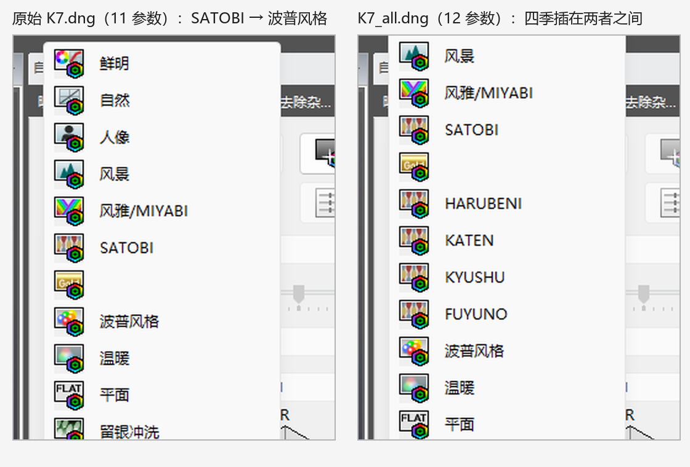
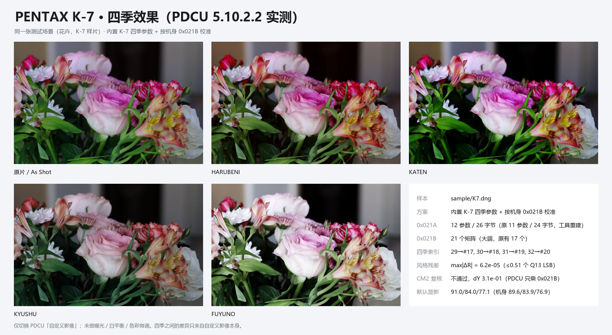

# PENTAX K-7 四季移植（KF 风格表）

日期：2026-11-02

样本：`sample/K7.dng`（13,193,349 B，`Software = Digital Camera Utility 5 Ver.5.10.2`，
由 PDCU 从 PEF 转换而来）。产物：`sample/K7_all.dng`（13,228,440 B），
由 v2.10 的 `--builtin k7` 生成（与 `--builtin kf --allow-cross-model`
的产物逐字节相同），四季矩阵已按 K7 的 `0x021B` 基准校准。
PDCU 5.10.2.2 实测通过。



## 0. 结论

1. **可以照 K20D 的方案做，而且两条主线都适用**：K-7 的 MakerNote 同样是
   EXIF `0x927C` 的 AOC 块、块内偏移是绝对文件偏移；34,002 B 的块里最大空隙
   只有 1 B（合计 8 B），所以和 K20D 一样走 **整块复制到文件尾 + 块内绝对偏移
   按位移重定位 + 改 `0x927C` 的 offset/count** 这条路。raw、1.07 MB 预览、
   缩略图一字节没动，原文件只有 **5 B** 变化。
2. **记录布局是 11 → 12 参数（同 645D），不是 K20D 的 8 → 12**。K-7 只缺
   10 号槽，填 `0xFFFF`；22 条老记录按参数 id 逐字段保留，压回 11 参数后
   **22/22 逐字节相同**。
3. **色彩同构**：`Y = inv(M_KF[0])·M_K7[0]`，
   `M_K7(季节) = M_KF(季节)·Y`。量化后四条相对风格
   `R = M·inv(M_base)` 与 KF 的最大差 **6.2×10⁻⁵（≤0.51 个 Q13 LSB）**。
   直接照抄 KF 矩阵而不乘 Y，`max|R−R_KF|` 会到 **1.2×10⁻¹～2.5×10⁻¹**。
4. **K-7 的 CM2 互证不通过（dY = 3.1×10⁻¹）**，与 K10D（2.7×10⁻¹）同类；
   这不是移植误差：K-7 与 KF 的 **mode-0 相对风格逐项相同（1.1×10⁻¹⁶）**，
   说明 `Y` 是纯输入校准，而 PDCU 只乘 `0x021B`（见
   [`PDCU-AsShot基准矩阵验证.md`](PDCU-AsShot基准矩阵验证.md)）。
5. **PDCU 5.10.2.2 实测**：原文件 11 参数时“自定义影像”里没有四季；重建成
   12 参数后，HARUBENI / KATEN / KYUSHU / FUYUNO 出现在 **SATOBI 与波普风格
   之间**。marker 测试（把 #17–#20 换成纯 R / 纯 G / 纯 B / 单位矩阵）证明
   PDCU 读的就是写进去的矩阵，而不是它自己的内置数据。
6. **默认显影变化很小**：原文件 As Shot 88.9/81.6/77.3，重建后
   91.0/84.0/77.1（机身 JPEG 预览 89.6/83.9/76.9），差 ≤2.4；
   参数 10 填 `0` 或 `0xFFFF` 渲染逐像素相同。

一句话：**能参考，方法几乎逐条照搬；K-7 只是把 K20D 的“8→12”换成
“11→12”，把 K20D 的专用矩阵换成按 K-7 基准算出的矩阵。**

## 1. 样本解剖

### 1.1 文件身份

| 项目 | 值 |
|---|---|
| 机型 / 唯一机型 | `PENTAX K-7` / `PENTAX K-7` |
| 写入者 | `Digital Camera Utility 5 Ver.5.10.2` |
| 文件时间 / 拍摄时间 | 2026-11-02 21:25:45 / 2023-12-24 12:42:57 |
| DNG 版本 | 1.2.0.0 |
| 镜头 | DA70mmF2.4 Limited（70 mm，35 mm 等效 105 mm） |
| ISO / 快门 / 光圈 | 250 / 1/60 s / F4.0 |
| raw / 预览 | 4736×3136 / 4672×3104 |
| 尺寸 | 13,193,349 B |
| SHA-256 | `2727D91AD2C735499AF717B26C139EF2C90E429C1D5E71901FA43AEF86707CFC` |

K-7 是 2009 年的机身，机内只写 PEF；这份 `.dng` 是 PDCU 5.10.2 的转换产物，
所以 MakerNote 落在 EXIF `0x927C` 的 “AOC” 容器里、内部偏移是绝对文件偏移，
与 K20D 完全同一条解析分支。

### 1.2 私有块

| 项目 | K-7 | K20D（对照） | 645D（对照） |
|---|---:|---:|---:|
| 容器 | EXIF MakerNote `0x927C`（`AOC\0`） | 同左 | DNGPrivateData `0xC634` |
| 位置 / 长度 | 0x80E..0x8CE0，**34,002 B** | 0x80E..0x66E6，24,280 B | 102,400 B |
| 私有字节序 | **大端** `MM` | 大端 | 大端 |
| 私有 IFD 条目 | 94 | 96 | — |
| 偏移基准 | 绝对文件偏移 | 绝对文件偏移 | 相对块首 |
| `0x021A` | 674 B，nParams=**11**，nRecords=**22**，**24 B/条** | 434 B，8，20，18 B/条 | 602 B，11，24，24 B/条 |
| 参数 id | `1..9,128,129` | `1..6,128,129` | `1..9,128,129` |
| `0x021A` 记录后预留 | **120 B** | 54 B | 0 B |
| `0x021B` | 310 B，**17** 个 18 B 矩阵 | 274 B，15 个 | 310 B，17 个 |
| `0x021A` 之后空隙 | **0 B**（紧接 `0x021B`） | 0 B | 2 B |
| `0x021B` 之后空隙 | **0 B**（紧接 `0x021C`） | 0 B | 0 B |
| 块内 1 B 对齐缝 | 8 处，合计 **8 B** | 5 处，合计 5 B | 有 2 B 缝 |
| 原生四季 | 无 | 无 | 无 |

`0x021A` 的 674 B 里，记录区是 26 + 22×24 = 554 B，后面有 **120 B 预留**
（正好是 5 条 24 B 记录的空间）。这 120 B 看起来像是给“再加几个模式”留的，
但 12 参数方案需要 704 B：老记录每条从 24 B 涨到 26 B（+44 B），再加 4 条
新记录（+104 B），合计 **+148 B**，比 120 B 多 28 B；而且 `0x021A` 的 tag
一旦变长，就会压到紧邻的 `0x021B`。所以**预留不够，仍然必须搬块**。

### 1.3 文件级布局（没有一处空隙）

| 范围 | 内容 | 长度 |
|---|---|---:|
| 0x8..0x6AC | IFD0 + 其数据（含 `0xC621`/`0xC622`） | 1,700 B |
| 0x6AC..0x80E | EXIF IFD + 其数据 | 354 B |
| **0x80E..0x8CE0** | **AOC MakerNote（被整块搬走的那块）** | **34,002 B** |
| 0x8CE0..0x9662 | SubIFD0 的 IFD、tile 表与小标签 | 2,434 B |
| 0x9662..0x9726 | SubIFD1 的 IFD | 196 B |
| 0x9726..0x10EB47 | SubIFD1 单条 JPEG（**1,070,113 B，4672×3104**，全尺寸预览） | 1,070,113 B |
| 0x10EB47..0x11CC47 | IFD0 缩略图（160×120 RGB，120 条 strip × 480 B） | 57,600 B |
| 0x11CC47..0xC95085 | SubIFD0 的 256 个 tile = **raw**（4736×3136，CFA，12.03 MB） | 12,026,942 B |
| 0xC95085 | 文件尾 | — |

预览尾 0x10EB47 正好是缩略图首字节，缩略图尾 0x11CC47 正好是第一个 raw tile，
raw 的最后一个 tile 结束于 0xC95085 = EOF。**文件里没有可借用的空闲区**，
这与 K20D（块前、块后都紧排）一致，也是走整块重建的原因。

### 1.4 模式表内容

22 条记录，id 为 `0,1,16,17,18,20,19,2..15,23`；矩阵索引（记录倒数第二个 u16，
即参数 128）只用到 **#0–#7**：

```
id : index
0:0  1:1  16:2  17:3  18:4  20:5  19:7  2:2  3:3  4:0  5:1
6:2  7:1  8:1  9:1  10:1  11:2  12:1  13:1  14:0  15:1  23:6
```

矩阵 **#8–#16 没有被任何记录引用**（三行相同的数码滤光镜矩阵一类）。
本方案不碰它们，只在表尾追加 **#17–#20** 给四季用。

## 2. 色彩：为什么可以精确移植

### 2.1 基准矩阵与 Y

```
M_K7[0] = Q13 (11744, -2624, -928, -832, 10304, -1280, 352, -3136, 10976)
        = [ 1.43359 -0.32031 -0.11328 ]
          [-0.10156  1.25781 -0.15625 ]
          [ 0.04297 -0.38281  1.33984 ]

M_KF[0] = Q13 (12800, -5248, 640, -1664, 12256, -2400, 320, -3648, 11520)
        = [ 1.56250 -0.64062  0.07812 ]
          [-0.20312  1.49609 -0.29297 ]
          [ 0.03906 -0.44531  1.40625 ]

Y = inv(M_KF[0]) · M_K7[0]
  = [ +0.942911 +0.147807 -0.090717 ]
    [ +0.065021 +0.860018 +0.074962 ]
    [ +0.024953 -0.003989 +0.979036 ]
```

`max|Y−I| = 0.1478`，非对角项合计 0.407——K-7 的输入色彩空间与 KF 差得比
K20D（0.097 / 0.36）还多一点。K-7 的 mode-0 矩阵每行也精确归一（行和 = 1.0）。

### 2.2 CM2 互证：本样本不通过，但不影响 PDCU

用两台各自的 DNG `ColorMatrix2` 构造
`T = diag(1/(CM2·W_D65))·CM2`，再算 `T(KF)·inv(T(K-7))`，
与 `0x021B` 得到的 Y 差 **3.06×10⁻¹**：

```
CM2 check: WARNING - the target's 0x021B base and its ColorMatrix2 imply
                     different Y (dY 3.1e-01); using the 0x021B base
```

这比 K20D（2.0×10⁻⁵）、645D（4.0×10⁻⁵）大四个数量级，与 K10D（2.7×10⁻¹）
同类：**这份 DNG 的 ColorMatrix1/2 与它自己的 `0x021B` 不是同一套标定**。

它不影响移植，理由不是“相信 `0x021B`”这种口头判断：

- K-7 与 KF 的 **mode-0 相对风格完全相同**（22 个同名模式里 mode 0 的
  `|R_K7 − R_KF|` = **1.1×10⁻¹⁶**，就是 0）。也就是说两台的 Bright 基准
  只差一个输入校准 Y；`Y = inv(M_KF[0])·M_K7[0]` 是构造出来的精确解，
  不依赖 CM2。
- PDCU 只乘 `0x021B`，不读 `0xC621`/`0xC622`：见
  [`PDCU-AsShot基准矩阵验证.md`](PDCU-AsShot基准矩阵验证.md) 的四份单变量 DNG
  实验（改 CM1/CM2 输出 0 个像素变化，改 `0x021B[0]` 立即生效）。
- K10D 已经有同类的 CM2 失配（0.27），四季仍然在 PDCU 里正常工作。

边界：Lightroom / RawTherapee 之类会用 ColorMatrix，对它们的色彩而言这份 DNG
本来就“名不副实”——但这类软件不读四季，与本方案无关。

注意：用 `--builtin k7` 时日志会显示 `CM2 check: pass (dY 9.5e-07)`，
这是同一机身两侧相抵的 vacuous pass，不代表这份文件的 CM2 与 `0x021B`
一致；真实的 0.31 失配要用 `--builtin kf`（或任何别家 donor）才会打印出来。

### 2.3 风格表是旧一代

22 个同名模式的 `R = M·inv(M_base)` 中位差 **7.63×10⁻²**、最大
**1.51×10⁻¹**（K20D 是 7.7×10⁻²，645D 是 7.3×10⁻²；K-3 / 645Z / K-S2 / KP
都在 10⁻⁵ 量级）。所以 K-7 用的是**旧一代风格表**，不能靠“风格表一致”自动
放行跨机型；和 K20D / 645D / K10D 一样，要用一份专用内置数据。

### 2.4 写出的四季矩阵

| 季节 | 矩阵索引 | Q13（行优先，大端 int16） | 量化残差 | max\|R−R_KF\| |
|---|---:|---|---:|---:|
| HARUBENI | #17 | 12678, −918, −3568, −2124, 13323, −3007, −1762, 1234, 8719 | 0.476 LSB | 5.31×10⁻⁵ |
| KATEN | #18 | 13603, −4013, −1398, −808, 12474, −3474, 1085, −4455, 11562 | 0.433 LSB | 3.57×10⁻⁵ |
| KYUSHU | #19 | 13020, −5271, 443, 1231, 6646, 315, 119, 420, 7654 | 0.440 LSB | 5.89×10⁻⁵ |
| FUYUNO | #20 | 8301, 516, −624, −214, 8444, −37, 586, 559, 7046 | 0.494 LSB | 6.20×10⁻⁵ |

相对风格 `R = M·inv(M_base)`：

| 季节 | R |
|---|---|
| HARUBENI | `[[1.0948, 0.1233, -0.2181], [-0.0897, 1.2280, -0.1383], [-0.1512, 0.3309, 0.8202]]` |
| KATEN | `[[1.1518, -0.1091, -0.0427], [0.0188, 1.1607, -0.1796], [0.0539, -0.1002, 1.0463]]` |
| KYUSHU | `[[1.0912, -0.2004, 0.1092], [0.1522, 0.7220, 0.1258], [0.0070, 0.2643, 0.7288]]` |
| FUYUNO | `[[0.7231, 0.2442, 0.0328], [0.0397, 0.8601, 0.1003], [0.0489, 0.2730, 0.6779]]` |

与 645D、K20D、K10D 写出的四条 R 逐项一致（差在 10⁻⁵ 量级），即 KF / K-1
的四季签名。

**反例（为什么不校准不行）**：把 KF 四季矩阵原样写进 K-7 的 `0x021B`，

| 季节 | 直抄的 max\|R−R_KF\| |
|---|---:|
| HARUBENI | 2.04×10⁻¹ |
| KATEN | 2.43×10⁻¹ |
| KYUSHU | 2.50×10⁻¹ |
| FUYUNO | 1.15×10⁻¹ |

直抄偏差比 K20D / 645D（都是 0.6–1.3×10⁻¹）还大，所以这份机身更不能省 Y。

## 3. 记录布局：11 → 12 参数

### 3.1 参数 id 是子集关系

```
K-7:   1 2 3 4 5 6 7 8 9     128 129        (11)
KF:    1 2 3 4 5 6 7 8 9 10  128 129        (12)
```

按**参数 id**映射（不是按位置）。K-7 只缺 **10 号槽**，填 `0xFFFF`——这正是
KF 自己记录里的“未设置”值；其余槽原样保留，矩阵索引（128 号）含义不变。

实测往返：把新表里的 22 条老记录按参数 id 压回 11 参数，与原始记录
**22/22 逐字节相同**：

| 记录 | 原始（11 参数 / 24 B） | 重建（12 参数 / 26 B） |
|---|---|---|
| id 0 | `00000001000100030001ffffffff00000000000000000000` | `00000001000100030001ffffffff000000000000ffff00000000` |
| id 23 | `0017ffffffff0001ffffffffffff00000000000000060001` | `0017ffffffff0001ffffffffffff000000000000ffff00060001` |

四季记录直接沿用 KF 的 12 参数记录（大端，矩阵索引改成 17–20）：

| 模式 | 名称 | 记录（hex） | 索引 |
|---:|---|---|---:|
| 29 | HARUBENI | `001d000100020003ffffffffffff00000000fffe000400110000` | 17 |
| 30 | KATEN | `001e0001000800040001ffffffff00000003fffdffff00120000` | 18 |
| 31 | KYUSHU | `001f0001000400010001ffffffffffff0000ffffffff00130000` | 19 |
| 32 | FUYUNO | `00200001000800040001ffffffff0003fffc0004ffff00140000` | 20 |

（与 `season_common.K30_SERIES_RECORDS` 相同，也就是 645D / K20D / K10D
内置数据用的四条。）

### 3.2 12 参数是硬要求

同一台 PDCU 5.10.2.2、同一张 K-7 图：

| 文件 | `0x021A` 布局 | 结构检查 | 自定义影像菜单 |
|---|---|---|---|
| 原始 `K7.dng` | 11 参数 / 24 B（22 条） | 22 条记录 / 17 矩阵 | **看不到四季** |
| `K7_all.dng` | 12 参数 / 26 B（26 条） | 26 条记录 / 21 矩阵 | **HARUBENI / KATEN / KYUSHU / FUYUNO 全部出现** |

与 645D（11 → 12）、K20D（8 → 12）、K10D（5 → 12）的结论一致：PDCU 的四季
判定走 12 参数这条解析路径。

## 4. 空间：为什么必须整块搬

### 4.1 需要多少

| 表 | 旧 | 新 | 差 |
|---|---:|---:|---:|
| `0x021A` | 2 + 2×11 + 2 + 22×24 = **674 B** | 2 + 2×12 + 2 + 26×26 = **704 B** | +30 B |
| `0x021B` | 4 + 17×18 = **310 B** | 4 + 21×18 = **382 B** | +72 B |
| 合计 | 984 B | **1,086 B** | +102 B |

### 4.2 现有可用空间

| 位置 | 空隙 |
|---|---:|
| `0x021A` 标签尾 0x10C8 → `0x021B` 首 0x10C8 | **0 B** |
| `0x021B` 标签尾 0x11FE → `0x021C` 首 0x11FE | **0 B** |
| 私有 IFD 结尾 0xC82 → 首个数据标签 0x0200 首 0xC82 | **0 B** |
| 块内 1 B 对齐缝（8 处） | 合计 **8 B** |
| 块尾 0x8CE0 → SubIFD0 | 0 B |
| 文件其它位置 | 无（见 1.3 节） |

`0x021A` 的 120 B 预留只够**保持 11 参数**时追加 5 条 24 B 记录；12 参数要
把 22 条老记录各加 2 B，再追加 4 条 26 B 记录，合计 +148 B，超出 28 B；
`0x021B` 还要 +72 B。两条表都必须在块内另找连续空间，而块内最大连续空隙
只有 1 B。

### 4.3 采用方案：整块重建到文件尾

| 方案 | 做法 | 文件增量 | 改动面 | 结论 |
|---|---|---:|---|---|
| **整块重建**（采用） | 复制 34,002 B 的 AOC 块到 EOF，按 `delta` 重定位块内所有绝对偏移，在块尾追加两张新表，改 EXIF `0x927C` 的 offset/count | +35,091 B | 原文件只有 **5 B** 变化 | 已实现、已验证、PDCU 接受 |
| 块尾插入 + 全局重定位 | 在 0x8CE0 插入约 1,086 B，把其后所有 TIFF 偏移整体 +`delta`（SubIFD0 的 256 个 TileOffsets、SubIFD1 的 StripOffset、缩略图的 120 个 StripOffsets……） | +1,086 B | 约 400 个偏移字段 | 省 34 KB，但漏改一处就是静默坏图；不采用 |
| 数据放文件尾、只改两个条目 | 追加 1,086 B，把两个条目指过去 | +1,086 B | 2 个条目 | tag 数据落在 `0x927C` 声明范围外；工具解析器直接拒绝，不采用 |

### 4.4 结果

| 项目 | 值 |
|---|---|
| 块位置 / 长度 | 0xC95088..0xC9D998，**35,088 B**（旧 0x80E，34,002 B，+1,086） |
| `0x021A` | 0xC9D55A..0xC9D81A，**704 B**，26 条 |
| `0x021B` | 0xC9D81A..0xC9D998，**382 B**，21 个矩阵 |
| 文件大小 | 13,193,349 → **13,228,440 B（+35,091）** |
| 0xC95085..0xC95088 | 3 B 对齐填充 |
| 原文件前 13,193,349 B 的差异 | **只有 5 B**：0x736/0x737（`0x927C` count）、0x73A–0x73C（`0x927C` offset） |
| 旧块 0x80E..0x8CE0 | 原样保留（无引用，死区） |
| 新块内其它 92 个私有标签 | 逐字节相同，只是绝对偏移随块搬移（`0x021A`/`0x021B` 两个条目改指新表） |

逐字节校验（与 K20D 同一套）：

| 检查 | 结果 |
|---|---|
| 复制块除“所有非 inline 条目的 value 偏移 +delta”外 | 逐字节相同 |
| raw（256 个 tile，12,026,942 B） | 逐字节相同，tile 偏移/长度未变 |
| 全尺寸预览（1,070,113 B） | 逐字节相同 |
| 缩略图（120 条 strip，57,600 B） | 逐字节相同，strip 偏移/长度未变 |
| 上述三类 payload 合计 13,154,655 B | 377 个范围全部逐字节相同 |
| 工具 `verify_output()` | 通过（块位置/长度/文件尾、其它私有标签 SHA-1 指纹、记录数/矩阵数/索引） |

产物 SHA-256：
`2898150290DF0CC2E6915418A0532BD35091795A20749AF94DBA100F128CE7EC`。

## 5. PDCU 实测（5.10.2.2）

### 5.1 菜单


打开 `K7_all.dng`，Laboratory 的“自定义影像”下拉里，四项按
`HARUBENI → KATEN → KYUSHU → FUYUNO` 排在 **SATOBI 之后、波普风格之前**；
原文件同一位置是 SATOBI 直接接波普风格（见文首对照图）。

### 5.2 marker 验证：PDCU 读的是我们写的矩阵

把产物里四个季节矩阵换成纯 R / 纯 G / 纯 B / 单位矩阵，
同一 PDCU 里点这四项：

| 点击位置 | 渲染均值 R/G/B | 说明 |
|---|---|---|
| HARUBENI（#17） | 115.8 / **0.0** / 0.0 | 纯红 → 矩阵 #17 生效 |
| KATEN（#18） | 0.0 / 106.5 / **0.0** | 纯绿 → 矩阵 #18 |
| KYUSHU（#19） | 0.0 / 0.0 / 91.1 | 纯蓝 → 矩阵 #19 |
| FUYUNO（#20） | 119.2 / 114.0 / 105.1 | 单位矩阵 → 明显偏亮的中性 |

说明 PDCU 既读 `0x021A` 的记录（决定菜单项），也读 `0x021B` 的矩阵
（决定画面），而且索引 17–20 对得上。单位矩阵那一行（119.2/114.0/105.1）
比 As Shot（91.0/84.0/77.1）亮，说明四季的“提亮”不只来自矩阵：记录里的
其它参数（对比度/色调曲线）也在起作用；FUYUNO 的真实矩阵本来就接近单位
矩阵（Q13 对角 8301/8444/7046 ≈ 1.01/1.03/0.86），所以它的画面与单位矩阵
那一行非常接近（119.9/113.8/107.1），这是正常的。

### 5.3 默认显影（As Shot）

| 渲染 | R | G | B | 与机身 JPEG 预览的差 |
|---|---:|---:|---:|---:|
| 机身 JPEG 预览（4672×3104） | 89.6 | 83.9 | 76.9 | — |
| 原始 `K7.dng`（11 参数，PDCU） | 88.9 | 81.6 | 77.3 | −0.7 / −2.3 / +0.4 |
| 重建后 `K7_all.dng`（12 参数，PDCU） | 91.0 | 84.0 | 77.1 | **+1.4 / +0.1 / +0.2** |

重建把 G/B 拉得更贴近机身预览，R 略高；总变化 ≤2.4，远小于 645D 那次
（11 参数 122.1/81.4/70.1 → 12 参数 158.9/115.4/98.6），也没有 K20D 的
“填充值把画面抬亮变平”的问题。

**参数 10 的填充值 A/B**：把 22 条老记录的 10 号槽从 `0xFFFF` 改成 `0`，
As Shot 仍是 91.0/84.0/77.1，逐像素相同。也就是说 K-7 上这个补出来的槽
不参与默认显影（与 645D 的结论一致）。

### 5.4 四季相对 As Shot 的变化



同一张图、只切换“自定义影像”，抓同一视口（27.74%，1219×789）取 R/G/B 均值：

| 季节 | K-7 均值 | K-7 Δ% (R/G/B) | KF 均值（同 PDCU，KF 机身） | KF Δ% | 方向 |
|---|---|---|---|---|---|
| As Shot | 91.0 / 84.0 / 77.1 | — | — | — | — |
| HARUBENI | 95.5 / 77.2 / 71.2 | **+4.9 / −8.1 / −7.7** | 105.5 / 94.2 / 85.8 | +5.1 / −6.2 / −4.1 | 暖（B 降）✅ |
| KATEN | 88.4 / 78.3 / 72.3 | −2.9 / −6.8 / −6.2 | 93.2 / 92.9 / 82.5 | −7.2 / −7.5 / −7.8 | 暖而略暗 ✅ |
| KYUSHU | 80.6 / 75.5 / 71.0 | **−11.4** / −10.1 / −7.9 | 88.4 / 91.9 / 86.5 | **−12.0** / −8.5 / −3.4 | 冷 / 低饱和 ✅ |
| FUYUNO | 119.9 / 113.8 / 107.1 | +31.8 / +35.5 / **+38.9** | 139.7 / 133.9 / 130.9 | +39.1 / +33.4 / **+46.3** | 明显提亮 ✅ |

四条的方向与 KF 一致，“哪个通道变化最大”也一致（HARUBENI 的 B、KYUSHU 的 R、
FUYUNO 的 B）。绝对值不能跨照片比较；K-7 这张是暗背景花卉，幅度与 KF 的
亮场景不同是正常的。

## 6. 与 K20D 方案逐项对照

| K20D 方案的做法 | K-7 | 说明 |
|---|---|---|
| `0x021A` 重建成 12 参数 / 26 B | **照搬** | 11 → 12，只缺 10 号槽 |
| `Y = inv(M_KF[0])·M_body[0]`，四季矩阵乘 Y | **照搬** | R 残差 ≤0.51 LSB |
| 专用内置数据（`season_k20d_data.py`，Y=I） | **已实现（`season_k7_data.py`）** | v2.10 新增 `--builtin k7`；与 `--builtin kf` + 运行时校准的产物逐字节相同 |
| `0x021A`/`0x021B` 搬出原位 | **照搬** | 旧位只有 0 B / 0 B，必须搬 |
| 整块复制到文件尾 + 重定位绝对偏移 + 改 `0x927C` | **照搬，同一条代码路径** | 容器、字节序、绝对偏移、块内无空隙全部相同 |
| 文件 +25,280 B | **+35,091 B** | 块更大（34,002 vs 24,280），新表 +1,086 |
| 原文件改 5 B | **5 B** | 同样的 `0x927C` count/offset |
| 逐字节校验 raw / 预览 / 缩略图 | **照搬，全部通过** | 第 4.4 节 |
| PDCU 菜单 + 四项渲染 + marker + As Shot | **照搬，全部通过** | 第 5 节 |
| 新增槽 `0,0,0,0xFFFF`（K20D 的修正） | **只补 10 号 = FFFF** | 0 与 FFFF 逐像素相同 |
| CM2 互证 | **不通过（3.1×10⁻¹）** | 元数据问题；K-7 的 mode-0 R 与 KF 相同，Y 仍精确 |

## 7. 工具与复现

**v2.10 已内置**：新增 `tools/season_k7_data.py`（`BASE_MATRIX` = K-7 的
mode-0，四季矩阵已是 K-7 色彩空间，目标 `Y=I`），并在
`dng_season_params.py` 注册了 `MODEL_TO_DONOR_KIND['PENTAX K-7'] = 'k7'`、
`BUILTIN_SOURCES['builtin_k7']`（“内置 K-7”）、`AUTO_SELECT_GROUPS`、
`_BUILTIN_DATA_MODULES['k7']` 与 `--selftest-k7`；GUI 的来源行是数据驱动，
自动多出第 7 行。写入路径没有新代码：`plan_patch` 在块内找不到连续空位时
回落到 `plan_rebuild_makernote()`。

```powershell
# 结构检查（11 参数 / 24 B、22 条、17 矩阵、缺 29-32）
python tools\dng_season_params.py --target sample\K7.dng --list

# 生成（自动整块重建 MakerNote；内置 K-7 数据，Y=I）
python tools\dng_season_params.py --target sample\K7.dng --builtin k7 ^
    --out sample\K7_all.dng --overwrite

# 交叉校验：内置 KF + 运行时校准，产物应与上面逐字节相同
python tools\dng_season_params.py --target sample\K7.dng --builtin kf ^
    --allow-cross-model --out sample\K7_all_kf.dng --overwrite

# 隐藏自检（与发布版同一入口）
python tools\dng_season_gui.py --selftest-k7 sample\K7.dng out.dng
```

产物：13,228,440 B，
SHA-256 `2898150290DF0CC2E6915418A0532BD35091795A20749AF94DBA100F128CE7EC`。

内置数据模块 `tools/season_k7_data.py` 与 `season_k20d_data.py` 同构：

```python
from season_common import (BLOCK_SIZE, K30_SERIES_RECORDS, N_PARAMS,
                           REC_SIZE, TABLE_PARAMS)

MODEL = 'PENTAX K-7'
UNIQUE_MODEL = 'PENTAX K-7'
BLOCK_COUNT = 4
PRIV_ENDIAN = '>'
BASE_MATRIX = (11744, -2624, -928, -832, 10304, -1280, 352, -3136, 10976)
CM2 = (0.877792, -0.269806, -0.061401,
       -0.418549, 1.111801, 0.274719,
       -0.086838, 0.138474, 0.877991)   # 与 0x021B 失配 0.31，仅作跨机型提示
RECORDS = dict(K30_SERIES_RECORDS)       # 大端，索引 0..3
MATRICES = {0: bytes.fromhex('3186fc6af210f7b4340bf441f91e04d2220f'),
            1: bytes.fromhex('3523f053fa8afcd830baf26e043dee992d2a'),
            2: bytes.fromhex('32dceb6901bb04cf19f6013b007701a41de6'),
            3: bytes.fromhex('206d0204fd90ff2a20fcffdb024a022f1b86')}
```

`--selftest-k7` 的参考 SHA-256 就是上面那份 PDCU 实测文件：
`2898150290DF0CC2E6915418A0532BD35091795A20749AF94DBA100F128CE7EC`
（13,228,440 B）。内置路径与 `--builtin kf --allow-cross-model` 的产物
**逐字节相同**，已在本机验证。

本次分析脚本（`.tmp` 未入库）：

```powershell
python .tmp\k7_probe.py       # 结构探针
python .tmp\k7_math2.py       # Y、四季矩阵、量化残差
python .tmp\k7_verify2.py     # 逐字节完整性 / payload 范围
python .tmp\k7_naive.py       # 直抄 vs 校准的 R 偏差
python .tmp\k7_marker_build.py / k7_marker_run.py   # marker 验证
python .tmp\k7_real_run.py    # PDCU 四季抓图
```

## 8. 边界与未验证

- **单样本、单 PDCU 版本**：只验证了一张 PDCU 5.10.2 转换的 K-7 文件；
  不同 PDCU 版本、不同拍摄设置的块大小/偏移可能不同。工具全部运行时探测，
  没有硬编码 0x80E / 34,002 / 94 条目。
- **CM2 失配（3.1×10⁻¹）是这份 DNG 的元数据问题**，不是移植问题；拿它去
  Lightroom 等读 ColorMatrix 的软件，色彩会与 PDCU 不一致（这类软件也不读四季）。
- **12 参数升级会让默认显影轻微变化**（88.9/81.6/77.3 → 91.0/84.0/77.1），
  方向是更贴近机身预览的 G/B；如果不希望任何默认显影变化，需要先在 PDCU 里
  做 A/B 再决定是否采用。
- **MakerNote 被搬到文件尾**（与 K20D 相同）；ExifTool / Lightroom /
  RawTherapee 对“MakerNote 在文件尾”的文件怎么读，未测。
- **再另存未测**：`K7_all.dng` 经 PDCU 另存后四季是否保留，未验证。
- **没测把改过的 DNG 写回相机或在 K-7 机身回放**。
- K-7 的 120 B 表内预留只够 5 条 11 参数记录，不够 12 参数；如果将来找到
  PDCU 版本能在 11 参数下识别四季，可以回到更小的改法。

---

版权所有 © 2026 KimHoLau X deepseek harness

