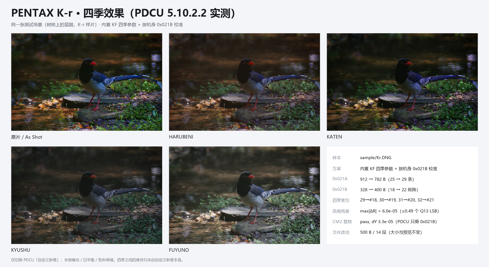

# PENTAX K-r 四季移植：能否照搬 K-5 方案

日期：2026-11-06

样本：

- sample/Kr.DNG（PENTAX K-r，10,091,306 B）
- 对照：sample/K5.DNG、sample/Kx.DNG、内置 season_kf_data.py
- 产物：.tmp/Kr_all.dng（SHA-256 6F533F24…F786A5）

---

## 0. 结论

**K-5 的“写入路径 + KF×Y 配方”可以照搬；K-5 的 0x021B 矩阵值和文件偏移不能照搬。**

- **结构层：可以。** K-r 与 K-5 同为 DNGPrivateData 0xC634、大端、相对偏移，
  私有块同为 0x37E..0x1937E（102,400 B）；0x021A 都是 12 参数 / 25 条 / 26 B，
  0x021B 都是 18 个矩阵，且 0x021B 后面都没有空隙。K-5 那套
  “0x021A 缩短 + 0x021B 搬进释放尾部”的紧凑布局可以直接复用。
- **0x021A 记录：可以。** K-r 的 25 条模式记录与 K-5、K-5 II **逐字节相同**
  （25/25）；四季记录也都来自 KF，所以记录表本身可以照搬。
- **0x021B 矩阵：不可以。** K-r 的基准矩阵和 K-5 不同，Y(K-r) 与 Y(K-5) 差
  1.57×10⁻¹；必须用 K-r 自己的 0x021B 重算 M_KF季节 · Y(K-r)。
  直接搬 K-5 的矩阵会把 K-5 的输入空间套到 K-r 上。
- **偏移：不可以。** K-r 的 0x021A 在 0x932（2,354），0x021B 在 0xCC2（3,266）；
  K-5 是 0xA32（2,610）/ 0xE5E（3,678）。同一个私有块起点，但表更短，
  绝对偏移整体不同。
- **PDCU：实测可用。** PDCU 5.10.2.2 打开补丁后的 K-r DNG，菜单列出
  HARUBENI / KATEN / KYUSHU / FUYUNO 四项；四项画面都改变（相对 As Shot
  的平均像素差 6.82–24.70），说明记录和矩阵都参与了渲染。
- **落地：按 A 档（有 0x021B）处理，数据源 kf，写入路径同 K-5，Y 用 K-r 自己的。**
  CLI 与 GUI 都已登记（MODEL_TO_DONOR_KIND / AUTO_SELECT_GROUPS），
  不需要新数据模块；输出与登记前逐字节相同。

一句话：**K-r 是“K-5 的写入路径 + 自己的 Y”，不是“K-5 的矩阵复制”。**

---

## 1. 结构：K-r 更像 K-5，而不是 K-x

| 项目 | K-r（sample/Kr.DNG） | K-5（sample/K5.DNG） | K-x（sample/Kx.DNG） |
|---|---|---|---|
| 机型 | PENTAX K-r | PENTAX K-5 | PENTAX K-x |
| 容器 | DNGPrivateData 0xC634，相对偏移 | 同 | 同 |
| 私有块 | 0x37E..0x1937E（102,400 B） | 同 | 0x372..0x19372（102,400 B） |
| 私有块字节序 | 大端 | 大端 | 大端 |
| 0x021A | **912 B / 25 条 / 12 参数 / 26 B，234 B 填充** | 1,068 B / 25 条 / 12 参数 / 26 B，390 B 填充 | 578 B / 23 条 / **11 参数 / 24 B**，无填充 |
| 0x021B | 328 B / 18 矩阵 | 328 B / 18 矩阵 | 292 B / 16 矩阵 |
| 0x021A 记录 | 与 K-5 **25/25 逐字节相同** | — | 与 K-5 不同（11 参数布局） |
| 0x021B 基准 #0 | 1.484375 / -0.484375 / 0 … | 1.527344 / -0.531250 / 0.003906 … | 1.535156 / -0.441406 / -0.093750 … |
| 机型 ID（0x0004 / 0x0005） | 0x8642 / 0x12E6C | 0x87E2 / 0x12E76 | 0x8BAE / 0x12DFE |

结论：K-r 虽然和 K-x 同代（2010 年的入门机），但它的 0x021A 已经升级为
**12 参数 / 26 字节**，和 K-5 同构；K-x 的 11 参数 / 24 字节布局反而更老。
所以 **K-5 的方案是正确类比，K-x 的方案不是**。

两个 0x021A 标签的完整 SHA-256 不同（K-r 的表长 912，K-5 是 1,068），
但记录区 0..24 逐字节相同；差异只在尾部填充（K-r 234 B，K-5 390 B）。
K-r 的填充同样**不是空的**（11 种字节值），和 K-5 一样需要留意。

---

## 2. 校准：Y(K-r) 是新的，不是 K-5 的

    Y(K-r) = inv(M_KF[0]) · M_Kr[0]
           = [ 0.969397   0.063106  -0.032503 ]
             [ 0.050376   0.911111   0.038513 ]
             [ 0.025136   0.008988   0.965877 ]

- max|Y−I| = 8.89×10⁻²，是 K-5 的 Y（max|Y−I|≈9.6×10⁻²）之外的另一组校准；
- K-r 的 18 个 0x021B 矩阵与 K-5 的最大差 0.288；这不是风格不同，而是 Y 不同；
- 与 Y(K-5) 的最大差 1.57×10⁻¹，所以 **K-5 写出的 72 B 四季矩阵不能直接用**；
- 与 KF 的风格检查：25 个共有模式，R 中位数 6.7×10⁻⁵，最大 1.53×10⁻¹
  （#2 / #8 两个特例），style_ok = True；
- ColorMatrix2 复核：由 CM2 反推的 Y 与 0x021B 的 Y 只差 3.3×10⁻⁵，pass；
- 四季 R 与 KF 的差：HARUBENI 5.9×10⁻⁵、KATEN 4.5×10⁻⁵、
  KYUSHU 6.0×10⁻⁵、FUYUNO 2.4×10⁻⁵，全部小于 1 个 Q13 LSB。

逐模式残差与 K-5 同型：除 #2（0.231）和 #8（1.304）外，其余 23 个模式
的 M_Kr = M_KF · Y 残差中位数 9.0×10⁻⁵。四季使用新增的 #18–#21，
不经过 #2 / #8，所以两个特例不影响四季。

---

## 3. 实际写入方案

| 标签 | 原 | 新 | 位置 |
|---|---|---|---|
| 0x021A | 912 B / 25 条 | **782 B / 29 条** | 0x932..0xC40（原址，标签缩短） |
| 0x021B | 328 B / 18 矩阵 | **400 B / 22 矩阵** | 0xCC2 → **0xC40**（搬到 0x021A 尾部释放的空间） |

四季映射：

| 季节 | record id | 矩阵索引 |
|---|---:|---:|
| HARUBENI | 29 | #18 |
| KATEN | 30 | #19 |
| KYUSHU | 31 | #20 |
| FUYUNO | 32 | #21 |

实现细节：

1. K-r 的 0x021A 尾部有 234 B 填充，4 条新记录只需要 104 B，所以记录区放得下；
   新标签 782 B 比原 912 B 短 130 B。
2. 0x021B 后面没有空隙（0x021C 紧接 3,594），所以 400 B 的新矩阵表放到
   0x021A 释放的 0xC40；它占用 0x021A 尾部的 130 B + 旧 0x021B 的前 270 B。
3. 旧矩阵剩余 0xDD0..0xE0A 不再被任何标签引用；0x021B 条目改为
   offset=0xC40、count=400。

逐字节验证：

| 检查 | 结果 |
|---|---|
| 文件大小 | 10,091,306 B，**不变** |
| 改动字节 | **500 B，14 段**，全部在私有块 0x6FD..0xDD0 |
| 私有块外 | 前缀、后缀逐字节相同 |
| 内嵌预览 JPEG | 25,610 B，SHA-256 不变 |
| 其它私有标签 | 95 个标签的 SHA-1 全部不变 |
| 前 25 条记录 / 前 18 个矩阵 | 逐字节相同 |
| 0x0004 / 0x0005 | 机型 ID，未动 |

### 3.1 K-r 的填充也不是空的

K-r 的 234 B 0x021A 尾部填充有 11 种字节值，不是 0xAA/0xFF。工具默认的紧凑布局
会把这段覆盖掉；**PDCU 5.10.2.2 实测没有影响**（见 §4）。这和 K-5 的 390 B
非空填充是同一类风险：如果未来发现固件/其它软件用到这段，应改用保守布局
（保留 912 B 标签、把新 0x021B 放到私有块尾部 35,254 之后的空闲区）。
保守布局没有做 PDCU 实测。

---

## 4. PDCU 5.10.2.2 实测

打开 .tmp/Kr_all.dng 后：

- 拍摄资讯显示 **PENTAX K-r**；
- “自定义影像”菜单在 SATOBI 之后、波普风格之前列出
  **HARUBENI / KATEN / KYUSHU / FUYUNO**；
- 四项分别从 As Shot 起算（独立文件，避免 PDCU 残留上一次选择）：
  - HARUBENI 平均像素差 **6.82**，98.3% 像素 > 2；
  - KATEN 平均像素差 **10.45**，98.9% 像素 > 2；
  - KYUSHU 平均像素差 **9.33**，98.2% 像素 > 2；
  - FUYUNO 平均像素差 **24.70**，98.9% 像素 > 2；
- 状态栏从“未更改”变成“已更改”。

这说明 PDCU 确实读取了追加的 29–32 记录和 #18–#21 矩阵并参与渲染。
As Shot 只做了结构论证：mode 0 记录和矩阵 #0 在补丁前后逐字节相同，
其余 95 个私有标签未变；没有单独做 As Shot 逐像素对比。

---

## 5. 能照搬 / 不能照搬

| 层面 | 结论 | 说明 |
|---|---|---|
| 写入路径（0x021A 缩短 + 0x021B 搬到释放尾部） | **可以** | K-r 与 K-5 同结构，0x021B 后无空隙 |
| 0x021A 记录表（25 条 + 4 条四季） | **可以** | K-r 与 K-5 25/25 逐字节相同 |
| K-5 的 0x021B 四季矩阵 | **不可以** | Y(K-r) 与 Y(K-5) 差 1.57×10⁻¹，必须按 K-r 重算 |
| K-5 的文件偏移（0xA32 / 0xE5E） | **不可以** | K-r 是 0x932 / 0xCC2，标签更短 |
| 0x021A 的 234 B 填充 | **需决策** | K-r 填充非空；紧凑布局已实测，保守布局未实测 |
| K-x 的 11 参数布局方案 | **不适用** | K-r 是 12 参数 / 26 B，和 K-5 同代布局 |
| 机型 ID / UniqueCameraModel | **不能动** | 0x0004 / 0x0005 / 0xC614 |

---

## 6. 工具落地

### 6.1 CLI 今天就能跑

    python tools\dng_season_params.py --target sample\Kr.DNG --builtin kf ^
        --out .tmp\Kr_all.dng --force

工具会打印：

    style check    : pass (25 common modes, median 6.7e-05)
    CM2 check      : pass (0x021B base vs ColorMatrix2, dY 3.3e-05)
    mode table     : 912 -> 782 B (-130), nRecords 25 -> 29
    matrix table   : 328 -> 400 B, matrices 18 -> 22
    season records : 29/HARUBENI, 30/KATEN, 31/KYUSHU, 32/FUYUNO

CLI 能通过，是因为 check_cross_model() 看到 K-r 与 KF 的
style_ok = True，把 KF 当作已校准的跨机型 donor。

### 6.2 GUI 登记（已加入）

GUI 的 _start() 会用 builtin_source_allows() 检查机型；source_for_models()
负责自动选中来源。现在 K-r 已登记：

    donor_kind_for_model('PENTAX K-r')        -> 'kf'
    source_for_models({'PENTAX K-r'})         -> BuiltinSource('builtin_kf', ...)
    builtin_source_allows('builtin_kf','K-r') -> True

改动只有两处：MODEL_TO_DONOR_KIND 加 "PENTAX K-r": "kf"，
AUTO_SELECT_GROUPS 的 KF 校准组加入 "PENTAX K-r"，让单文件也能自动选中
“内置 KF / K-70”。不需要新建 season_kr_data.py：K-r 是有 0x021B 的 A 档机型，
运行时用 season_kf_data.py + Y 即可。

### 6.3 文档 / 测试

- README 适配表已加一行：**PENTAX K-r | A | KF×Y | 6.0×10⁻⁵ | PDCU 5.10.2.2 菜单 + 四季渲染（单场景）**。
- 排名文档已加入 K-r：**#12，75.6，A 档 14 台**。
- 回归测试至少断言：输出 29 条 / 22 矩阵、四季 → #18–#21、前 25 条记录和
  前 18 个矩阵与源文件逐字节相同。
- 如果以后要防填充被误改，可以断言补丁后 0x021A 标签长度为 782。

---

## 7. 风险与边界

1. **只测了 PDCU 5.10.2.2，且只有单场景**（蓝鹊）。其它 PDCU 版本、Lightroom /
   Capture One / dcraw 不保证；As Shot 没有逐像素对比。
2. **K-r 只有一份样本**，0x021A 填充又是非空数据；如果将来出现不同固件/不同
   样本，先跑一遍 --list 与 marker 再批量处理。
3. **不要照搬 K-5 的 0x021B 矩阵**：K-r 的 Y 是独立的，直抄会偏色。四季记录
   可以照搬，矩阵必须按 K-r 重算。
4. **不要照搬 K-x 的 11 参数方案**：K-r 已经是 12 参数 / 26 B，走 K-x 的
   11→12 重建是多余的，甚至会破坏原有布局。
5. **K-r 的 0x021A 填充含义未知**：当前紧凑布局覆盖它，PDCU 实测无影响；
   保守布局未测。
6. **“正确”的定义是“与 KF 风格一致、落在 K-r 自己的 0x021B 色彩空间里”**，
   不是“官方 K-r 四季”。

---

## 8. 复现

| 脚本（.tmp） | 作用 |
|---|---|
| tools/dng_season_params.py | 主工具；--builtin kf 即可产出 .tmp/Kr_all.dng |
| kr_probe.py | 读 K-r / K-5 / K-x 的容器、表结构、矩阵 |
| kr_cmp.py | 逐记录/逐矩阵对比，算 Y 与残差 |
| kr_verify.py | 改动范围、预览哈希、其它标签 digest |
| kr_four.py / kr_cd.py | 逐季独立文件，从 As Shot 起算，抓取四季画面 |
| kr_fig.py | 生成 K-r 四季效果图 |

产物哈希：

    Kr.DNG        2D9944C6D1241A9BDF3A405C01C21632C5EAAA790A41F9A2F7EF110BC0DF6465
    Kr_all.dng    6F533F248A4CED9A679298CE5F5B8EEC12E3891DD4A7B691622244DC65F786A5

---

版权所有 © 2026 KimHoLau X deepseek harness
