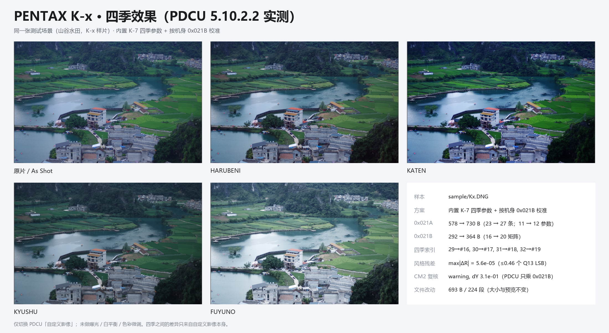

# PENTAX K-x 四季移植：能否照搬 K-r 方案

日期：2026-11-07

样本：

- sample/Kx.DNG（PENTAX K-x，11,974,876 B）
- 对照：sample/K7.dng、sample/K5.DNG、sample/Kr.DNG
- 产物：.tmp/Kx_k7.dng（SHA-256 875591EF…2CB03C92）

---

## 0. 结论

**不能照搬 K-r 的方案。K-x 的结构是“11 参数 → 12 参数重建 + 搬表”，数据源也不是 KF，而是 K-7。**

- **结构层：不能照搬 K-r。** K-r 是 12 参数 / 25 条 / 18 矩阵，0x021A 尾部还有
  234 B 填充，表可以在原址缩短、0x021B 塞进释放的尾部。K-x 是
  **11 参数 / 23 条 / 16 矩阵**，0x021A 只有 578 B、**没有填充**，0x021B 紧接
  其后；必须把记录重建为 12 参数 / 26 B，并把两张表整体搬到私有块尾部。
  K-x 走的是 K-7 / K20D / 645D 那条“重建 + 搬表”路径，不是 K-r 的紧凑追加。
- **数据层：不能用 KF / K-r 的四季表。** K-x 的 0x021B 与 **K-7** 是同一套风格表：
  21 个共有模式，矩阵残差中位数 1.17×10⁻⁴、最大 1.35×10⁻⁴；R 中位数
  7.25×10⁻⁵、最大 8.56×10⁻⁵。与 KF 的差是 **0.124（中位）/ 0.252（最大）**，
  与 K-5 / K-r 是 **0.124 / 0.136**；直抄会换掉整套风格，不是校准问题。
- **正确 donor：内置 K-7。** 用 K-7 的四季记录 + 矩阵，Y = inv(M_K7[0]) · M_Kx[0]；
  四季 R 与 K-7 的差 4.9–5.6×10⁻⁵，全部小于 1 个 Q13 LSB。
- **PDCU：实测可用。** 5.10.2.2 打开补丁后的 K-x DNG，菜单列出四项；
  四项画面都改变（相对 As Shot 的平均像素差 6.23–36.37）。
- **落地：按 A 档处理，donor 用内置 K-7，不用 KF。** CLI 与 GUI 都已登记
  （MODEL_TO_DONOR_KIND / AUTO_SELECT_GROUPS）；输出与登记前逐字节相同。

一句话：**K-x 是“K-7 的 donor + 11→12 重建 + 搬表”，不是“K-r 的 KF donor + 紧凑追加”。**

---

## 1. 结构：K-x 比 K-r 老一代

| 项目 | K-x（sample/Kx.DNG） | K-r（sample/Kr.DNG） | K-7（sample/K7.dng） |
|---|---|---|---|
| 机型 | PENTAX K-x | PENTAX K-r | PENTAX K-7 |
| 私有块 | 0x372..0x19372（102,400 B） | 0x37E..0x1937E（102,400 B） | AOC MakerNote，不同容器 |
| 字节序 | 大端 | 大端 | 大端 |
| 0x021A | **578 B / 23 条 / 11 参数 / 24 B，无填充** | 912 B / 25 条 / 12 参数 / 26 B，234 B 填充 | 674 B / 22 条 / 11 参数 / 24 B，120 B 填充 |
| 0x021B | **292 B / 16 矩阵** | 328 B / 18 矩阵 | 310 B / 17 矩阵 |
| 记录布局 | 11 参数 [1–9,128,129] | 12 参数 [1–10,128,129] | 11 参数 [1–9,128,129] |
| 表位置 | 0x8CA / 0xB0E，紧排 | 0x932 / 0xCC2，紧排 | AOC 块内 |
| 机型 ID | 0x8BAE / 0x12DFE | 0x8642 / 0x12E6C | — |

K-x 与 K-r 虽然都是 2010 年前后的机型，但 K-x 的 0x021A 仍是
**11 参数 / 24 B**，K-r 已经是 12 参数 / 26 B。K-x 没有填充，增长 152 B 后
无法原地放下，所以两张表都要搬。

---

## 2. 风格：K-x 与 K-7 同表，不是 KF

把各机身的 0x021B 按 mode-0 归一化，比较 R = M_mode · inv(M_base)：

| donor | 共有模式 | 矩阵残差中位/最大 | R 残差中位/最大 | 判定 |
|---|---:|---:|---:|---|
| **K-7** | 21 | **1.17×10⁻⁴ / 1.35×10⁻⁴** | **7.25×10⁻⁵ / 8.56×10⁻⁵** | **同一套风格表** |
| K20D | 20 | 5.31×10⁻² / 8.51×10⁻² | 2.90×10⁻² / 5.18×10⁻² | 不同表 |
| 645D | 23 | 9.71×10⁻² / 3.09×10⁻¹ | 5.21×10⁻² / 1.91×10⁻¹ | 不同表 |
| KF | 23 | 1.24×10⁻¹ / 2.52×10⁻¹ | 7.63×10⁻² / 1.51×10⁻¹ | 不同表 |
| K-5 / K-r | 23 | 1.24×10⁻¹ / 1.36×10⁻¹ | 7.63×10⁻² / 8.38×10⁻² | 不同表 |

所以 **K-x 的四季必须用 K-7 的数据**；用 KF 或 K-r 的四季表，等于把另一套
风格（Bright/Natural 等基础表）搬到 K-x 上，色偏不是“校准能救”的量级。

### Y(K-x ← K-7)

    Y = inv(M_K7[0]) · M_Kx[0]
      = [ 1.065119  -0.042536  -0.022583 ]
        [-0.018859   1.163457  -0.144598 ]
        [-0.019138   0.068474   0.950664 ]

- max|Y−I| = 1.63×10⁻¹，比 K-r 的 8.9×10⁻² 大，校准不能省；
- K-7 内置数据是 4 条四季记录 / 4 个矩阵，plan_calibration() 用
  BASE_MATRIX 算 Y；K-x 的 21 个共有模式与 K-7 样本吻合到 1.3×10⁻⁴，
  所以这是一次“同一风格表 × Y”的精确移植；
- ColorMatrix2 复核：K-x 的 0x021B 基准与 CM2 反推的 Y 差 **3.1×10⁻¹**
  （warning，和 K10D / K-7 同类）；PDCU 只乘 0x021B，所以四季仍按 0x021B。

---

## 3. 写入方案：11→12 重建 + 搬表

| 标签 | 原 | 新 | 位置 |
|---|---|---|---|
| 0x021A | 578 B / 23 条 / 11 参数 | **730 B / 27 条 / 12 参数** | 0x8CA → **0xE088**（私有块尾部空闲区） |
| 0x021B | 292 B / 16 矩阵 | **364 B / 20 矩阵** | 0xB0E → **0xE362**（紧随新表） |

四季映射：

| 季节 | record id | 矩阵索引 |
|---|---:|---:|
| HARUBENI | 29 | #16 |
| KATEN | 30 | #17 |
| KYUSHU | 31 | #18 |
| FUYUNO | 32 | #19 |

实现细节：

1. 原有 23 条记录从 11 参数 / 24 B 重新编码为 12 参数 / 26 B；缺失的 10 号槽写
   0xFFFF，其余参数按 id 保留。
2. 4 条四季记录来自 K-7 donor，同样按 12 参数 / 26 B 写入；矩阵用
   M_K7季节 · Y 量化后写到大端。
3. 0x021A 从 578 B 增到 730 B（+152 B），0x021A 后只有 2 B 空隙，原址放不下；
   0x021B 后面是 0x021C（3,122），也没有空隙。因此两张表一起搬到私有块尾部
   的 0xE088 / 0xE362，文件不增长。
4. 旧的 0x021A / 0x021B 区域变成无引用死区；0x021C 之后的标签不动。

逐字节验证：

| 检查 | 结果 |
|---|---|
| 文件大小 | 11,974,876 B，**不变** |
| 改动字节 | **693 B，224 段**（搬表后大量短段） |
| 私有块外 | 前缀、后缀逐字节相同 |
| 内嵌预览 JPEG | 20,840 B，SHA-256 不变 |
| 其它私有标签 | 91 个标签的 SHA-1 全部不变 |
| 原 16 个矩阵 | 逐字节保留 |
| 原 23 条记录 | 11 个原参数逐项保留；新 10 号槽 = 0xFFFF |
| 0x0004 / 0x0005 | 机型 ID，未动 |

---

## 4. PDCU 5.10.2.2 实测

打开 .tmp/Kx_k7.dng 后：

- 拍摄资讯显示 **PENTAX K-x**；
- “自定义影像”菜单在 SATOBI 之后、波普风格之前列出
  **HARUBENI / KATEN / KYUSHU / FUYUNO**；
- 四项分别从 As Shot 起算（独立文件，避免 PDCU 残留上一次选择）：
  - HARUBENI 平均像素差 **6.23**，94.5% 像素 > 2；
  - KATEN 平均像素差 **16.93**，98.9% 像素 > 2；
  - KYUSHU 平均像素差 **10.48**，98.9% 像素 > 2；
  - FUYUNO 平均像素差 **36.37**，97.9% 像素 > 2；
- 状态栏从“未更改”变成“已更改”。

这说明 PDCU 确实读取了 12 参数的 29–32 记录和 #16–#19 矩阵并参与渲染。
As Shot 只做了结构论证：mode 0 记录/矩阵和其余 91 个私有标签未变，
没有单独做 As Shot 逐像素对比。

---

## 5. 能照搬 / 不能照搬

| 层面 | 结论 | 说明 |
|---|---|---|
| K-r 的 12 参数紧凑追加 | **不能** | K-x 是 11 参数 / 24 B，必须重建为 12 参数 / 26 B |
| K-r 的“0x021B 塞进 0x021A 尾部” | **不能** | K-x 的 0x021A 无填充、增长后原址放不下 |
| K-r 的 KF donor | **不能** | K-x 的风格表是 K-7，不是 KF；残差 0.124（中位） |
| K-7 donor + Y(K-x) | **可以** | 21 个共有模式吻合到 1.3×10⁻⁴；四季 R 差 ≤5.6×10⁻⁵ |
| K-7 的 AOC MakerNote 搬块 | **不需要** | K-x 是 0xC634 相对偏移，块内还有 66 KB 空闲 |
| K-r 的文件偏移 | **不能** | K-x 的表在 0x8CA / 0xB0E，K-r 在 0x932 / 0xCC2 |
| ColorMatrix2 | **不能拿来定 Y** | K-x 的 CM2 与 0x021B 差 0.31；PDCU 只乘 0x021B |

---

## 6. 工具落地

### 6.1 CLI 今天就能跑

    python tools\dng_season_params.py --target sample\Kx.DNG --builtin k7 ^
        --out .tmp\Kx_k7.dng --force --overwrite

工具会打印：

    donor          : built-in k7 season data (model PENTAX K-7)
    result         : Y = [ +1.06512 -0.04254 -0.02258 ] ...
    CM2 check      : WARNING - ... dY 3.1e-01
    mode table     : 578 -> 730 B (+152), nRecords 23 -> 27
    record layout  : 11 params / 24 B -> 12 params / 26 B
    matrix table   : 292 -> 364 B, matrices 16 -> 20
    season records : 29/HARUBENI, 30/KATEN, 31/KYUSHU, 32/FUYUNO

CLI 能通过，是因为内置 K-7 donor 只带 4 条四季记录、没有共同模式记录，
calibration_allows_cross() 按 trusted and not style_known 允许校准后的
跨机型移植；风格是否真的相同，需要用 K-7 样本的 21 个模式另行核对（本文已核对）。

### 6.2 GUI 登记（已加入）

GUI 的 builtin_source_allows() 会用 MODEL_TO_DONOR_KIND 检查机型。现在已登记：

    donor_kind_for_model('PENTAX K-x')        -> 'k7'
    source_for_models({'PENTAX K-x'})         -> BuiltinSource('builtin_k7', ...)
    builtin_source_allows('builtin_k7','K-x') -> True

改动只有两处：MODEL_TO_DONOR_KIND 加 "PENTAX K-x": "k7"，
AUTO_SELECT_GROUPS 的 builtin_k7 组加入 "PENTAX K-x"，让单文件也能
自动选中“内置 K-7”。

注意：不要把 K-x 映射到 kf 或 kr。K-x 的 0x021B 与 KF / K-5 / K-r 的
风格差 0.124（中位），不是同一张表；映射到 K-7 才是正确的。

不需要新建 season_kx_data.py：K-x 是有 0x021B 的 A 档机型，运行时用
season_k7_data.py + Y 即可。

### 6.3 文档 / 测试

- README 适配表已加一行：PENTAX K-x | A | K-7 四季表 × Y(K-x) | 5.6×10⁻⁵ |
  PDCU 5.10.2.2 菜单 + 四季渲染（单场景）。
- 排名文档已加入 K-x：**#17，73.4，A 档 15 台**。
- 回归测试至少断言：输出 27 条 / 20 矩阵、四季 → #16–#19、原 16 个矩阵保留、
  原 23 条记录的 11 个参数逐项保留、10 号槽为 0xFFFF。
- 如果以后要防搬表出错，可以断言新 0x021A / 0x021B 都指向私有块尾部且
  标签外字节不变。

---

## 7. 风险与边界

1. **只测了 PDCU 5.10.2.2，且只有单场景**（山谷水田）。其它 PDCU 版本、
   Lightroom / Capture One / dcraw 不保证；As Shot 没有逐像素对比。
2. **K-x 与 K-7 风格相同的证据来自样本比对**（21 个共有模式，最大 1.35×10⁻⁴），
   不是官方声明；如果将来出现不同固件的 K-x，先重跑 §2 的比对。
3. **K-7 内置数据只有 4 条四季记录 / 4 个矩阵**，不是 K-7 的完整 22 条原生表；
   它足够做四季，但不能反过来验证 K-x 的全部模式。
4. **0x021A / 0x021B 搬表后，旧的 578 B / 292 B 区域成为死区**；文件大小不变，
   但如果你有工具按固定偏移读 K-x 的 0x021A，需要改为读标签里的 offset。
5. **CM2 与 0x021B 差 0.31**（warning）；PDCU 只乘 0x021B，所以四季不受影响，
   但别的软件读 CM2 会看到不同颜色，那些软件本来也不读四季。
6. **K-x 的 0x021A 没有填充**，所以不存在 K-r/K-5 那种“覆盖未知填充”的选项；
   这里必须搬表，搬表本身是标准路径（K-7 / K20D / 645D 同型）。

---

## 8. 复现

| 脚本（.tmp） | 作用 |
|---|---|
| tools/dng_season_params.py | 主工具；--builtin k7 即可产出 .tmp/Kx_k7.dng |
| kx_probe.py | 读 K-x 结构并试跑 KF donor 的 plan |
| kx_donors2.py / kx_samples.py | 逐模式比较 K-x 与 KF / K-7 / K20D / 645D 的风格 |
| kx_verify2.py | 用 K-7 的 BASE_MATRIX 重算 Y，校验四季矩阵 |
| kx_ab.py / kx_cd.py | 逐季独立文件，从 As Shot 起算，抓取四季画面 |
| kx_fig.py | 生成 K-x 四季效果图 |

产物哈希：

    Kx.DNG        EFA351C6B0033E3347A01728ED45796320F86C8F35EE6B59667ACECD4DF90593
    Kx_k7.dng     875591EF76827581982F57FC358F89A89A2A9769779D44365300D36E2CB03C92

---

版权所有 © 2026 KimHoLau X deepseek harness
