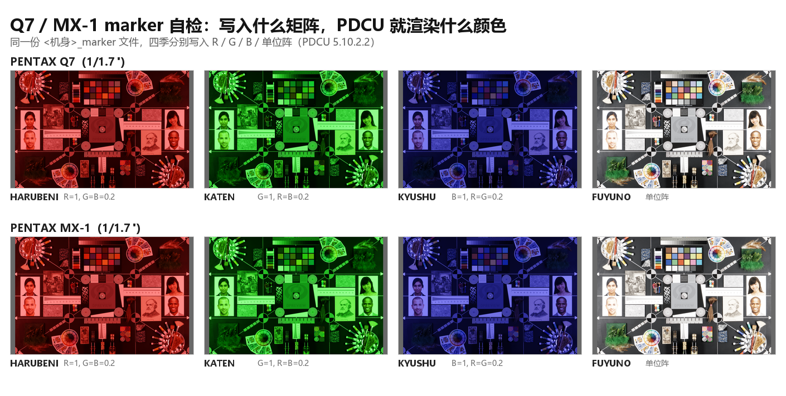

# Q7 / MX-1 四季移植：沿用 K-50 的优化思路

日期：2026-11-04

| 项目 | 文件 |
|---|---|
| 目标 1 | `sample/Q7.dng`（PENTAX Q7，1/1.7"，棚拍色卡） |
| 目标 2 | `sample/MX1.dng`（PENTAX MX-1，1/1.7"，棚拍色卡） |
| 参照 | [`PDCU-K30-K01-四季自检.md`](PDCU-K30-K01-四季自检.md)（同构机身的方法与限制）、[`PDCU-K50-四季方案优化分析.md`](PDCU-K50-四季方案优化分析.md) |
| 工具 | `tools/dng_season_params.py --builtin q7 / mx1` |
| 结论 | 两台都接入自检；marker 全过；隐含基准与 K-3 差分 0.6% 量级（比 K-30 / K-01 强，因为这两台与 K-3 同一张棚拍） |



## 0. 结论

Q7 与 MX-1 和 K-30 / K-01 / K-50 同构（无 `0x021A`/`0x021B`、4 条记录、4 个矩阵），
区别只有两点：**私有块是小端**，以及**1/1.7" 小底的 ColorMatrix2 离单反很远**
（Y 与 K-3 的 `0x021B` 基准分别差 3.4×10⁻¹ 和 1.0×10⁻¹，是全部支持机型里最大的两个）。

1. **P1**：两个模块各补 `CM2` 与 `CALIBRATED_FROM = 'kf'`。实跑自检矩阵差 **0 LSB**、
   隐含基准差 Q7 5.9×10⁻⁵ / MX-1 5.7×10⁻⁵。
2. **P2**：`--builtin q7 / mx1` 打印隐含基准与重算结论，GUI 日志同步；改 1% CM2 立刻
   WARNING（Q7 dY 1.8×10⁻²、MX-1 1.5×10⁻²）。
3. **P0**：marker 实测两台全过；隐含基准残差 Q7 3.92、MX-1 5.38 ΔE76，与 K-50（4.53）
   同一带。**并且**这两台的样本就是 K-3 那张棚拍，所以能像 K-50 一样做跨机身差分：
   Q7 0.67%、MX-1 0.63%（K-50 是 0.27%）。
4. **输出字节不变**：Q7 `7113270F…`、MX-1 `6CCF0D62…`，与 README 记录一致。

## 1. 为什么这两台要单独看

Q7 / MX-1 的 Y 与单反差一个量级——KF 四季矩阵乘上这么大的 Y 之后，数值上已经离 KF
很远，所以“能不能列出四季”“颜色对不对”更容易出问题：

| 机身 | max\|Y − Y(K-3)\| | 说明 |
|---|---:|---|
| K-50 | 3.65×10⁻⁵ | 单反线，几乎重合 |
| K-30 | 2.19×10⁻⁵ | 单反线 |
| K-01 | 1.5×10⁻⁵ | 单反线 |
| **MX-1** | **1.0×10⁻¹** | 1/1.7" 小底 |
| **Q7** | **3.4×10⁻¹** | 1/1.7" 小底 |

Y 这么大，矩阵就不再是“微调”，而是“换了一个色彩空间”。这也是本次要逐台做 marker
实测、而不是只跑自检的原因。

## 2. P1：数据一致性

`season_q7_data.py` 新增 `CM2`（完整精度，来自 `sample/Q7.dng`）与
`CALIBRATED_FROM = 'kf'`；`season_mx1_data.py` 原有 `CM2` 升级为完整精度，并补上
`CALIBRATED_FROM`。

`baked_calibration()` 的判定（实跑）：

| 机身 | 矩阵差（量化后） | 隐含基准差 | ColorMatrix2 差 | 判定 |
|---|---:|---:|---:|---|
| Q7 | 0 LSB | 5.9×10⁻⁵ | 5.0×10⁻¹³ | pass |
| MX-1 | 0 LSB | 5.7×10⁻⁵ | 0 | pass |
| K-30 / K-01 / K-50 | 0 LSB | 1.8–5.8×10⁻⁵ | 0 | pass |

注意这里的“矩阵差”是**量化到 Q13 之后**再比的：Q7 / MX-1 的浮点差在 0.5 LSB
边界上，但编码成 int16 后与内置表逐字节一致，所以判定仍是 0 LSB。

`tests/test_season_data.py` 现在覆盖五台机身（K-30 / K-01 / K-50 / Q7 / MX-1），六组
用例；`records` 那组按模块自己的字节序解码（Q7 / MX-1 是小端），已验证 4 条记录
与 KF 的差别只有矩阵索引。

## 3. P2：透明度

`--builtin q7` 的实际输出：

    == calibration ==
    target base    : (none - this body writes no 0x021B)
    donor base     : [+1.37549 -0.10449 -0.27100] ...  (implied base of the bundle)
    result         : pre-calibrated offline: Y = T(KF) * inv(T(target)),
                     baked into the bundled matrices
    recompute      : pass - bundled matrices equal KF-style * Y recomputed from
                     this file's ColorMatrix2 (dY 0.0e+00, dBase 5.9e-05, dCM2 5.0e-13)

改 1% CM2 后的告警：

| 机身 | 矩阵 dY | 基准 dBase | ColorMatrix2 dCM2 |
|---|---:|---:|---:|
| Q7 | 1.8×10⁻² | 1.6×10⁻² | 1.3×10⁻² |
| MX-1 | 1.5×10⁻² | 1.2×10⁻² | 8.8×10⁻³ |

## 4. P0-a：marker 实测 —— 两台都通过

| 机身 | HARUBENI | KATEN | KYUSHU | FUYUNO（单位阵） |
|---|---|---|---|---|
| Q7 主通道 | R（111/34/31） | G（33/101/29） | B（37/35/93） | 中性（132/131/127） |
| MX-1 主通道 | R（115/36/33） | G（36/105/31） | B（39/37/97） | 中性（138/136/132） |

两台都是小底、Y 很大，如果 PDCU 把矩阵“当成相对本机的微调”而不是绝对矩阵，
这里就会看到串色；实测四项干净地对应 R / G / B / 中性，说明**绝对矩阵语义成立**。
同一机身的 marker 文件与 base 文件，As Shot 逐字节相同（`Q7` / `MX1` 各两组），
改写 `0x021B` 不影响默认显影。

## 5. P0-b：隐含基准 —— 与 K-3 差分 0.6%

把 HARUBENI 的矩阵换成隐含基准（风格 = 单位阵），其余三个季节不动：

| 机身 | ΔE76 | ΔL* | ΔC* | ΔH* |
|---|---:|---:|---:|---:|
| Q7 | 3.92 | −0.90 | +1.03 | +0.20 |
| MX-1 | 5.38 | −1.53 | +1.16 | −0.14 |
| K-50（参照） | 4.53 | −1.40 | +1.13 | +0.24 |
| K-70 对照（矩阵已知正确） | 5.77 | −2.19 | +2.69 | +0.85 |

和 K-30 / K-01 不同，这两台的样本**就是 K-3 那张棚拍**，所以能做和 K-50 一样的
跨机身差分（把季节记录带来的参数效应消掉）：

| 机身 | D_as / D_base 最大差 | 折合 ΔE00 |
|---|---:|---:|
| K-50 | 0.27% | ≲0.15 |
| **Q7** | **0.67%** | **≲0.35** |
| **MX-1** | **0.63%** | **≲0.35** |
| K-30（街景，不同场景） | 7.52% | 不可用 |
| K-01（醒狮，不同场景） | 2.75% | 不可用 |

Q7 / MX-1 比 K-50 略大，一部分来自画布几何：Q7 的最佳对齐偏移是 5 px（K-50 / K-3
是 0 px），均值比会被这点偏移轻微放大。所以 0.6% 是**上限**，不是精确值；但已经
能排除“Y 差一个量级导致偏色”的可能——那种误差会是 5% 以上。

## 6. 回归

| 检查 | 结果 |
|---|---|
| Q7 输出 SHA-256 | `7113270F5448D828C870F502994A138A57DEE27C4562D796437B69E82395600D`（与 README 一致） |
| MX-1 输出 SHA-256 | `6CCF0D6238B28CEDF2DB040552A5802A204A4A4BD62BDD3F3188B50C3CE9448F`（与 README 一致） |
| K-30 / K-01 / K-50 | 未受影响，哈希不变 |
| `tests/test_season_data.py` | 七组用例、五台机身全过 |

## 7. 复现

```powershell
# 生成（输出与 README 哈希一致）
python tools\dng_season_params.py --target sample\Q7.dng --builtin q7 ^
    --out .tmp\k50opt\Q7_new.dng --overwrite
python tools\dng_season_params.py --target sample\MX1.dng --builtin mx1 ^
    --out .tmp\k50opt\MX1_new.dng --overwrite

# 数据自检
python tests\test_season_data.py

# P0 探针（会启动 PDCU 并抓画布）
python .tmp\k50opt\build_probes_q7mx1.py
python .tmp\k50opt\p0_render2.py Q7_new_marker.dng Q7_new_base.dng MX1_new_marker.dng MX1_new_base.dng
python .tmp\k50opt\p0_analyze_q7mx1.py
python .tmp\k50opt\diff_all.py
```

本次生成物（不覆盖 `sample/`）：`.tmp/k50opt/Q7_new_marker.dng`、`Q7_new_base.dng`、
`MX1_new_marker.dng`、`MX1_new_base.dng`；PDCU 截图在 `.tmp/k50opt/p0/`。

## 8. 边界

- 0.63–0.67% 的差分里混着 5 px 的画布偏移，属**上限**；要更紧需要按色卡逐块取色。
- 只覆盖 PDCU 5.10.2.2。
- 未做 P3（完整表）：同 K-50，缺原表、且属于未验证的行为变更。
- Q7 / MX-1 的四季仍是**推算**，不是官方固件数据；本次只是把“推算值没有被写错/没有过期”
  这件事钉得更死，不改变数据来源的定性。

---

版权所有 © 2026 KimHoLau X deepseek harness
