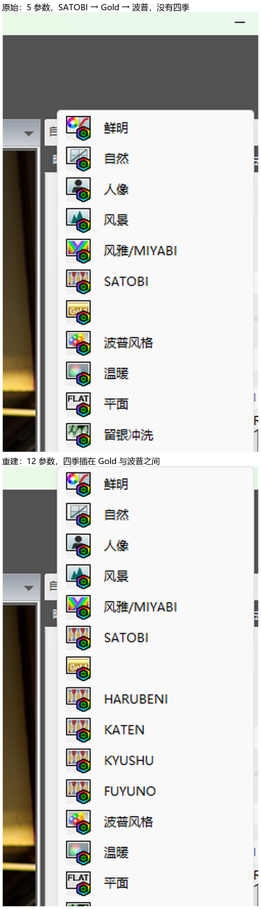
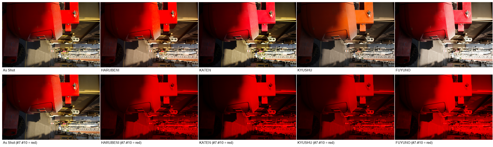
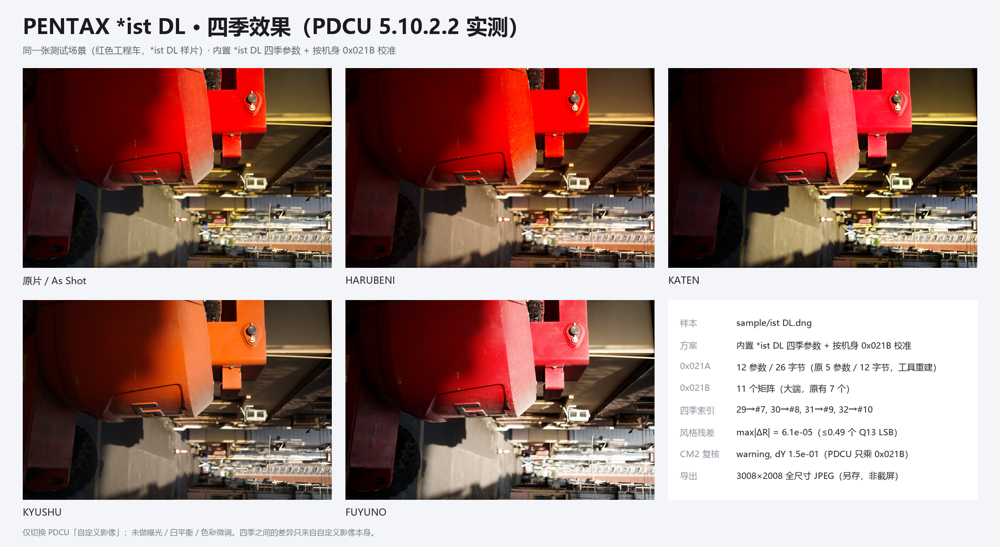

# PENTAX *ist DL 四季移植分析（2026-11-03 复核修订）

> **状态：可用；v2.12 已内置 `istdl` 来源（`tools/season_istdl_data.py`）。前一轮的“已放弃”结论作废。**
>
> 前一轮把 PDCU 的四季画面判成“不受文件里的表控制”，依据是六组 A/B 下画面不变。
> 本轮复核发现：那六组 A/B **全部选错了菜单行**——键盘选风格时按 40 次 `UP` 回顶，
> 但 PDCU 的风格列表会回绕（35 项），40 次 `UP` 等价于 30 次，于是 `DOWN k` 实际落在
> 第 `k-5` 行。所以被量的“四季”其实是**人像 / 风景 / 风雅 / SATOBI**。
>
> 用 `HOME` 重新定位到真正的四季（索引 7–10）后：把 `0x021B` #7–#10 换成纯红，
> 四季画面**整幅变纯红**，As Shot 逐像素不变；全尺寸另存 JPEG 也一样。
> 也就是说 PDCU 确实读我们写进去的四季矩阵，*ist DL 与 K10D / K-7 同属 A 档，
> 移植链路完全成立。

日期：2026-11-03（复核）；初版同日
样本：`sample/ist DL.dng`（5,742,291 B，PENTAX *ist DL，3008×2008，DNG 1.2.0.0，
`Software = Digital Camera Utility 5 Ver.5.10.2`，即 PDCU 5 由 PEF 转出）。
产物：`.tmp/istdl_all.dng`（5,755,216 B，SHA-256
`A5986CA863787DC9EB29DBBBD98A4B096171F6561A5752C978A41564982CE63C`），
由 `--builtin kf --allow-cross-model` 生成（运行时算 Y）。
实测：PDCU 5.10.2.2（Windows，1920×1080）。

## 0. 结论

1. **方法可以照 K10D，数据不能照。** 两台都是 5 参数 / 12 字节的 `0x021A`，都缺 4–10
   号槽，都必须先重建为 12 参数 / 26 字节，PDCU 才会列出四季——这一步与 K10D 逐字相同。
   但 K10D 那套内置矩阵是按 K10D 的 base 烤死的，直接写进 *ist DL 会残留
   5.8–8.3×10⁻² 的相对风格误差（K10D→*ist DL 的 Y 本身还有 7.6×10⁻²）。
2. **空间方案要照 K20D / K-7，不能照 K10D。** K10D 的私有块是 `0xC634`（相对偏移）且带
   19,048 B 全零空洞，两张表原地塞进去、文件不增长。*ist DL 这份是 PDCU 写出的
   `0x927C` AOC MakerNote（绝对偏移），12,408 B **完全紧排（内部空隙 0 B）**，
   `0x021A` 夹在 `0x0216` 与 `0x021C` 之间。只能走“整块复制到文件尾 +
   重定位绝对偏移”：文件 **+12,925 B**，原文件只改 **5 个字节**。
3. **色彩要按 *ist DL 自己的 mode-0 重算。** Y = inv(M_KF[0])·M_istDL[0]，
   max|Y−I| = 0.1625（K10D 0.121、K20D 0.097），四季矩阵量化残差 ≤0.49 LSB，
   相对风格与 KF 差 ≤6.1×10⁻⁵。它的 7 条老记录与 KF 同名模式的差中位 8.1×10⁻²，
   属“旧一代风格表”（K20D 7.7、K10D 8.6、645D 7.3），所以跨机型移植必须带 Y。
4. **菜单这一关通过了。** PDCU 5.10.2.2 里四季插在 SATOBI 之后的无字 Gold 档与
   “波普风格”之间（见文首图），说明 2005 年的机身同样走“12 参数才认四季”这条解析路径。
5. **四季矩阵生效这一环也打通了（本轮更正）。** 真正的四季行是索引 7–10；
   把 #7–#10 换成纯红后，四项画面全部变纯红、As Shot 逐像素不变，
   屏幕与全尺寸另存 JPEG 都是如此（§7.3–7.4、图 `PDCU-istDL-四季矩阵生效.png`）。
   前一轮“四季画面不可控”的结论来自选错行（§1），本次作废。



## 1. 上一轮错在哪

### 1.1 选行方法会回绕

上一轮的选风格函数是：

```python
key(VK_UP, 40)        # 想回到列表顶部
key(VK_DOWN, k)       # 再下移 k 行
key(VK_RETURN)
```

*ist DL 的“自定义影像”列表共 **35 项**（18 个风格 + 17 个图像/场景组），并且
**上下键会回绕**。40 次 `UP` 等价于 30 次，落点不是第 0 行而是第 30 行，于是
`DOWN k` 实际停在 `(30 + k) mod 35 = k − 5`：

| 传入 k | 实际选中 | 期望（按“顶部起第 k 行”） |
|---:|---|---|
| 6 | 自然（索引 1） | SATOBI |
| 7 | 人像（2） | HARUBENI |
| 8 | 风景（3） | KATEN |
| 9 | 风雅（4） | KYUSHU |
| 10 | SATOBI（5） | FUYUNO |

本轮用两种独立方式验证了落点：截下弹窗里的焦点框（`HOME` + `DOWN k` 后逐张看），
以及选中后看右侧面板上的当前风格图标。两者都显示 `DOWN 8 → HARUBENI`、
`DOWN 9 → KATEN`、`DOWN 10 → KYUSHU`、`DOWN 11 → FUYUNO`，而上一轮的
`k=7..10` 对应的是人像 / 风景 / 风雅 / SATOBI。

### 1.2 为什么“逐行悬停核对”没抓到

上一轮确实用鼠标悬停截图核对过列表布局（Gold 在哪、四季从第几行开始），
核对的是**列表本身**；但真正决定渲染的是**键盘落点**。两者之间差了 5 行，
看起来却完全自洽：四季确实存在、也确实“能选、能出四种不同画面”，
只是量的不是那四行。

### 1.3 连带失效的结论

- 上一轮 §6.2 的六组 A/B（#7–#10 纯红、`0x021C`、`0x021D`、旧块、记录互换、
  记录参数全同）测的都是人像 / 风景 / 风雅 / SATOBI，所以“画面逐项不变”是必然的：
  这几档本来就不吃 #7–#10。
- 上一轮 §6.3 的“把 #1–#3 换成纯绿 / 纯蓝 / 纯白，列表第 2–4 项仍是原样”同样选错了行
  （`k=1..3` 落在图像/场景组里）。本轮按正确行号复测：自然 / 人像 / 风景
  **确实不吃** #1–#3（§7.6），但这是另一条结论，和四季无关。
- 上一轮 §0 第 5 条、§6.3、§7.2、§8.2 都建立在“选错行”的数据上，本轮一并改写。

## 2. 样本解剖

### 2.1 文件身份

| 项目 | 值 |
|---|---|
| 机型 / 唯一机型 | `PENTAX *ist DL` / `PENTAX *ist DL` |
| 尺寸 / raw | 3008×2008（raw 3040×2024，SubIFD0 的 128 个 tile，`PhotometricInterpretation` = 32803） |
| 写入者字段 | `Software = Digital Camera Utility 5 Ver.5.10.2`（**是 PDCU 写的**） |
| DNG 版本 | 1.2.0.0（`0xC612` = 01 02 00 00） |
| 文件大小 | 5,742,291 B |
| ISO / 快门 / 白平衡 | 200 / 1/2000 s / 自动 |
| ColorMatrix1/2 | 都在；CM2 与 0x021B 推出的 Y 差 **0.1543** |
| 机型 ID（`0x0005`） | `0x12B1A`（在块外，v2.11 的重定位修复不影响它） |

关键差别：这份 DNG 不是机内写的，也不是第三方转换器写的，而是 **PDCU 5 从 PEF 转出**的。
所以容器是 `0x927C`（AOC）而不是 `0xC634`，与 K20D / K-7 同一条路，
与 K10D（第三方 `0xC634`，DNG 1.1）相反。

### 2.2 私有块

| 项目 | *ist DL | K10D（对照） | K-7（对照） |
|---|---:|---:|---:|
| 容器 | `0x927C` AOC MakerNote | `0xC634` | `0x927C` |
| 位置 / 长度 | 0x82E..0x38A6，**12,408 B** | 0x312..0x13312，77,824 B | 34,002 B |
| 字节序 | **大端 `MM`** | 大端 | 大端 |
| 偏移基准 | **绝对文件偏移** | 相对块首 | 绝对 |
| 私有 IFD 条目 | **88** | 90 | — |
| `0x021A` | 98 B，nParams=**5**，nRecords=**7**，12 B/条 | 38 B，5，2，12 B | 674 B，11，22，24 B |
| 参数 id | `1,2,3,128,129` | 同 | 1–9,128,129 |
| `0x021B` | 130 B，**7** 个 18 B 矩阵 | 40 B，2 个 | 310 B，17 个 |
| 块内空隙 | **0 B（全紧排）** | 19,048 B 全零 | 最大 1 B |
| 原生四季 | 无 | 无 | 无 |

### 2.3 两张表与 7 条老记录

`0x021A` 紧接在 `0x0216`（6 B）之后、`0x021B` 之前，`0x021B` 又紧接
`0x021C`（18 B）。两张表被夹在别的标签中间，**前后都没有可借用的缝**。

7 条记录（id 0–6，param 128 是矩阵索引）：

| id | 参数 1/2/3 | param128 | param129 | 矩阵 | 备注 |
|---:|---|---:|---:|---:|---|
| 0 | 1 / 1 / 1 | 0 | 0 | #0 | 基准 |
| 1 | 1 / 1 / 2 | 1 | 1 | #1 | 与 #4/#5/#6 逐字节相同 |
| 2 | 1 / 1 / 4 | 2 | 0 | #2 | |
| 3 | 1 / 4 / 2 | 3 | 1 | #3 | |
| 4 | 3 / 1 / 4 | 4 | 0 | #4 | = #1 |
| 5 | 1 / 1 / 2 | 5 | 1 | #5 | = #1 |
| 6 | 3 / 4 / 4 | 6 | 0 | #6 | = #1 |

7 条记录只用到 **4 个互不相同的矩阵**（#0、#1、#2、#3），#4–#6 与 #1 完全相同：
这台机身的“7 种色彩模式”主要是靠参数与机身曲线区分，而不是靠矩阵。

矩阵本身（Q13，行和均为 1.00000）：

```
#0  12512  -4640    320   -1152  11264  -1920    -384  -1600  10176
#1  13600  -5408      0   -1696  12512  -2624   -1088  -2432  11712
#2  13856  -5600    -64   -1888  12704  -2624    -992  -2080  11264
#3  13920  -5728      0   -1792  12800  -2816   -1440  -3104  12736
```

### 2.4 文件级布局

| 范围 | 内容 | 长度 |
|---|---|---:|
| 0x8..0x82E | IFD0（32 条目）+ EXIF IFD（0x6B4，25 条目）+ 数据 | 2,086 B |
| **0x82E..0x38A6** | **AOC MakerNote（88 条目，大端，绝对偏移）** | **12,408 B** |
| 0x38A6..0x3EA8 | SubIFD0（raw 3040×2024）+ SubIFD1（全尺寸 JPEG）的 IFD 与 tile 表 | 1,538 B |
| 0x3EA8..0x105718 | SubIFD1 单条 strip = 全尺寸 JPEG（3008×2008） | 1,054,832 B |
| 0x105718..0x113818 | IFD0 缩略图（160×120，120 条 strip） | 57,600 B |
| 0x113818..EOF | SubIFD0 的 raw：128 个 tile（Compression 7） | 4,613,819 B |

块内 `0x021A` 与 `0x021B` 之间 2 B、`0x021B` 与 `0x021C` 之间 0 B；
块尾 `0x0403`（8,200 B）之后到块末只有 8 B。**没有任何一处能放下 +218 B 的新表。**

## 3. 与 K10D 逐项对照

| 项目 | K10D | *ist DL | 能不能照搬 |
|---|---|---|---|
| 表布局 | 5 参数 / 12 B / 2 条 | 5 参数 / 12 B / **7 条** | ✅ 方法相同，条数不同 |
| 12 参数重建 | 必须 | 必须 | ✅ 照搬 |
| 新增矩阵位置 | #2–#5（原有 2 个） | **#7–#10**（原有 7 个） | ✅ 照搬规则，索引要重算 |
| 容器 | `0xC634` 相对偏移 | `0x927C` 绝对偏移 | ❌ 分支不同 |
| 空间 | 块内 19 KB 空洞，**+0 B** | 完全紧排，**+12,925 B** | ❌ 要照 K20D / K-7 |
| 色彩校准 | `Y = inv(M_KF[0])·M_K10D[0]`，max\|Y−I\| 0.121 | 同式，**0.1625** | ✅ 公式照搬，数值重算 |
| 内置数据 | `season_k10d_data.py`（Y 烤进矩阵） | `season_istdl_data.py`（v2.12，Y 烤进矩阵） | ✅ 已补 |
| As Shot | 只乘 0x021B[0] | **未定位**（§9.3） | ⚠️ 待查 |
| PDCU 菜单 | 四季出现 | **四季出现** | ✅ 已实测 |
| 四季矩阵生效 | marker 验证通过 | **通过（本轮）** | ✅ 已打通 |

## 4. 色彩

### 4.1 基准矩阵与 Y

```
M_istDL[0] = Q13 (12512, -4640, 320, -1152, 11264, -1920, -384, -1600, 10176)
           = [ +1.52734 -0.56641 +0.03906 ]
             [ -0.14062 +1.37500 -0.23438 ]
             [ -0.04688 -0.19531 +1.24219 ]

Y = inv(M_KF[0]) · M_istDL[0]
  = [ +0.99267 +0.02037 -0.01304 ]
    [ +0.03076 +0.95365 +0.01559 ]
    [ -0.05117 +0.16254 +0.88863 ]
```

max|Y−I| = **0.1625**，比 K10D（0.121）、K20D（0.097）都大；非对角项合计 0.2935，
反而比 K10D（0.396）、K20D（0.36）小——差异主要落在对角，6 MP CCD 的
输入色彩空间与 KF 差得更多，**校准这一步比 K10D 更不能省**。

### 4.2 写出的四季矩阵

| 季节 | 索引 | Q13（行优先，大端 int16） | 量化残差 | max\|R−R_KF\| |
|---|---:|---|---:|---:|
| HARUBENI | #7 | 13640, −3342, −2106, −2484, 14470, −3794, −2587, 3117, 7663 | 0.47 LSB | 5.4×10⁻⁵ |
| KATEN | #8 | 14554, −6506, 143, −1033, 13274, −4050, 389, −3053, 10856 | 0.46 LSB | 5.0×10⁻⁵ |
| KYUSHU | #9 | 13842, −7496, 1846, 1024, 7226, −58, −497, 1778, 6910 | 0.49 LSB | 6.1×10⁻⁵ |
| FUYUNO | #10 | 8754, −657, 96, −533, 9343, −619, 37, 1764, 6390 | 0.49 LSB | 6.1×10⁻⁵ |

行和 0.99988–1.00012（Q13 量化），与 K10D 同量级。本轮用 `season_kf_data` 重算，
四个矩阵与文档记录逐系数相同。

### 4.3 反例：直抄别的机身的矩阵

把 KF 或 K10D 的四季矩阵原样写进 *ist DL 的 `0x021B`（即不乘 Y）：

| 季节 | 直抄 KF：max\|R−R_KF\| | 直抄 K10D（内置数据）：max\|R−R_KF\| |
|---|---:|---:|
| HARUBENI | 1.09×10⁻¹ | 8.3×10⁻² |
| KATEN | 1.64×10⁻¹ | 7.8×10⁻² |
| KYUSHU | 9.0×10⁻² | 6.9×10⁻² |
| FUYUNO | 8.4×10⁻² | 5.8×10⁻² |

K10D 的数据比 KF 更接近 *ist DL（Y 只差 0.0755 对 0.1625），但**仍然差 6–8×10⁻²**，
不是“差不多就能用”。结论：K10D 只能提供**公式**，不能提供**系数**。

### 4.4 风格表与 CM2

7 个同名模式的相对风格差（R = M·inv(M_base)）：

| 模式 | 0 | 1 | 2 | 3 | 4 | 5 | 6 |
|---|---:|---:|---:|---:|---:|---:|---:|
| \|R_istDL − R_KF\| | 0 | 8.1×10⁻² | 1.5×10⁻¹ | 7.8×10⁻² | 1.4×10⁻¹ | 8.1×10⁻² | 1.9×10⁻¹ |

中位 8.1×10⁻²、最大 1.9×10⁻¹，与 K20D（7.7×10⁻²）、K10D（8.6×10⁻²）、645D（7.3×10⁻²）
同一档：**旧一代风格表**，不是 K-3/KP/K-S2 那种 10⁻⁵ 的“同一张表”。工具因此要求
`--allow-cross-model`。

CM2 互证不通过：用两台各自的 ColorMatrix2 构造 T = diag(1/(CM2·W_D65))·CM2 算出的
Y 与 0x021B 的差是 **0.1543**（K10D 0.27、K-7 0.31 是同类）。这份 DNG 是 PDCU 写的，
说明 PDCU 自己写出的 ColorMatrix 与它写出的 0x021B 也不是同一套标定。

## 5. 记录布局：5 → 12 参数

### 5.1 参数 id 是子集关系

```
*ist DL:  1 2 3          128 129        (5)
K10D:     1 2 3          128 129        (5)
KF:       1 2 3 4 5 6 7 8 9 10  128 129  (12)
```

按参数 id 映射（不按位置）。缺的 4–10 号槽：4–9 填 0，10 填 `0xFFFF`
（与 KF 自己的记录一致；K10D 已实测 4–6 号槽填 `0,0,0` 与
`1,0xFFFF,0xFFFF` 在 PDCU 里逐像素相同）。

### 5.2 往返校验与四条季节记录

把新表里的 7 条老记录按参数 id 压回 5 参数，**7/7 逐字节相同**，param128
（矩阵索引 0–6）与 param129 都原样保留。

四条季节记录（12 参数 / 26 B，大端，param128 改成 7–10）：

| 模式 | 名称 | 记录（hex） | 索引 |
|---:|---|---|---:|
| 29 | HARUBENI | `001d000100020003ffffffffffff00000000fffe000400070000` | 7 |
| 30 | KATEN | `001e0001000800040001ffffffff00000003fffdffff00080000` | 8 |
| 31 | KYUSHU | `001f0001000400010001ffffffffffff0000ffffffff00090000` | 9 |
| 32 | FUYUNO | `00200001000800040001ffffffff0003fffc0004ffff000a0000` | 10 |

这四条与 645D / K20D / K10D / K-7 内置数据用的是同一套 KF 记录，只有 param128 不同。

## 6. 空间：只能整块重建（K20D / K-7 路线）

### 6.1 需要多少

| 表 | 旧 | 新 | 差 |
|---|---:|---:|---:|
| `0x021A` | 2 + 2×5 + 2 + 7×12 = **98 B** | 2 + 2×12 + 2 + 11×26 = **314 B** | +216 B |
| `0x021B` | 4 + 7×18 = **130 B** | 4 + 11×18 = **202 B** | +72 B |
| 合计 | 228 B | 516 B | **+288 B** |

块内可用空隙：**0 B**（§2.4 已逐标签验证，全部紧排）。所以只能整块搬到文件尾：
块 12,408 → 12,924 B（+516，把两张新表接在块尾），文件 +12,925 B（含 1 B 四字节对齐）。

### 6.2 产物的改动面

| 项目 | 结果 |
|---|---|
| 文件大小 | 5,742,291 → **5,755,216 B（+12,925）** |
| 原文件里被改的字节 | **5 B**：`0x927C` 条目的 count（0x73E–0x73F，0x3078→0x327C）与 offset 低 3 字节（0x742–0x744，0x00082E→0x579ED4） |
| 新块位置 | 0x579ED4..0x57D150 |
| 新表位置 | `0x021A` 0x57CF4C、`0x021B` 0x57D086 |
| 旧块 | 0x82E..0x38A6 逐字节保留（变成无引用死区） |
| 其余 86 个私有标签 | 逐字节相同（含 0x0005，它指向块外 0x12B1A，未重定位） |
| raw（3040×2024） | 逐字节相同 |
| 全尺寸 JPEG 预览（1,054,832 B） | 逐字节相同 |
| 缩略图与 0x0400/0x0401/0x0403 | 逐字节相同 |

### 6.3 逐字节完整性

- 0x0..0x82E 只有 `0x927C` 条目的 5 B 不同；
- 0x38A6 到旧 EOF 全同；
- 新块除 `0x021A`/`0x021B` 与重定位后的绝对偏移外，与旧块逐字节一致
  （工具的 `_private_tag_digest` 检查通过，88 个标签里只有这两张表不同）；
- 7 条老记录的 5→12→5 往返 7/7 通过。

## 7. PDCU 5.10.2.2 实测（本轮重做）

### 7.1 菜单

原文件（5 参数 / 7 条）：SATOBI → **Gold**（无文字标签、图标写 Gold 的一档）→ 波普风格，
**没有四季**。
产物（12 参数 / 11 条）：**HARUBENI / KATEN / KYUSHU / FUYUNO 四项插在 Gold 与
波普风格之间**（见文首图）。

列表共 35 项，四季的索引是 **7 / 8 / 9 / 10**（0 基）：

| 索引 | 0 | 1 | 2 | 3 | 4 | 5 | 6 | 7 | 8 | 9 | 10 | 11 |
|---|---|---|---|---|---|---|---|---|---|---|---|---|
| 名称 | 鲜明 | 自然 | 人像 | 风景 | 风雅 | SATOBI | Gold | **HARUBENI** | **KATEN** | **KYUSHU** | **FUYUNO** | 波普 |

### 7.2 怎么可靠地选中四季

`UP×40` 不可用（会回绕）。本轮验证可用的写法：

```text
打开“自定义影像”下拉
HOME                      # 把焦点放到列表之前
DOWN (索引+1)             # 索引 7 时按 8 次
ENTER
```

验证落点的两个独立办法：截弹窗里的焦点框；或选中后看右侧“自定义影像”面板的当前图标。
`DOWN 8/9/10/11` 分别得到 HARUBENI / KATEN / KYUSHU / FUYUNO，面板图标为四季图标。

### 7.3 marker A/B：矩阵确实控制四季

同一张图、同一 PDCU、同一套导出设置，唯一差别是产物里 `0x021B` #7–#10 的数值：

| 变体 | As Shot | HARUBENI | KATEN | KYUSHU | FUYUNO |
|---|---|---|---|---|---|
| A 校准产物（KF×Y） | 103.4 / 50.4 / 37.1 | 108.4 / 45.5 / 33.5 | 99.1 / 50.4 / 39.9 | 95.0 / 58.5 / 41.8 | 117.2 / 73.6 / 68.0 |
| B #7–#10 全纯红 | **同上（逐像素 0 差）** | **94.2 / 0.2 / 0.3** | **85.6 / 0.2 / 0.3** | **83.1 / 0.2 / 0.3** | **115.8 / 0.2 / 0.4** |

- A/B 的 As Shot 逐像素相同（meanAbs 0.0），说明唯一变量就是那四个矩阵；
- 四项画面全部变纯红（与 As Shot 的 meanAbs 差 31.0 / 34.8 / 37.5 / 47.8，
  max 254–255）；
- 结论：PDCU 读 `0x021B` 的 #7–#10，索引与 `0x021A` 记录里的 param128 对得上。



### 7.4 导出通道：与屏幕一致

上一轮把“另存 / 导出是否也这样”留成未验证。本轮用 PDCU 的
“将处理的图像另存为…”导出 **3008×2008 全尺寸 JPEG**（不是屏幕抓图），
A/B 结果与屏幕完全一致：校准产物四季互不相同，纯红变体四季全红、As Shot 不变。
所以这不是“预览简化”，导出路径同样读矩阵。

### 7.5 四季效果与 KF 的方向

全尺寸导出、整幅均值（% 为相对 As Shot）：

| 季节 | 均值 R/G/B | ΔR / ΔG / ΔB (%) | 方向 |
|---|---|---|---|
| As Shot | 103.4 / 50.4 / 37.1 | — | — |
| HARUBENI | 108.4 / 45.5 / 33.5 | +4.8 / −9.7 / −9.7 | 偏暖、压绿蓝 ✅ |
| KATEN | 99.1 / 50.4 / 39.9 | −4.2 / +0.1 / +7.6 | 偏暗、略冷 |
| KYUSHU | 95.0 / 58.5 / 41.8 | −8.1 / +16.0 / +12.6 | 压红、偏冷绿 |
| FUYUNO | 117.2 / 73.6 / 68.0 | +13.3 / +46.2 / +83.2 | 大幅提亮、去饱和 ✅ |



把四季图对 As Shot 做线性回归，KYUSHU 的等效矩阵是
`[[0.962,-0.217,0.188],[0.158,0.562,0.202],[0.021,0.264,0.621]]`，
与 `R_KF(KYUSHU) = [[1.091,-0.200,0.109],[0.152,0.722,0.126],[0.007,0.264,0.729]]`
结构一致（差异来自 PDCU 的色调曲线与场景截断，FUYUNO 大面积高光截断，回归不可用）。
也就是说：**写进去的就是 KF 的四季签名**，只是渲染器再加自己的曲线。

### 7.6 机身原有的模式不吃 #1–#3

本轮按正确行号复测：把 #1/#2/#3 换成纯绿 / 纯蓝 / 纯白，选 自然 / 人像 / 风景，
三项是 102.4/54.4/45.3、105.6/51.2/40.2、102.7/48.9/32.6；同一文件不改 #1–#3 再导一次，
三项逐项相同（同样的三个数），没有变成纯色。说明这台机身的旧模式由 PDCU 内部曲线决定，只有 #0（基准）和
新增的 #7–#10（四季）参与文件矩阵。这条不影响移植：我们要的就是四季那四格。

## 8. 移植路线（现在可用）

```powershell
# 结构检查（5 参数 / 12 B、7 条、7 矩阵、缺 29-32）
python tools\dng_season_params.py --target "sample/ist DL.dng" --list

# 生成（自动重建 12 参数 + 整块搬到文件尾，+12,925 B）
python tools\dng_season_params.py --target "sample/ist DL.dng" --builtin istdl ^
    --out .tmp\istdl_all.dng --overwrite
```

`--builtin istdl` 与旧写法 `--builtin kf --allow-cross-model` 的产物
**逐字节相同**（同一套矩阵，只是 Y 已在数据模块里烤好，GUI 也能自动选中）。

产物 SHA-256：
`A5986CA863787DC9EB29DBBBD98A4B096171F6561A5752C978A41564982CE63C`
（5,755,216 B）。PDCU 5.10.2.2 能列出四项，并按写入的矩阵渲染（§7.3–7.4）。

### 8.1 落地记录（v2.12）

1. `tools/season_istdl_data.py`：`BASE_MATRIX` = *ist DL 的 mode-0，
   `MATRICES` = §4.2 的四个（已乘 Y），记录复用 `K30_SERIES_RECORDS`；
   注册进 `MODEL_TO_DONOR_KIND` / `BUILTIN_SOURCES`（“内置 *ist DL”）/
   `AUTO_SELECT_GROUPS` / `_BUILTIN_DATA_MODULES` /
   `SELFTEST_DONOR_FLAGS`（`--selftest-istdl`）。
2. `--builtin istdl` 的产物与旧写法 `--builtin kf --allow-cross-model`
   **逐字节相同**（同一个 SHA）；GUI 隐藏自检 `--selftest-istdl` 也产出同一 SHA。
3. 回归：`sample/` 里 17 个既有机型（含 K-1 Mark II 的 DCU 转出 DNG）重新生成，
   与 v2.11 的参考 SHA 逐字节一致；*ist DL 从原来的 `no-donor` 变成有产物，
   是本次唯一预期的变化。
4. readme 适配表加入第 16 行（A 档，共 21 台），版本说明补 v2.12；
   GUI 版本号 2.12，窗口高度 978 → 1012（`minsize` 1120×1012），容纳第 8 个来源行。

## 9. 边界与未验证

1. **单样本、单版本**：只有一张 PDCU 转出的 *ist DL DNG，只测 PDCU 5.10.2.2。
   机内 PEF（不经 PDCU）的布局未测。
2. **行号依赖 PDCU 的列表长度**：35 项、会回绕。换 PDCU 版本或换语言后，
   列表可能变长/变短，`UP×N` 的落点会跟着变；要么用 `HOME`，要么先截图核对。
3. **As Shot 的取值规则仍未定位**：单把 #0 或单把 #7–#10 换红都没让 As Shot 变红，
   只有 11 个矩阵全红才变红。这条只影响“默认显影”的解释，不影响四季。
4. **四季以外的旧模式**不吃 #1–#6（§7.6），所以这些档位的风格无法用文件改。
5. **未测**：改过的 DNG 经 PDCU 另存后四季是否保留（另存的是像素，四季不会回到文件里）；
   写回相机回放（*ist DL 不支持 DNG 回放）。
6. 本轮只复核了 *ist DL；K10D / K-7 的结论未重跑。它们的 marker 测试是用鼠标点行做的，
   不经过会回绕的键盘路径，暂按原结论保留。

---

版权所有 © 2026 KimHoLau X deepseek harness
