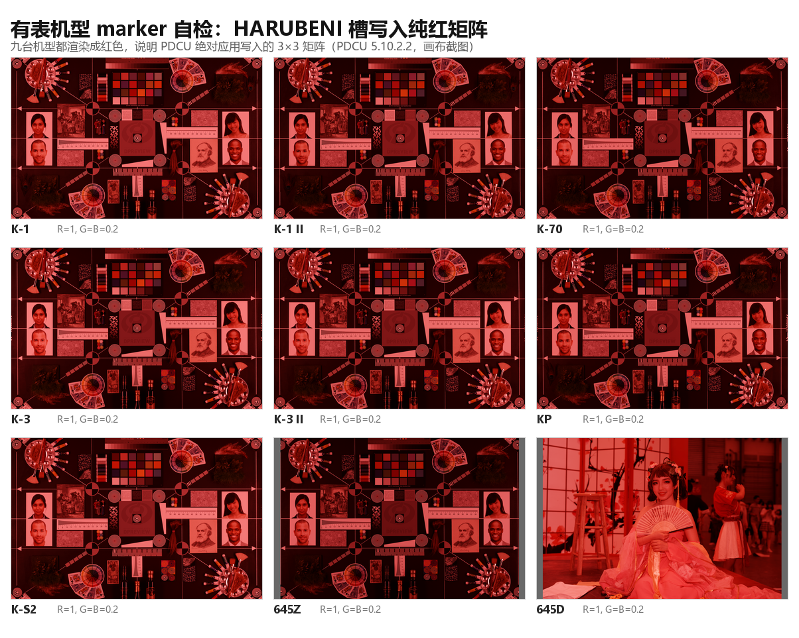

# 有表机型的 marker 自检（9 台实测）

日期：2026-11-04

| 项目 | 说明 |
|---|---|
| 目的 | 证明“PDCU 读的就是写进 `0x021B` 的矩阵”，把这批机型的间接证据换成直接证据 |
| 机型 | K-1 / K-1 II / K-70 / K-3 / K-3 II / KP / K-S2 / 645Z / 645D（仓库里有样本的 9 台） |
| 未覆盖 | KF / K-5 II / K-5 II s——`sample/` 里没有这三台的 DNG |
| 工具 | `tools/dng_season_params.py` 先按内置表补齐，再把 4 个季节矩阵改写成 marker |



## 0. 结论

**9 台全部通过。** 把四季槽依次写成“纯 R / 纯 G / 纯 B / 单位阵”后，PDCU 5.10.2.2 的
渲染结果与写入的矩阵一一对应：

- HARUBENI 槽写 `diag(1, 0.2, 0.2)` → 画面只出红；
- KATEN 槽写 `diag(0.2, 1, 0.2)` → 只出绿；
- KYUSHU 槽写 `diag(0.2, 0.2, 1)` → 只出蓝；
- FUYUNO 槽写单位阵 → 三通道都保留（`min/max` 0.78–0.96），不压任何通道。

这说明“绝对矩阵”语义对所有有表机型成立——不是只有 PDCU 给这几台预设了别的通路。

## 1. 方法

对每台机型：

1. 用 `--builtin` 把样本补成带四季的 `<name>_all.dng`（与发布路径完全一致）；
2. 找到 4 条季节记录各自指向的矩阵槽（不假设 0..3，按记录的 param 128 走），原地
   改写成 marker；
3. PDCU 打开该文件，依次选 As Shot / 四个季节，抓画布；
4. 只看“均值主通道”，并给单位阵单独一个判据：**三通道不被压低**（`min/max > 0.6`）。

## 2. 结果

| 机型 | As Shot 均值 | HARUBENI（红） | KATEN（绿） | KYUSHU（蓝） | FUYUNO（单位阵） | min/max |
|---|---|---|---|---|---|---:|
| K-1 | 98/95/90 | R 101/26/25 | G 26/90/23 | B 30/28/85 | 122/120/117 | 0.96 |
| K-1 II | 89/87/82 | R 92/22/21 | G 21/81/18 | B 25/24/77 | 111/110/106 | 0.96 |
| K-70 | 87/84/80 | R 88/20/18 | G 19/77/16 | B 23/22/73 | 107/105/101 | 0.94 |
| K-3 | 95/92/86 | R 98/25/23 | G 24/87/21 | B 28/26/82 | 119/117/113 | 0.95 |
| K-3 II | 92/91/86 | R 94/23/21 | G 21/83/19 | B 26/25/78 | 115/113/109 | 0.95 |
| KP | 88/86/82 | R 90/21/19 | G 20/79/17 | B 24/23/75 | 110/108/104 | 0.95 |
| K-S2 | 97/95/91 | R 100/25/23 | G 24/88/21 | B 28/27/83 | 121/119/115 | 0.96 |
| 645Z | 82/80/77 | R 83/23/21 | G 21/73/19 | B 25/24/70 | 100/98/95 | 0.95 |
| 645D | 159/115/99 | R 157/40/34 | G 55/126/30 | B 57/41/104 | 186/159/145 | 0.78 |

645D 那一行要单独说明：它的样本不是棚拍色卡（是一张室内人像），As Shot 本身就偏
亮偏暖（159/115/99），所以单位阵渲染也是 186/159/145、比值 0.78。判据看的是
**三个通道都被保留**（0.78 > 0.6），而不是“接近灰”。

## 3. 覆盖情况

| 系列 | 机型 | marker 实测 |
|---|---|---|
| 无表机身 | K-30 / K-01 / K-50 / Q7 / MX-1 | 已做（见各自文档） |
| 现代单反 | K-1 / K-1 II / K-70 / K-3 / K-3 II / KP / K-S2 / 645Z | **本次已做** |
| 旧布局 | 645D | **本次已做** |
| 旧布局 | K10D / K20D / K-7 / *ist DL | 早前已做（见各自移植文档） |
| 未覆盖 | KF / K-5 II / K-5 II s | 仓库无样本 |

21 台支持机型里 **18 台**已有 marker 直接证据；缺的三台只是没有样片，不是已知不通过。

## 4. 顺手补的 donor 自洽断言

13 个内置季节包的四季风格 `R = M季节·inv(M基准)` 与 KF 的最大差（本次实测）：

| 包 | max\|R − R(KF)\| | 包 | max\|R − R(KF)\| |
|---|---:|---|---:|
| k1 | 0.60 LSB | k1ii | 0.60 LSB |
| kf | 0 LSB | 645d | 0.48 LSB |
| k30 | 0.62 LSB | k01 | 0.50 LSB |
| k50 | 0.61 LSB | q7 | 0.80 LSB |
| mx1 | 0.88 LSB | k20d | 0.48 LSB |
| k10d | 0.45 LSB | k7 | 0.51 LSB |
| istdl | 0.50 LSB | | |

全部 ≤1 LSB。这条检查已写进 `tests/test_season_data.py` 的 `test_donor_style`（阈值 2 LSB），
覆盖所有内置包——不只五台无表机身。

## 5. 复现

```powershell
# 1) 补丁 + 改写 marker（9 台）
python .tmp\k50opt\build_markers_all.py
# 2) PDCU 逐台渲染（会启动 PDCU 并抓画布，约 12 分钟）
python .tmp\k50opt\p0_render2.py mk_K1_marker.dng mk_K1ii_marker.dng mk_K70_marker.dng
python .tmp\k50opt\p0_render2.py mk_K3_marker.dng mk_K3ii_marker.dng mk_KP_marker.dng
python .tmp\k50opt\p0_render2.py mk_KS2_marker.dng mk_645Z_marker.dng mk_645D_marker.dng
# 3) 统计
python .tmp\k50opt\analyze_markers_all2.py
# 4) donor 自洽断言
python tests\test_season_data.py
```

生成物在 `.tmp/k50opt/mk_*_marker.dng` 与 `.tmp/k50opt/p0/`；不覆盖 `sample/`。

## 6. 边界

- 截图是 PDCU 画布（缩放后），不是导出的全尺寸 JPEG；marker 判据只用“主通道/通道保留”，
  不需要精确色值。
- 只覆盖 PDCU 5.10.2.2。
- 645D 的 marker 文件是在“12 参数重建”之后改写的，所以同时验证了重建后的表结构可用。
- 三台缺样本的机型没有结论；不能把这份结果外推成“它们也通过”。

---

版权所有 © 2026 KimHoLau X deepseek harness
