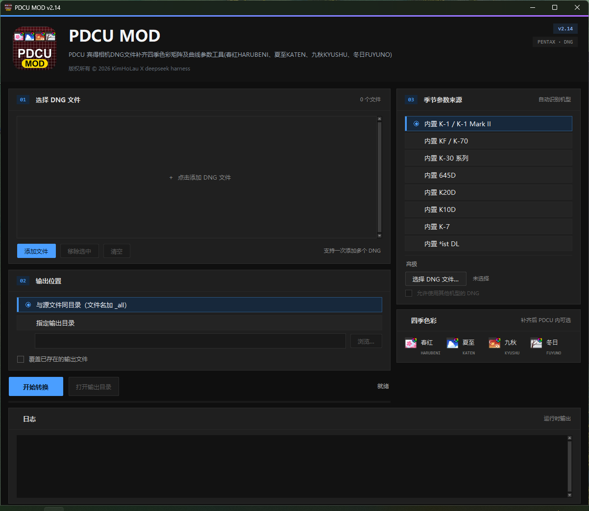

# PDCU MOD 工具

PDCU 宾得相机DNG文件补齐四季色彩矩阵及曲线参数工具(春红HARUBENI、夏至KATEN、九秋KYUSHU、冬日FUYUNO)



## 系统架构


交互版：[docs/PDCU-MOD-系统架构.html](docs/PDCU-MOD-系统架构.html)（下载后用浏览器打开；可切换深/浅色，点击节点上的“来源”查看对应源码）

- **主路径**：读取宾得 DNG 与机型 → 机身分级与校准 → MakerNote 写入
  `0x021A` / `0x021B` → 输出 `_all` 副本与校准报告。
- **四季配方库**：春红 HARUBENI、夏至 KATEN、九秋 KYUSHU、冬日 FUYUNO
  四套并行条目；每套含 `0x021A` 季节记录与 `0x021B` 基准矩阵，以
  PENTAX KF 机内原生表为基准。
- **三档校准**：S 档原生或等价原生（Y=I）；A 档目标有 `0x021B`，按
  `Y = inv(M_KF[0])·M_body[0]` 精确校准；B 档目标无 `0x021B`，Y 由
  ColorMatrix2 推算，**不保证与官方固件一致**。
- **写入边界**：只改 `0x021A` / `0x021B`，RAW 像素、BlackLevel、
  WhiteLevel 只读；注入目标是宾得私有 MakerNote 字段，不是 DNG 标准的
  ProfileIfd / OpcodeList。
- **下游与未知**：PDCU 兼容渲染器是否识别四季风格依赖下游实现；无法精确
  映射的字段标注“近似映射，待验证”。各机型的档位与残差见下方适配表。

## 四季滤镜-色彩雷达图


## 四季滤镜-机型适配表（S档>A档>B档）
| # | 机型 | 档 | 四季数据来源 | max\|ΔR\| | 验证 |
|---:|---|---|---|---:|---|
| 1 | **PENTAX KF** | S | 机内原生四季表（本项目基准） | 0 | donor 本体 |
| 2 | **PENTAX K-70** | S | 内置 KF 表；21 个基础矩阵与 KF 逐字节相同，Y=I | 0 | 九机同场景 |
| 3 | **PENTAX K-1** | S | 机内原生 K-1 四季表 | 7.3×10⁻⁵ | 九机同场景 |
| 4 | **PENTAX K-1 Mark II** | S | 内置 K-1 原生四季表；28 条记录 / 21 个基础矩阵与 K-1 逐字节相同，Y=I | 7.3×10⁻⁵ | PDCU 菜单 + As Shot 零变化 + 同场景比值（v2.4）；DCU 转出 DNG 实测（v2.11） |
| 5 | **PENTAX K-3** | A | KF×Y，Y 来自自身 0x021B | 5.7×10⁻⁵ | 九机同场景，CM2 pass |
| 6 | **PENTAX K-3 II** | A | 同 K-3 的 Y | 5.7×10⁻⁵ | 九机同场景 |
| 7 | **PENTAX K-5** | A | KF×Y，Y 来自自身 0x021B；基准与 K-3、K-5 II 逐字节相同 | 5.7×10⁻⁵ | PDCU 5.10.2.2 菜单 + 四季渲染（单场景） |
| 8 | **PENTAX K-5 II** | A | 基准与 K-3 逐字节相同，同一张表 | 6.0×10⁻⁵ | 矩阵/画面 ΔE；未 PDCU 实测 |
| 9 | **PENTAX K-5 II s** | A | 同 K-5 II | 6.0×10⁻⁵ | 同 K-5 II |
| 10 | **PENTAX K-r** | A | KF×Y，Y 来自自身 0x021B；与 K-5 不同 | 6.0×10⁻⁵ | PDCU 5.10.2.2 菜单 + 四季渲染（单场景） |
| 11 | **PENTAX KP** | A | KF×Y(KP) | 6.3×10⁻⁵ | 九机同场景，CM2 pass |
| 12 | **PENTAX K-S2** | A | KF×Y(K-S2) | 4.3×10⁻⁵ | 九机同场景，CM2 警告 1.3×10⁻² |
| 13 | **PENTAX 645Z** | A | KF×Y(645Z) | 4.4×10⁻⁵ | 九机同场景，CM2 警告 2.7×10⁻³ |
| 14 | **PENTAX 645D** | A | KF×Y(645D)，Y 来自自身 0x021B；0x021A 重建为 12 参数 | 5.8×10⁻⁵ | PDCU 菜单 + 四季渲染实测（v2.2），CM2 pass 4.0×10⁻⁵ |
| 15 | **PENTAX K20D** | A | KF×Y，Y 来自自身 0x021B；0x021A 重建为 12 参数，MakerNote 整块搬到文件尾 | 5.8×10⁻⁵ | PDCU 5.10.2.2 菜单实测（8 参数不列、12 参数列出，v2.8） |
| 16 | **PENTAX K10D** | A | KF×Y，Y 来自自身 0x021B；0x021A 重建为 12 参数（5 参数表），两张表搬进私有块内空闲区 | 5.6×10⁻⁵ | PDCU 5.10.2.2 菜单 + 四项渲染 + marker + As Shot（v2.9） |
| 17 | **PENTAX K-7** | A | KF×Y，Y 来自自身 0x021B；0x021A 重建为 12 参数（11 参数表），MakerNote 整块搬到文件尾 | 6.2×10⁻⁵ | PDCU 5.10.2.2 菜单 + 四项渲染 + marker + As Shot（v2.10） |
| 18 | **PENTAX K-x** | A | K-7 四季表 × Y(K-x)，Y 来自自身 0x021B；0x021A 11→12 重建，两张表搬进私有块空闲区 | 5.6×10⁻⁵ | PDCU 5.10.2.2 菜单 + 四季渲染（单场景） |
| 19 | **PENTAX \*ist DL** | A | KF×Y，Y 来自自身 0x021B；0x021A 重建为 12 参数（5 参数 / 7 条），MakerNote 整块搬到文件尾 | 6.1×10⁻⁵ | PDCU 5.10.2.2 菜单 + 四项渲染 + marker + 全尺寸导出（v2.12） |
| 20 | **PENTAX K-50** | B | ColorMatrix2 推算 Y | 5.7×10⁻⁵ | 九机同场景 + K-3 渲染对照 |
| 21 | **PENTAX K-01** | B | ColorMatrix2 推算 Y | 5.5×10⁻⁵ | PDCU 渲染复核（舞狮），无同场景定量 |
| 22 | **PENTAX K-30** | B | ColorMatrix2 推算 Y | 5.4×10⁻⁵ | PDCU 渲染复核（街景），无同场景定量 |
| 23 | **PENTAX MX-1** | B | ColorMatrix2 推算 Y（1/1.7"） | 1.07×10⁻⁴ | PDCU 菜单 + 四季渲染 + 同场景比值 + As Shot 零变化（v2.3） |
| 24 | **PENTAX Q7** | B | ColorMatrix2 推算 Y（小底） | 5.1×10⁻⁵ | 九机同场景，但 Y 不在单反校准线上 |

> 表里的 max|ΔR| 是四季风格 R = M季节·inv(M基准) 与 KF / K-7 原生的最大差；Q13 一个 LSB
> 是 1.22×10⁻⁴，所以**全部机型都在一个量化步长以内**。
> S 档：原生或等价原生（4 台）
> A 档：机身 0x021B 基准精确校准（15 台）
这 15 台都有 `0x021B` 基准矩阵。对与 KF 同表的机身算
`Y = inv(M_KF[0])·M_body[0]`，再乘 KF 四季矩阵；K-x 与 K-7 同表，算
`Y = inv(M_K7[0])·M_body[0]`，再乘 K-7 四季矩阵。数学上就是 Pentax 生成
各机身表的做法，所以是“精确解”。
> B 档：ColorMatrix2 推算（5 台）
这 5 台没有 `0x021A`/`0x021B`，Y 只能由 DNG 的 ColorMatrix2 反推：

## 所有机型实测（2026-10-27）
九台机身、同一场景、同一套 PDCU 5.10.2.2 渲染，仅切换“自定义影像”。
每机型的四季效果图、矩阵残差、色卡 ΔE 与渲染一致性见
[`docs/PDCU-九机型四季实测.md`](docs/PDCU-九机型四季实测.md)。

## 工具对照判定（2026-10-29）

同一张 K-1 场景，比较本工具与3年前开发的 `pentax_seasons`工具 产出的四季 DNG/JPG：
本工具的 DNG 里 KYUSHU 矩阵与 K-1 机内 **逐字节相同**（相对风格残差 0），
`pentax_seasons` 工具的文件只有四季的影调记录、矩阵索引全部越界（KYUSHU 指向 #24，
但文件只有 #0–#20）。两张 PDCU KYUSHU JPG 平均只差 **ΔE00 1.15**，但本工具那张
更冷、更淡，方向与 KYUSHU 的“压暗、偏冷/低饱和”一致。分析见
[`docs/PDCU-KYUSHU-四季对比判定.md`](docs/PDCU-KYUSHU-四季对比判定.md)，
对比图 [`docs/PDCU-KYUSHU-四季对比.jpg`](docs/PDCU-KYUSHU-四季对比.jpg)。

## 所有机型排名统计（2026-11-02，加权评分）
[`docs/PDCU-支持机型四季水准排名.md`](docs/PDCU-支持机型四季水准排名.md)：
按「数据出身 30% / 端到端验证 50% / 实现代价 10% / 风格残差 10%」打分排序，
与上面的档位适配表顺序不同（例如 K-50 以 76.8 分排在 K10D 75.4、K20D 74.2
之前，因为九机同场景的验证分更高）。

## 运行

发布文件：`dist/PDCU-Season-Params.exe`（或 `dist/PDCU-Season-ParamsV2.14.zip`）

双击运行，首次运行 Windows SmartScreen 可能提示
“未知发布者”，选择“更多信息 -> 仍要运行”。

**命名例外**：产品名是 **PDCU MOD**，但发布文件仍沿用
`PDCU-Season-Params.exe` / `PDCU-Season-ParamsV2.8.zip`，
`InternalName` / `OriginalFilename` 也保持 `PDCU-Season-Params`。
这是为了兼容既有发布、快捷方式和脚本；Windows 文件属性里的
`FileDescription` / `ProductName` 仍为 **PDCU MOD**，不随文件名变化。

macOS 上要用 py2app 打包（`python3 setup.py py2app`），打包步骤与
「预览卡在正在加载预览…」的排查见 `docs/PDCU-macOS-py2app打包.md`。

## 版本
> 发布物命名沿用旧名 `PDCU-Season-Params`（exe / zip / InternalName /
> OriginalFilename），产品名与文件属性中的 FileDescription / ProductName
> 仍是 **PDCU MOD**；这是兼容既有发布与脚本的例外，详见「运行」。
- **v2.14**：新增 **PENTAX K-5、K-r、K-x** 三台支持。
  K-5 与 K-r 走“KF×Y”的 A 档路径：K-5 的 0x021A 1,068→782 B、0x021B 328→400 B；
  K-r 的 0x021A 912→782 B、0x021B 328→400 B；两台都有 0x021A 尾部填充，
  工具用紧凑布局，PDCU 5.10.2.2 实测菜单 + 四季渲染。
  K-x 则不同：它是 11 参数 / 23 条 / 16 矩阵、无填充，且 0x021B 与 **K-7** 同风格表
  （21 个共有模式，最大 1.35×10⁻⁴），不是 KF。工具把 K-x 映射到内置 K-7，
  重建为 12 参数 / 27 条、20 矩阵，并把两张表搬进私有块尾部（文件大小不变），
  PDCU 5.10.2.2 实测通过。GUI 的“内置 KF / K-70”现在含 K-5 / K-r，
  “内置 K-7”现在含 K-x；支持机型从 21 台增到 24 台。版本号同步到 2.14。
- **v2.13**：给五台**没有机内 `0x021B`** 的机身（K-30 / K-01 / K-50 / Q7 / MX-1）
  加**离线校准自检**。这五台的四季矩阵是按各自 ColorMatrix2 离线算好的冻结表；工具
  现在会在转换时用**文件自己的** ColorMatrix2 重算 `Y = T(KF)·inv(T(target))`，核对内置的
  4 个矩阵（量化后 0 LSB）与隐含基准（1.8–5.9×10⁻⁵）：CLI 打印 `recompute : pass …`，
  GUI 日志同步一行“离线校准自检：pass …”。对不上（固件或样本变了）会打印 WARNING，
  并给出矩阵、基准与 ColorMatrix2 三个差值。数据模块新增 `CM2` 与
  `CALIBRATED_FROM='kf'` 声明；`tests/test_season_data.py` 从 1 台扩到 5 台、7 组用例
  （含“改 1% ColorMatrix2 必须报警”的防退化用例）。顺带修正 K-50 数据模块里一处过期
  数值（1.4e-5 → 3.65e-5）。PDCU 5.10.2.2 实测：五台的 marker（纯 R/G/B/单位阵）
  全部逐项对应；K-50 的“隐含基准 vs As Shot”跨机身差分 0.27%，Q7 0.67%、MX-1 0.63%。
  **输出字节未变**（18 组自检与 v2.12 记录逐字节相同）。另：有表机型补做了 marker
  自检（9 台有样本的机型全部通过）与 donor 风格自洽断言，见
  [`docs/PDCU-有表机型-marker实测.md`](docs/PDCU-有表机型-marker实测.md)。详见
  [`docs/PDCU-K50-四季方案优化分析.md`](docs/PDCU-K50-四季方案优化分析.md)、
  [`docs/PDCU-K30-K01-四季自检.md`](docs/PDCU-K30-K01-四季自检.md)、
  [`docs/PDCU-Q7-MX1-四季自检.md`](docs/PDCU-Q7-MX1-四季自检.md)。版本号同步到 2.13。
- **v2.12**：新增 **PENTAX \*ist DL**（内置 \*ist DL）。2005 年的 6 MP 机身，AOC
  MakerNote（`0x927C`，绝对偏移）只有 12,408 B 且**完全紧排**：`0x021A` 是
  5 参数 / 12 字节 / 7 条、`0x021B` 7 个矩阵。工具重建为 12 参数 / 26 字节并补四条
  季节记录，整块搬到文件尾：文件 +12,925 B，原文件只改 5 B，raw / 全尺寸 JPEG /
  缩略图逐字节未动。四季矩阵 = KF 四季矩阵 × `Y = inv(M_KF[0])·M_istDL[0]`
  （max|Y−I| = 0.1625，是支持机型里最大的），相对风格与 KF 差 ≤6.1×10⁻⁵。
  PDCU 5.10.2.2 实测：四项列在 SATOBI 之后的 Gold 档与“波普风格”之间；把 #7–#10
  换成纯红后四项画面全变纯红、As Shot 逐像素不变，3008×2008 另存 JPEG 同样——
  即四季确实由写入的矩阵控制（效果图
  [`docs/PDCU-istDL-四季效果.png`](docs/PDCU-istDL-四季效果.png)）。注意：PDCU 的风格列表有 35 项且上下键**会回绕**，
  键盘选行必须用 `HOME`，不能连按 `UP` 回顶；上一份“\*ist DL 不可移植”的分析
  就是在这里选错了行，本次一并更正（详见
  [`docs/PDCU-istDL-KF四季移植分析.md`](docs/PDCU-istDL-KF四季移植分析.md)）。
  界面：窗口高度 978 → 1012（`minsize` 1120×1012），容纳第 8 个来源选项；
  版本号同步到 2.12。
- **v2.11**：修复 **DCU 5 转出的 DNG 打补丁后 PDCU 不出图**。把 AOC MakerNote
  整块搬到文件尾时，工具把 `0x0004` / `0x0005` 当成"预览偏移"，只要数值落在块内就
  整体加位移；这两个标签其实是 **Pentax 机型 ID**（K-1 Mark II = `0x13240`），被改掉
  之后 PDCU 认不出机型——标签页打得开、相机信息也正常，但画面永远停在灰底。K-7
  （`0x12DB8`）/ K20D（`0x12CD2`）/ *ist DL（`0x12B1A`）的机型 ID 都在块外，所以
  v2.8–v2.10 一直没暴露；K-1 Mark II 由 PEF 转出的 DNG 块有 77,072 B，才第一次撞上。
  现在只有目标字节以 `FF D8` 开头才认定是预览偏移，并把 `0x0004` / `0x0005` 纳入
  搬块后的逐字节校验（旧的错误重定位会被 `verify_output()` 直接拒绝）。修复后该文件在
  PDCU 5.10.2.2 正常显影、四季四项齐全，As Shot 与补丁前逐像素相同；**17 个既有样本的
  输出逐字节未变**。详见
  [`docs/PDCU-DCU转换DNG-机型ID误重定位.md`](docs/PDCU-DCU转换DNG-机型ID误重定位.md)。
- **v2.10**：新增 **PENTAX K-7**（内置 K-7）。K-7 的 AOC MakerNote 与 K20D
  同型（EXIF `0x927C` + 绝对偏移），但 `0x021A` 是 **11 参数 / 24 字节 /
  22 条记录 / 17 个矩阵**，34,002 B 的块已排满（最大空隙 1 B）。工具把整张表
  重建成 12 参数（只补 10 号槽 `0xFFFF`，22 条老记录压回后逐字节相同），
  并把整块 MakerNote 搬到文件尾：文件 13,193,349 → 13,228,440 B（+35,091），
  原文件只改 5 B，raw / 全尺寸预览 / 缩略图逐字节未动。四季矩阵 =
  KF 四季矩阵 × `Y = inv(M_KF[0])·M_K7[0]`，相对风格与 KF 差 ≤6.2×10⁻⁵。
  PDCU 5.10.2.2 实测：11 参数不列四季，12 参数列出四项；marker（纯 R/G/B/
  单位矩阵）证明读的是写入的矩阵；默认显影 88.9/81.6/77.3 → 91.0/84.0/77.1
  （机身 JPEG 89.6/83.9/76.9）。这份样本的 ColorMatrix2 与 `0x021B` 差 0.31
  （K10D 同类），PDCU 不读 ColorMatrix，所以只影响别的软件。详见
  [`docs/PDCU-K7-KF四季移植.md`](docs/PDCU-K7-KF四季移植.md)。
  界面：窗口高度 974 → 1008（`minsize` 1120×978），容纳第 7 个来源选项；
  版本号同步到 2.10。
- **v2.9**：新增 **PENTAX K10D**（内置 K10D）。K10D 的 `0x021A` 是更老的
  **5 参数 / 12 字节**布局（2 条记录、2 个矩阵），而 PDCU 5.10.2.2 只认
  12 参数 / 26 字节；工具把整张表重建成 12 参数（老记录按参数 id 逐字段保留，
  缺的 4–10 号槽填 `0,0,0,0,0,0,0xFFFF`）。与 645D / K20D 不同的是**不需要搬块**：
  K10D 的私有块里有 19,048 B 全零空闲区（预览 JPEG 之后），两张新表直接放进去，
  **文件大小 +0 B**，原文件只改 6 个字节，raw / 全尺寸预览 / 缩略图逐字节未动。
  四季矩阵 = KF 四季矩阵 × `Y = inv(M_KF[0])·M_K10D[0]`，相对风格与 KF 差
  ≤5.6×10⁻⁵；PDCU 5.10.2.2 实测：5 参数看不到四季，12 参数列出并渲染四项，
  marker 测试（纯 R/G/B/单位矩阵）证明 PDCU 读的就是写入的矩阵；默认显影反而
  变准（105.3/108.1/100.5 → 111.0/112.4/103.2，机身 JPEG 112.0/113.3/104.8）。
  这份样本是旧版/第三方 PEF→DNG，ColorMatrix2 与 `0x021B` 差 0.27，PDCU 不读
  ColorMatrix，所以只影响别的软件。详见
  [`docs/PDCU-K10D-KF四季移植.md`](docs/PDCU-K10D-KF四季移植.md)。
  界面：窗口高度 940 → 974（`minsize` 1120×944），容纳第 6 个来源选项；
  版本号同步到 2.9。
- **v2.8**：新增 **PENTAX K20D**（PDCU 从 PEF 转换的 DNG）。K20D 的 AOC MakerNote
  是满的（24,280 B，最大空隙 1 B），`0x021A` 是 8 参数 / 18 字节旧布局；
  工具把整块 MakerNote 重建到文件尾（内部绝对偏移按位移重定位），在块尾
  追加 12 参数 / 26 字节的新 `0x021A` 与 19 个矩阵的新 `0x021B`，
  raw / 预览 / 缩略图一个字节不动，文件 +25,280 B，旧块留作死区。
  四季矩阵 = KF 四季矩阵 × `Y = inv(M_KF[0])·M_K20D[0]`，相对风格
  与 KF 差 ≤5.8×10⁻⁵（≤0.46 个 Q13 LSB）。新增的 7–10 号参数槽按目标布局的
  默认值填（`0,0,0,0xFFFF`，即 KF 自己的约定）；全填 `0xFFFF` 会让 PDCU 的默认
  显影抬亮变平（实测 −9%），已修正。PDCU 5.10.2.2 实测：8 参数看不到四季，
  12 参数列出并渲染四项，四项方向与 KF 原生机身一致、默认显影不变（62.4/51.7/42.1
  vs 原名 62.5/51.4/41.9、机身预览 60.6/50.7/42.7）。四项效果图见
  [`docs/PDCU-K20D-四季效果.png`](docs/PDCU-K20D-四季效果.png)，
  修复前后的 As Shot 对照见 [`docs/PDCU-K20D-PDCU实测.png`](docs/PDCU-K20D-PDCU实测.png)。
  顺带修好了 K20D 的文件选择器预览（`preview_jpeg` 回落到 SubIFD 的 4672×3104 JPEG）。
  分析见 [`docs/PDCU-K20D-KF四季移植.md`](docs/PDCU-K20D-KF四季移植.md)。
- **v2.7**：文件选择器加入 DNG 机内 JPEG 实时预览（约 720×480），后台读取
  不卡窗口；单击文件夹后按「打开」进入，并补了「此电脑」与主目录/桌面/下载/
  图片快捷位置。「季节参数来源」选项悬停时会显示适配机型。**转换逻辑与输出
  文件未变**，14 组机型自检仍与 v2.6 参考值逐字节相同。
- **v2.6**：把「四季色彩」卡片从彩色圆点改为四张 24px 季节图标
  （春红=樱花、夏至=雪山、九秋=红叶、冬日=枯枝雪景），图标随打包版一起
  进入资源目录；单张图标缺失时该行自动回退为原来的圆点。版本号推进到
  **2.6**，界面内显示与 Windows 文件属性一致。**转换逻辑与输出文件未变**，
  14 组机型自检仍与 v2.5 参考值逐字节相同。
- **v2.5**：界面改为 Lightroom 暗黑风格：近黑画布、深色卡片、蓝色强调色、
  圆角控件与深色对话框；工具更名为 **PDCU MOD**，标题区加入 logo 和新的
  功能说明。「季节参数来源」精简为四个内置选项（K-1 / K-1 Mark II、
  KF / K-70、645D、K-30 系列），不再显示技术说明；自定义 DNG 来源收进
  「高级」。转换逻辑与输出文件不变：14 组机型自检全部通过，与 v2.4 记录的
  8 个参考 SHA-256 逐字节相同；其余机型的 exe 输出也与源码 CLI 输出一致。
- **v2.4**：新增 **PENTAX K-1 Mark II**。K-1 Mark II 的 28 条 `0x021A` 模式记录、
  21 个 `0x021B` 基础矩阵与 K-1 **逐字节相同**，所以直接复用 K-1 原生四季表
  （Y=I），四季矩阵与 K-1 逐字节一致，相对风格残差为 0；与 KF 原生的差仍只有
  4.7×10⁻⁵～7.3×10⁻⁵。文件布局上 `0x021A` 从 1,146 B 缩到 860 B，`0x021B`
  后只有 2 B 空位（`0x021C` 在 0x2B06），工具把矩阵表迁到新表尾；补丁前后 As Shot
  逐像素相同，PDCU 5.10.2.2 实测识别为 PENTAX K-1 Mark II，四项都能列出并渲染。
  GUI 会自动识别 K-1 Mark II 并选 `k1ii` 内置数据。分析见
  [`docs/PDCU-K1II-四季移植.md`](docs/PDCU-K1II-四季移植.md)。
- **v2.3**：新增 **PENTAX MX-1**。MX-1 没有 `0x021A` / `0x021B`，私有块是
  小端、只有 51,458 B、82 条 IFD 条目；工具会新建两个标签，把被扩大的 IFD
  挤占的 `0x0222` 搬到预览 JPEG 后的空闲区，再用 MX-1 自己的 ColorMatrix2
  校准 KF 四季矩阵。PDCU 5.10.2.2 实测识别为 PENTAX MX-1，列出并渲染四项；
  补丁前后 As Shot 逐像素相同，四季/As Shot 比值与九机均值一致（色向偏差
  ≤1.67%）。Y 与 K-3 差 1.04×10⁻¹（Q7 为 3.4×10⁻¹），属于按 ColorMatrix2
  外推，不是官方 MX-1 四季数据。分析见
  [`docs/PDCU-MX1-KF四季移植.md`](docs/PDCU-MX1-KF四季移植.md)。
- **v2.2**：新增 **PENTAX 645D**。645D 的 `0x021A` 是旧布局（11 参数 / 24 B 记录、
  大端、表紧排），PDCU 5.10.2.2 只在 **12 参数 / 26 B** 布局下列出四季，所以工具会
  把整张表重建成 12 参数（原有 24 条记录逐字段保留，缺的参数 10 写 `0xFFFF`），
  并把 0x021A / 0x021B 一起迁到私有块空闲区。四季矩阵 = KF 四季矩阵 ×
  `Y = inv(M_KF[0])·M_645D[0]`，量化误差 ≤0.5 个 Q13 LSB、相对风格与 KF 差
  ≤5.8×10⁻⁵；645D 的 0x021B 基准与 ColorMatrix2 互证到 4.0×10⁻⁵。PDCU 实测
  能列出并渲染四项。注意：布局升级后 PDCU 对 645D 的默认显影会变（实测更接近
  机身 JPEG 预览）。四季效果总览见
  [`docs/PDCU-645D-四季效果.png`](docs/PDCU-645D-四季效果.png)，
  分析见 [`docs/PDCU-645D-KF四季移植.md`](docs/PDCU-645D-KF四季移植.md)。
- **v2.1**：K-30 的内置表改用 K-30 自己的 ColorMatrix2 校准（与 K-50 / K-01
  同一公式），不再用 K-3 基准代理，与旧表相比只有 6 个 Q13 系数差 1 个 LSB；
  K-01 的内置表也按 `sample/K01.DNG` 的 `0xC622` 原值重算，2 个系数各修正
  1 个 LSB。新增 `CM2 check`：用目标 DNG 的 ColorMatrix2 复核 `0x021B` 基准，
  偏差 >1×10⁻³ 时日志告警（645Z / K-S2 会触发；实测 PDCU 的屏幕渲染与
  另存 JPEG 都不读 CM2，校准仍以 `0x021B` 为准）。
- **v2.0**：新增 **PENTAX KP / K-S2 / K-50 / Q7**。KP、K-S2 与 K-3 一样，
  加文件即按目标自己的 `0x021B` 基准矩阵自动校准；K-50、Q7 机内完全没有
  `0x021A` / `0x021B`，工具新建标签，并用各自 DNG ColorMatrix2 推算的
  `Y` 校准 KF 四季矩阵（K-50 与 K-3 校准线只差 3.7×10⁻⁵，Q7 为小底推算）。
  九台同场景实测见
  [`docs/PDCU-九机型四季实测.md`](docs/PDCU-九机型四季实测.md)。
- **v1.9**：支持 **Digital Camera Utility 5 另存的 DNG**。这类文件的 Pentax
  MakerNote 在 EXIF `0x927C`（不是 `0xC634`）；工具现在按同样的私有 IFD
  结构读取，并在 `0x021B` 后没有空位时把矩阵表迁到 MakerNote 内空闲区。
  `sample/K5iis.dng`（K-5 II s，DCU 另存）已实测：直接加文件即可补四季，
  PDCU 能列出并渲染四项。
- **v1.8**：新增 **PENTAX K-3 / K-3 II / K-5 II / K-5 II s / 645Z** 的自动校准。
  工具在运行时读取目标自己的 `0x021B` 基准矩阵，算出 `Y = inv(M_donor[0])·M_target[0]`，
  再把 donor 的四季矩阵乘上 Y 写回——这就是 Pentax 生成各机身矩阵表的方式，
  所以跨机型从“近似”变成“精确”。这五台机型不需要勾选“跨机型”，加文件即用。
- **v1.7**：新增 PENTAX K-01 支持；K-01 与 K-30 同属“无 0x021A/0x021B、私有块大端”
  结构，但 IFD 条目数和预览偏移不同。K-01 自动识别，用 K-01 色彩空间单独校准。
- **v1.6**：新增 PENTAX K-30 支持；K-30 没有 0x021A/0x021B，工具会新建标签，
  并用 K-30 色彩空间校准 KF 四季矩阵。K-30 自动识别。
- **v1.5**：内置 KF 四季参数，K-70 自动识别。
- **v1.4**：内置 KF 数据；KF / K-70 按“基础矩阵相同”精确移植。

### v2.14 打包记录（2026-11-07）

构建：Python 3.14.3 + PyInstaller 6.22.3，PDCU-Season-Params.spec（onefile），
FileVersion / ProductVersion **2.14.0.0**。

| 产物 | 大小 |
|---|---:|
| dist/PDCU-Season-Params.exe | 19,398,784 B |
| dist/PDCU-Season-ParamsV2.14.zip（exe + 使用说明） | 19,144,746 B |

打包后抽测：

- K-x：exe --selftest-k7 输出与源码工具 .tmp/Kx_k7.dng 逐字节相同
  （875591EF…2CB03C92）；
- K-5：exe --selftest-kf 输出与 .tmp/K5_all.dng 相同（67C112F0…）；
- K-r：exe --selftest-kf 输出与 .tmp/Kr_all.dng 相同（6F533F24…）；
- 解压 zip 后从解压目录再跑一次 K-x 自检，输出哈希仍相同；
- 源码测试 python -m pytest：14 passed。

zip 内文件：PDCU-Season-Params.exe + 使用说明.txt（首行 PDCU MOD v2.14，
正文已补 K-5 / K-r / K-x 与 24 台支持说明）。

SHA-256：

    exe    89D3CBEFE21AE088C35EB26C2A30AFAC2D0D9C813BB8363757BF5FB7A8AA49E0
    zip    5B4CCEA23C2D53D3C57B35A9B917013AF21EDB40F88C176CDE1E633097FF7629

### v2.13 打包记录（2026-11-04）

构建：Python 3.14.3 + PyInstaller 6.22.3，`PDCU-Season-Params.spec`（onefile），
FileVersion / ProductVersion **2.13.0.0**。

| 产物 | 大小 |
|---|---:|
| `dist/PDCU-Season-Params.exe` | 19,395,675 B |
| `dist/PDCU-Season-ParamsV2.13.zip`（exe + 使用说明） | 19,142,313 B |

打包后 exe 的机型自检 **18/18 通过**，输出 DNG 与 v2.12 记录逐字节相同（K-1 /
K-1 Mark II / K-70 / K-3 / K-3 II / KP / K-S2 / 645Z / 645D / K-30 / K-01 / K-50 /
Q7 / MX-1 / K20D / K10D / K-7 / *ist DL）。v2.12 记录里的第 19 组（DCU 5 转出的
K-1 II，`sample/wrong/K1ii.dng`）**样本不在当前工作区**，本次未复跑；那次修复的
代码路径（机型 ID 0x0004/0x0005 的预览偏移判定）本次未改动，v2.12 的结论继续有效。

本次新增的行为只在日志侧：五台无表机身的转换日志会多一行
“离线校准自检：pass …”，EXIF / 0x021A / 0x021B / raw / 预览均未变——18 组自检的
输出 SHA-256 与 v2.12 逐一相同可以证明这一点。

界面：exe 窗口标题 `PDCU MOD v2.13`，版本资源 2.13.0.0；布局与 v2.12 相同
（本次只加了一行日志）；`PDCU-GUI.png` 已按 v2.13 更新（标题栏与 chip 都是 v2.13，
8 个来源选项完整显示，窗口 1216×1051）。

zip 内文件：`PDCU-Season-Params.exe` + `使用说明.txt`（首行 PDCU MOD v2.13，正文已补 v2.13 的离线校准自检说明）。

SHA-256：

```
exe    CF3855357ECF8FA593B63534DED25B50AA405885F27EF0302728672625CC094F
zip    ABC874B7BE5FE6952AAEE4617FF190905A6255D0B3CD5F90824589B096BEF1AB
```

### v2.12 打包记录（2026-11-03）

构建：Python 3.14.3 + PyInstaller 6.22.3，`PDCU-Season-Params.spec`（onefile），
FileVersion / ProductVersion **2.12.0.0**。

| 产物 | 大小 |
|---|---:|
| `dist/PDCU-Season-Params.exe` | 19,394,239 B |
| `dist/PDCU-Season-ParamsV2.12.zip`（exe + 使用说明） | 19,139,885 B |

打包后 exe 的 **19 组**机型自检全部通过：18 组与 v2.11 记录逐字节相同，第 19 组是新增的
*ist DL（产物与源码 CLI / GUI 逐字节相同）。

| 机型 | 自检参数 | 自检输出 SHA-256 |
|---|---|---|
| PENTAX *ist DL | `--selftest-istdl sample\ist DL.dng` | `A5986CA863787DC9EB29DBBBD98A4B096171F6561A5752C978A41564982CE63C` |

其余 18 组（K-1 / K-1 Mark II / K-70 / K-3 / K-3 II / KP / K-S2 / 645Z / 645D /
K-30 / K-01 / K-50 / Q7 / MX-1 / K20D / K10D / K-7，加上 v2.11 那份 DCU 转出的
K-1 Mark II）与 v2.11 的 SHA-256 记录逐字节相同。

界面：源码与 exe 的标题栏、右上角 chip 都是 v2.12，8 个来源选项完整显示；
窗口 1200×1012；`PDCU-GUI.png` 已按 v2.12 更新。

zip 内文件：`PDCU-Season-Params.exe` + `使用说明.txt`（首行 PDCU MOD v2.12）。

SHA-256：

```
exe    1EBAF888BE2288E48614EE88C15EE5BB9A4FAD9C4669FE4FA2D223D2B2886408
zip    11FB627C3E4E4E78E313281AADF897CFE76CEA75BA877026B36864CB84BD9C0E
ist_dl A5986CA863787DC9EB29DBBBD98A4B096171F6561A5752C978A41564982CE63C
```

### v2.11 打包记录（2026-11-03）

构建：Python 3.14.3 + PyInstaller 6.22.3，`PDCU-Season-Params.spec`（onefile；
构建机未检测到 UPX，与 v2.10 相同），FileVersion / ProductVersion **2.11.0.0**。

| 产物 | 大小 |
|---|---:|
| `dist/PDCU-Season-Params.exe` | 19,391,300 B |
| `dist/PDCU-Season-ParamsV2.11.zip`（exe + 使用说明） | 19,136,906 B |

打包后 exe 的 **18 组**机型自检全部通过：前 17 组与 v2.10 记录逐字节相同（新增的
0x0005 校验只影响"块内排满必须搬家"的文件，既有 17 台都不在其中），第 18 组是
v2.11 修的那份 **DCU 转出的 K-1 Mark II DNG**，输出与源码版 CLI / GUI 逐字节相同：

| 机型 | 自检参数 | 自检输出 SHA-256 |
|---|---|---|
| K-1 Mark II（DCU 转出） | `--selftest-k1ii sample\wrong\K1ii.dng` | `230264917ED7BBC49D83E437B004ACE37BCC5800D01E9C709B3387DA8EA41259` |

其余 17 组（K-1 / K-1 Mark II / K-70 / K-3 / K-3 II / KP / K-S2 / 645Z / 645D /
K-30 / K-01 / K-50 / Q7 / MX-1 / K20D / K10D / K-7）与 v2.10 的 SHA-256 记录逐字节
相同，见上一节表格。

界面：源码与 exe 的标题栏、右上角 chip 都是 v2.11，7 个来源选项完整显示；
`PDCU-GUI.png` 已按 v2.11 更新。

zip 内文件：`PDCU-Season-Params.exe` + `使用说明.txt`（首行 PDCU MOD v2.11）。

SHA-256：

```
exe    D43CEF6DD1E20CCFA6E5688CBF5FF980F3AAF86E26A152D8D46F6B51D4D29747
zip    60ECAC9B4E96175082F717437D00855646445E75AC481DB971BB90BE136A30A2
K1ii_dcu 230264917ED7BBC49D83E437B004ACE37BCC5800D01E9C709B3387DA8EA41259
```

### v2.10 打包记录（2026-11-02）

构建：Python 3.14.3 + PyInstaller 6.22.3，`PDCU-Season-Params.spec`（onefile；
构建机未检测到 UPX，产物与 v2.9 同量级），FileVersion / ProductVersion **2.10.0.0**。

| 产物 | 大小 |
|---|---:|
| `dist/PDCU-Season-Params.exe` | 19,391,128 B |
| `dist/PDCU-Season-ParamsV2.10.zip`（exe + 使用说明） | 19,136,995 B |

打包后 exe 的 **17 组**机型自检全部通过：前 16 组与 v2.9 记录逐字节相同，
新增的 K-7 输出与 PDCU 5.10.2.2 实测通过的那份 `sample/K7_all.dng` 逐字节相同
（也就证明了“内置 K-7”与“内置 KF + 运行时校准”两条路给出同一份文件）。

| 机型 | 自检参数 | 自检输出 SHA-256 |
|---|---|---|
| K-7 | `--selftest-k7` | `2898150290DF0CC2E6915418A0532BD35091795A20749AF94DBA100F128CE7EC` |

其余 16 组（K-1 / K-1 Mark II / K-70 / K-3 / K-3 II / KP / K-S2 / 645Z /
645D / K-30 / K-01 / K-50 / Q7 / MX-1 / K20D / K10D）与 v2.9 的 SHA-256
记录逐字节相同，见上一节表格。

界面：窗口高度 974 → 1008（`minsize` 1120×978），容纳第 7 个来源选项；
`PDCU-GUI.png` 已按 v2.10 更新（标题栏与 chip 都是 v2.10，7 个来源选项完整显示）。

冻结版的预览路径也单独验证过（`--preview-selftest sample\K7.dng`）：
`frozen True`、`preview bytes 1070113`、`decoded 4672x3104 RGB`、
ImageTk 与 PNG photo 都是 248×165；K-7 没有私有块预览，走的是 SubIFD 回落。

SHA-256：

```
exe    9D670B74B4EE62A6D8C90FF356D3435069A2DA9A0DA3BA549B32A03AC2E4BEB7
zip    8AA3F82A27A27B673FC6AA7AA17F9452B0B91FC7A920E3C70C15FCC44AC4F2CA
K7     2898150290DF0CC2E6915418A0532BD35091795A20749AF94DBA100F128CE7EC
```

### v2.9 打包记录（2026-11-02）

构建：Python 3.14.3 + PyInstaller 6.22.3，`PDCU-Season-Params.spec`（onefile、UPX），
FileVersion / ProductVersion **2.9.0.0**。

| 产物 | 大小 |
|---|---:|
| `dist/PDCU-Season-Params.exe` | 19,389,364 B |
| `dist/PDCU-Season-ParamsV2.9.zip`（exe + 使用说明） | 19,134,413 B |

打包后 exe 的 **16 组**机型自检全部通过：前 15 组与 v2.8 记录逐字节相同，
新增的 K10D 输出与 PDCU 5.10.2.2 实测通过的那份 `sample/K10D_all.DNG` 逐字节相同
（也就证明了“内置 K10D”与“内置 KF + 运行时校准”两条路给出同一份文件）。

| 机型 | 自检参数 | 自检输出 SHA-256 |
|---|---|---:|
| K10D | `--selftest-k10d` | `A763819668E6F5B9514C432D15697F01CB156F82E3303DE94907A8BDECC0254B` |

其余 15 组（K-1 / K-1 Mark II / K-70 / K-3 / K-3 II / K-5 II / K-5 II s / KP /
K-S2 / 645Z / 645D / K-30 / K-01 / K-50 / Q7 / MX-1 中的非重复机型）与 v2.8 的
SHA-256 记录逐字节相同，见下一节表格。

界面：窗口高度 940 → 974（`minsize` 1120×944），容纳第 6 个来源选项；
`PDCU-GUI.png` 已按 v2.9 更新（标题栏与 chip 都是 v2.9，6 个来源选项完整显示）。

SHA-256：

```
exe    EDA8D2B4CEFE78F8395E235A85679F76C099A409C165778D93F0E2B850F00E31
zip    B1B502C37B0DF1BCB5352D927AF9C2B4E6DB6154B89636102B18F910D5F14AC6
K10D   A763819668E6F5B9514C432D15697F01CB156F82E3303DE94907A8BDECC0254B
```

### v2.8 打包记录（2026-11-01）

构建：Python 3.14.3 + PyInstaller 6.22.3，`PDCU-Season-Params.spec`（onefile、UPX），
FileVersion / ProductVersion **2.8.0.0**。

| 产物 | 大小 |
|---|---:|
| `dist/PDCU-Season-Params.exe` | 19,384,033 B |
| `dist/PDCU-Season-ParamsV2.8.zip`（exe + 使用说明） | 19,130,016 B |

打包后 exe 的 **15 组**机型自检全部通过：前 14 组与 v2.7 记录逐字节相同，
新增的 K20D 输出与 PDCU 5.10.2.2 实测通过的那份 `sample/K20D_all.dng` 逐字节相同。

| 机型 | 自检参数 | 自检输出 SHA-256 |
|---|---|---:|
| K20D | `--selftest-k20d` | `5E3C201B9D814894D930F5AAEB123594160B3A9B2435AF15EAD8D153143165E9` |
| K-1 Mark II | `--selftest-k1ii` | `33FCCDF4D3DC42B0ED242673C9F0A7DCDABB5A07F247D86287B0058696971493` |
| K-1 | `--selftest` | `5F0B52CC1D116EAA48224C1A38722EBE6823ABADA3BDD7ED7F533C275E987584` |
| K-70 | `--selftest-kf` | `5B44C9C1E9970C50928232255F74385FE15841345D8278E47BC77AFE422570D6` |
| K-3 | `--selftest-kf` | `29C45ED9AB7812389BFFC825D67AD84FBF0A11A20828FE0CD3F94C8C1FF36D2B` |
| K-3 II | `--selftest-kf` | `0829FA8975A9B3A38AE910B7446DECD51404CC49585487C6553CDADCD668376B` |
| KP | `--selftest-kf` | `3BF7F56E17F2CDB83847E9C236B32F28F79E3A2CBC3C05330B83810601A91E22` |
| K-S2 | `--selftest-kf` | `BA0DC8BA30CEF971DCD38DC7BCDE271DD23368F6C06D48BF071CFFF9096E9FAC` |
| 645Z | `--selftest-kf` | `768EC1AAE05BD5E84AD374B7122DE711273054C8DE379BF1ECB89B4346988135` |
| 645D | `--selftest-645d` | `E9497DE8099EB53401922103DC46144640EFE416080AE85B36AA40CD07AEBE62` |
| K-30 | `--selftest-k30` | `328E52A671C26AA5E8524003E51F78A2F55475AA9665E4C6EECA5EB648A25AEC` |
| K-01 | `--selftest-k01` | `06B87D743391237AC54EDC847CA8FA97982EDF87BC568F3311E5415B813B3745` |
| K-50 | `--selftest-k50` | `D45021DE23B86628A4D3D3E862782C4149C06614AAD07E53017B044CB4F75F1A` |
| Q7 | `--selftest-q7` | `7113270F5448D828C870F502994A138A57DEE27C4562D796437B69E82395600D` |
| MX-1 | `--selftest-mx1` | `6CCF0D6238B28CEDF2DB040552A5802A204A4A4BD62BDD3F3188B50C3CE9448F` |

界面：窗口高度 900 → 940（`minsize` 1120×910），容纳第 5 个来源选项；
版本号已同步到标题栏与右上角 chip。

冻结版的预览路径也单独验证过（`--preview-selftest sample\K20D.dng`）：
`frozen True`、`pillow 12.1.1`、`preview bytes 1177094`、`decoded 4672x3104 RGB`、
ImageTk 与 PNG photo 都是 248×165；K20D 没有私有块预览，走的是 v2.8 新增的
SubIFD 回落。冻结版 GUI 启动后窗口正常创建（标题栏与 chip 都是 v2.8，5 个来源选项与四季卡片完整显示），
界面截图已更新为 `PDCU-GUI.png`。

SHA-256：

```
exe    A75B397F1A5D0D0A193536959F068B624CEC1FA7F703056417278A8D3CFFAB65
zip    7B701F92E1ED31AEB702A064475CE770A767B935B4F69BEBDBCA92B73481C18C
K20D   5E3C201B9D814894D930F5AAEB123594160B3A9B2435AF15EAD8D153143165E9
```

### v2.7 打包记录（2026-10-30）

构建：Python 3.14.3 + PyInstaller 6.22.3，`PDCU-Season-Params.spec`（onefile），
FileDescription / ProductName **PDCU MOD**，FileVersion / ProductVersion **2.7.0.0**。
文件选择器加入 DNG 内嵌 JPEG 实时预览；预览使用 Pillow 12.1.1，spec 排除 numpy
以控制体积。「季节参数来源」选项悬停时显示适配机型。四张季节 PNG 仍从 onefile
的 `assets` 资源目录读取。

| 产物 | 大小 |
|---|---:|
| `dist/PDCU-Season-Params.exe` | 19,370,256 B |
| `dist/PDCU-Season-ParamsV2.7.zip`（exe + 使用说明） | 19,116,393 B |

打包后 exe 的 14 组机型自检全部通过，与 v2.6 记录逐字节相同；转换逻辑与输出
文件未改变。冻结版已在空目录启动，选择 `sample/645D.DNG` 后右侧正常显示
640 × 480 预览，确认 Pillow 与 DNG 预览数据已打进 onefile。

SHA-256：

```
exe    7710133E03127F28E6C8A829CD920B9082470634353EAED1F1DCB54242C82846
zip    BE39CA616CAA854C09D49761BA6B3BDBC5041D67C5358B7FA8651433674A75C1
```

### v2.6 打包记录（2026-10-30）

构建：Python 3.14.3 + PyInstaller 6.22.3，`PDCU-Season-Params.spec`（onefile），
FileDescription / ProductName **PDCU MOD**，FileVersion / ProductVersion **2.6.0.0**。
四张季节 PNG 以 `assets` 资源目录打入 onefile，冻结版不依赖 exe 旁边的 assets。

| 产物 | 大小 |
|---|---:|
| `dist/PDCU-Season-Params.exe` | 12,904,053 B |
| `dist/PDCU-Season-ParamsV2.6.zip`（exe + 使用说明） | 12,658,095 B |

打包后 exe 的 14 组机型自检全部通过，且与 v2.5 参考值逐字节相同；转换逻辑与
输出文件均未改变：

| 机型 | 自检参数 | 自检输出 SHA-256 |
|---|---|---:|
| K-1 Mark II | `--selftest-k1ii` | `33FCCDF4D3DC42B0ED242673C9F0A7DCDABB5A07F247D86287B0058696971493` |
| K-1 | `--selftest` | `5F0B52CC1D116EAA48224C1A38722EBE6823ABADA3BDD7ED7F533C275E987584` |
| K-70 | `--selftest-kf` | `5B44C9C1E9970C50928232255F74385FE15841345D8278E47BC77AFE422570D6` |
| K-3 | `--selftest-kf` | `29C45ED9AB7812389BFFC825D67AD84FBF0A11A20828FE0CD3F94C8C1FF36D2B` |
| K-3 II | `--selftest-kf` | `0829FA8975A9B3A38AE910B7446DECD51404CC49585487C6553CDADCD668376B` |
| KP | `--selftest-kf` | `3BF7F56E17F2CDB83847E9C236B32F28F79E3A2CBC3C05330B83810601A91E22` |
| K-S2 | `--selftest-kf` | `BA0DC8BA30CEF971DCD38DC7BCDE271DD23368F6C06D48BF071CFFF9096E9FAC` |
| 645Z | `--selftest-kf` | `768EC1AAE05BD5E84AD374B7122DE711273054C8DE379BF1ECB89B4346988135` |
| 645D | `--selftest-645d` | `E9497DE8099EB53401922103DC46144640EFE416080AE85B36AA40CD07AEBE62` |
| K-30 | `--selftest-k30` | `328E52A671C26AA5E8524003E51F78A2F55475AA9665E4C6EECA5EB648A25AEC` |
| K-01 | `--selftest-k01` | `06B87D743391237AC54EDC847CA8FA97982EDF87BC568F3311E5415B813B3745` |
| K-50 | `--selftest-k50` | `D45021DE23B86628A4D3D3E862782C4149C06614AAD07E53017B044CB4F75F1A` |
| Q7 | `--selftest-q7` | `7113270F5448D828C870F502994A138A57DEE27C4562D796437B69E82395600D` |
| MX-1 | `--selftest-mx1` | `6CCF0D6238B28CEDF2DB040552A5802A204A4A4BD62BDD3F3188B50C3CE9448F` |

冻结版已在空目录中单独启动验证：四季图标从 onefile 的 `assets` 读取并正常显示；
另用缺少 `spring.png` 的测试构建验证，春红行回退为彩色圆点，其余三行与进程均正常。

SHA-256：

```
exe    B8C3C7E1D6D2328968FE86E95456EE8DFF05CAAD5DCA96187AE3A8AA2325D583
zip    B93D7CB3D89810FD1AB45F9FF3BF428D6868505995F855BFC53D090EDDF0F494
```

### v2.5 打包记录（2026-10-30）

构建：Python 3.14.3 + PyInstaller 6.22.3，`PDCU-Season-Params.spec`（onefile），
FileDescription / ProductName **PDCU MOD**，FileVersion / ProductVersion **2.5.0.0**。

| 产物 | 大小 |
|---|---:|
| `dist/PDCU-Season-Params.exe` | 12,892,397 B |
| `dist/PDCU-Season-ParamsV2.5.zip`（exe + 使用说明） | 12,643,922 B |

打包后 exe 的自检（`--selftest-*`），14 组机型自检全部通过，且与源码 CLI 输出逐字节相同：

| 机型 | 自检参数 | 自检输出 SHA-256 |
|---|---|---:|
| K-1 Mark II | `--selftest-k1ii` | `33FCCDF4D3DC42B0ED242673C9F0A7DCDABB5A07F247D86287B0058696971493` |
| K-1 | `--selftest` | `5F0B52CC1D116EAA48224C1A38722EBE6823ABADA3BDD7ED7F533C275E987584` |
| KP | `--selftest-kf` | `3BF7F56E17F2CDB83847E9C236B32F28F79E3A2CBC3C05330B83810601A91E22` |
| 645D | `--selftest-645d` | `E9497DE8099EB53401922103DC46144640EFE416080AE85B36AA40CD07AEBE62` |
| K-30 | `--selftest-k30` | `328E52A671C26AA5E8524003E51F78A2F55475AA9665E4C6EECA5EB648A25AEC` |
| K-01 | `--selftest-k01` | `06B87D743391237AC54EDC847CA8FA97982EDF87BC568F3311E5415B813B3745` |
| 645Z | `--selftest-kf` | `768EC1AAE05BD5E84AD374B7122DE711273054C8DE379BF1ECB89B4346988135` |
| MX-1 | `--selftest-mx1` | `6CCF0D6238B28CEDF2DB040552A5802A204A4A4BD62BDD3F3188B50C3CE9448F` |

前四项与 v2.4、后四项与 v2.3 / v2.2 记录逐字节相同；K-50 / Q7 / K-3 / K-3 II /
K-S2 / K-70 也全部通过，并与源码 CLI 输出逐字节一致。

SHA-256：

```
exe     841FB3B42E207EED8DF4196C94FA9039308BD5AAEEC465B46541DF73265F96B3
zip     E7346E5B58908E07366AC6EEF45B3CEB7C1D59ECBDEEF4385896592715470B4E
```

### v2.4 打包记录（2026-10-29）

构建：Python 3.14.3 + PyInstaller 6.22.3，`PDCU-Season-Params.spec`（onefile），
FileVersion / ProductVersion **2.4.0.0**。

| 产物 | 大小 |
|---|---:|
| `dist/PDCU-Season-Params.exe` | 12,601,356 B |
| `dist/PDCU-Season-ParamsV2.4.zip`（exe + 使用说明） | 12,355,557 B |

打包后 exe 的自检（`--selftest-*`），与 CLI 生成物逐字节比对：

| 机型 | 自检参数 | 自检输出 SHA-256 |
|---|---|---:|
| K-1 Mark II | `--selftest-k1ii` | `33FCCDF4D3DC42B0ED242673C9F0A7DCDABB5A07F247D86287B0058696971493` |
| K-1 | `--selftest` | `5F0B52CC1D116EAA48224C1A38722EBE6823ABADA3BDD7ED7F533C275E987584` |
| KP | `--selftest-kf` | `3BF7F56E17F2CDB83847E9C236B32F28F79E3A2CBC3C05330B83810601A91E22` |
| 645D | `--selftest-645d` | `E9497DE8099EB53401922103DC46144640EFE416080AE85B36AA40CD07AEBE62` |

K-1 / KP / 645D 与本次源码 CLI 及 v2.3 记录的参考值逐字节相同；v2.4 只新增 K-1 Mark II，其他机型输出不变。

SHA-256：

```
exe     F280A86927743B0050C1AB9AFE7C44DD0FB4B0EE8FDA8208B5E602DB95E83A2A
zip     2CE436146D39F9EC1237B9C693B4141F3E234F3851BDEA41147FB8CAF3F15FAC
K1II    33FCCDF4D3DC42B0ED242673C9F0A7DCDABB5A07F247D86287B0058696971493
```

### v2.3 打包记录（2026-10-29）

构建：Python 3.14.3 + PyInstaller 6.22.3，`PDCU-Season-Params.spec`（onefile），
FileVersion / ProductVersion **2.3.0.0**。

| 产物 | 大小 |
|---|---:|
| `dist/PDCU-Season-Params.exe` | 12,601,025 B |
| `dist/PDCU-Season-ParamsV2.3.zip`（exe + 使用说明） | 12,354,548 B |

打包后 exe 的自检（`--selftest-*`），与 CLI 生成物逐字节比对：

| 机型 | 自检参数 | 自检输出 SHA-256 |
|---|---|---:|
| MX-1 | `--selftest-mx1` | `6CCF0D6238B28CEDF2DB040552A5802A204A4A4BD62BDD3F3188B50C3CE9448F` |
| 645D | `--selftest-645d` | `E9497DE8099EB53401922103DC46144640EFE416080AE85B36AA40CD07AEBE62` |
| K-30 | `--selftest-k30` | `328E52A671C26AA5E8524003E51F78A2F55475AA9665E4C6EECA5EB648A25AEC` |
| K-01 | `--selftest-k01` | `06B87D743391237AC54EDC847CA8FA97982EDF87BC568F3311E5415B813B3745` |
| KP | `--selftest-kf` | `3BF7F56E17F2CDB83847E9C236B32F28F79E3A2CBC3C05330B83810601A91E22` |
| 645Z | `--selftest-kf` | `768EC1AAE05BD5E84AD374B7122DE711273054C8DE379BF1ECB89B4346988135` |

后五项与 v2.2 记录的参考值逐字节相同（v2.3 只新增 MX-1，其他机型输出不变）。

SHA-256：

```
exe     5EF5C37F4C33165FA54B1229334D5A2F7BD335596747BEFBAEAD105BF1E6D06C
zip     5908023ECC7C3D1453F31E313B9BD1D15F0F26B120D72A02C6A4CC1C04AF4ECA
MX1     6CCF0D6238B28CEDF2DB040552A5802A204A4A4BD62BDD3F3188B50C3CE9448F
```

### v2.2 打包记录（2026-10-28）

构建：Python 3.14.3 + PyInstaller 6.22.3，`PDCU-Season-Params.spec`（onefile、UPX），
FileVersion / ProductVersion **2.2.0.0**。

| 产物 | 大小 |
|---|---:|
| `dist/PDCU-Season-Params.exe` | 12,598,554 B |
| `dist/PDCU-Season-ParamsV2.2.zip`（exe + 使用说明） | 12,352,469 B |

打包后 exe 的自检（`--selftest-*`），与 CLI 生成物逐字节比对：

| 机型 | 自检参数 | 自检输出 SHA-256 |
|---|---|---:|
| 645D | `--selftest-645d` | `E9497DE8099EB53401922103DC46144640EFE416080AE85B36AA40CD07AEBE62` |
| K-30 | `--selftest-k30` | `328E52A671C26AA5E8524003E51F78A2F55475AA9665E4C6EECA5EB648A25AEC` |
| K-01 | `--selftest-k01` | `06B87D743391237AC54EDC847CA8FA97982EDF87BC568F3311E5415B813B3745` |
| KP | `--selftest-kf` | `3BF7F56E17F2CDB83847E9C236B32F28F79E3A2CBC3C05330B83810601A91E22` |
| 645Z | `--selftest-kf` | `768EC1AAE05BD5E84AD374B7122DE711273054C8DE379BF1ECB89B4346988135` |

后四项与 v2.1 记录的参考值逐字节相同（v2.2 只新增 645D，其他机型输出不变）。

SHA-256：

```
exe     E2608C9E9C02503A4F48214D0E8CD1EB0BC481BD04094ACF5FA147BAC0D36CD3
645D    E9497DE8099EB53401922103DC46144640EFE416080AE85B36AA40CD07AEBE62
```

### v2.1 打包记录（2026-10-28）

构建：Python 3.14.3 + PyInstaller 6.22.3，`PDCU-Season-Params.spec`（onefile、UPX），
FileVersion / ProductVersion **2.1.0.0**。

| 产物 | 大小 |
|---|---:|
| `dist/PDCU-Season-Params.exe` | 12,594,289 B |
| `dist/PDCU-Season-ParamsV2.1.zip`（exe + 使用说明） | 12,347,171 B |

打包后 exe 的自检（`--selftest-*`），与 CLI 生成物逐字节比对：

| 机型 | 自检输出 = 参考文件 | CM2 check |
|---|---|---:|
| K-30 | `sample/K30_KF_all.DNG` | 无（无 0x021B，不校准） |
| K-01 | `sample/K01_KF_all.DNG` | 无（同上） |
| KP | `sample/season_all/KP_all.dng` | pass，dY 1.8×10⁻⁵ |
| 645Z | `sample/season_all/645Z_all.dng` | **WARNING**，dY 2.7×10⁻³ |

645Z 的告警在打包版 GUI 里同样出现：加文件 → 开始转换，日志为

```
按目标机身校准：Y = [...]  style: median 7.2e-05, max 9.8e-05 over 27 modes
CM2 check: WARNING - the target's 0x021B base and its ColorMatrix2 imply
different Y (dY 2.7e-03); using the 0x021B base
```

SHA-256（v2.1 发布物与 K-30 / K-01 新内置表的输出）：

```
exe     64C9240D90F8E81C1239857D9BEE2844EBA0DCD5D9FBF8E01DAF532B50AFA89A
K30     328E52A671C26AA5E8524003E51F78A2F55475AA9665E4C6EECA5EB648A25AEC
K01     06B87D743391237AC54EDC847CA8FA97982EDF87BC568F3311E5415B813B3745
KP      3BF7F56E17F2CDB83847E9C236B32F28F79E3A2CBC3C05330B83810601A91E22
645Z    768EC1AAE05BD5E84AD374B7122DE711273054C8DE379BF1ECB89B4346988135
```

## 支持机型

| 机型 | 推荐用法 | 说明 |
|---|---|---|
| **PENTAX K-1** | 内置 K-1 四季参数 | 原有支持；兼容老固件带填充的 `0x021A` |
| **PENTAX K-1 Mark II** | 内置 K-1 / K-1 Mark II 四季参数 | v2.4 新增；28 条记录 / 21 个基础矩阵与 K-1 逐字节相同，Y=I；`0x021B` 自动迁移 |
| **PENTAX KF** | 内置 KF / K-70 四季参数 / 同机型 donor | KF 文件通常已自带四季；也可作为 K-70 的 donor |
| **PENTAX K-70** | 内置 KF / K-70 四季参数 | KF 与 K-70 共用同一套 21 个基础色彩矩阵，可精确补四季 |
| **PENTAX K-30** | 内置 K-30 系列四季参数 | K-30 无 0x021A/0x021B；工具新建标签并用其 ColorMatrix2 校准 |
| **PENTAX K-01** | 内置 K-30 系列四季参数 | K-01 同样无表、大端；IFD 95 条，工具按实际布局重建 |
| **PENTAX K-3** | 内置 KF 四季参数 + 自动校准 | 与 K-3 II / K-5 II / K-5 II s 共用同一张基准矩阵，校准后精确 |
| **PENTAX K-3 II** | 内置 KF 四季参数 + 自动校准 | 矩阵表与 K-3 只差第 2 号一格，自动校准结果与 K-3 完全相同 |
| **PENTAX K-5 II / K-5 II s** | 内置 KF 四季参数 + 自动校准 | 私有块是**大端**、25 条记录 / 18 个矩阵；两台矩阵表逐字节相同 |
| **PENTAX 645Z** | 内置 KF 四季参数 + 自动校准 | 基准矩阵与 K-3 不同，工具会算出 645Z 自己的 Y |
| **PENTAX 645D** | 内置 645D 四季参数 | v2.2 新增；11 参数表自动重建为 12 参数，四季矩阵按机身校准 |
| **PENTAX K20D** | 内置 K20D 四季参数 | v2.8 新增；PDCU 转换的 DNG（相机只写 PEF）；8 参数表自动重建为 12 参数，MakerNote 整块搬到文件尾（+25 KB） |
| **PENTAX K10D** | 内置 K10D 四季参数 | v2.9 新增；5 参数 / 12 字节表自动重建为 12 参数，两张表搬进私有块内的 19 KB 空闲区，**文件大小不变** |
| **PENTAX K-7** | 内置 K-7 四季参数 | v2.10 新增；11 参数 / 24 字节表自动重建为 12 参数，MakerNote 整块搬到文件尾（+35 KB） |
| **PENTAX KP** | 内置 KF 四季参数 + 自动校准 | v2.0 新增；有 `0x021B`，按机身校准 |
| **PENTAX K-S2** | 内置 KF 四季参数 + 自动校准 | v2.0 新增；有 `0x021B`，按机身校准 |
| **PENTAX K-50** | 内置 K-30 系列四季参数 | v2.0 新增；无表、大端；Y 由 ColorMatrix2 推算 |
| **PENTAX Q7** | 内置 K-30 系列四季参数 | v2.0 新增；无表、小端；Y 由 ColorMatrix2 推算 |
| **PENTAX MX-1** | 内置 K-30 系列四季参数 | v2.3 新增；无表、小端；82 条 IFD，只搬 `0x0222`；Y 由 ColorMatrix2 推算 |

KF / K-70 的四季记录来自同一套模式表，矩阵也按同一套基础色彩矩阵校准；
v1.4 起内置 KF 数据，K-70 不需要再准备 donor DNG，也不需要勾选“跨机型”复选框。

K-3 / K-3 II / K-5 II / K-5 II s / 645Z / KP / K-S2 没有机内四季数据，但它们的
`0x021B` 矩阵表就是 KF 的表乘一个 3×3 输入校准 `Y`（K-3、645Z 已逐矩阵验证到
1.5×10⁻⁴；KP、K-S2 在 v2.0 的九机型实测中残差 ≤6.3×10⁻⁵）。
v1.8 起工具在运行时按目标的基准矩阵算 `Y`，把 KF 四季矩阵乘上去再写入，
所以四季风格与 KF 原生一致，不再是“近似”。判据与误差见
[`docs/PDCU-K3-四季三方案对比.md`](docs/PDCU-K3-四季三方案对比.md)、
[`docs/PDCU-K3II-四季三方案对比.md`](docs/PDCU-K3II-四季三方案对比.md)、
[`docs/PDCU-K52-K52s-四季三方案对比.md`](docs/PDCU-K52-K52s-四季三方案对比.md)、
[`docs/PDCU-645Z-四季三方案对比.md`](docs/PDCU-645Z-四季三方案对比.md)。

K-30 / K-01 / K-50 / Q7 / MX-1 是另一种情况：它们的私有块里完全没有
`0x021A` / `0x021B`；K-30 / K-01 / K-50 的私有块是大端，Q7 / MX-1 是小端。
工具会：

1. 把被扩大的 IFD 挤占的小标签搬到预览 JPEG 后的空闲区：
   K-30 / K-01 的 `0x0200` / `0x0201` / `0x0205`、Q7 的
   `0x0200` / `0x0201` / `0x0206`、MX-1 的 `0x0222`；
2. 按目标实际的条目数重建 IFD（K-30 为 102 条，K-01 为 97 条，
   MX-1 为 84 条），插入 `0x021A` / `0x021B`；
3. 把 KF 的 4 条四季记录、4 个矩阵转换成目标的字节序；
4. K-30 / K-01 / K-50 都用各自 DNG 的 ColorMatrix2 单独校准，
   `Y = T(KF)·inverse(T(机身))`；三台的 Y 最大只差 3.2×10⁻⁵。
5. K-30 的 Y 与 K-3 的 Y 差 2.2×10⁻⁵，量化后的四季矩阵与 K-3 的精确解
   只差 1 个 Q13 LSB；Q7 / MX-1 用各自的 ColorMatrix2 校准，1/1.7" 小底的
   Y 离单反线较远（Q7 3.4×10⁻¹、MX-1 1.0×10⁻¹），属于最佳推算。

详细分析见 [`docs/PDCU-K30-KF四季移植.md`](docs/PDCU-K30-KF四季移植.md)、
[`docs/PDCU-K01-KF四季移植.md`](docs/PDCU-K01-KF四季移植.md) 和
[`docs/PDCU-MX1-KF四季移植.md`](docs/PDCU-MX1-KF四季移植.md)。

v1.9 起还支持 **DCU 5 另存的 DNG**：它们的 Pentax MakerNote 在 EXIF `0x927C`，
不是相机 DNG 的 `0xC634`。工具会按同样的私有 IFD 结构读写；如果 `0x021B`
后面没有空位，矩阵表会自动迁到 MakerNote 内的空闲区。K-5 II s 的 DCU 文件
`sample/K5iis.dng` 已实测，生成 `sample/K5iis_all.dng` 后 PDCU 能列出并渲染四季。
与 K-1 原生的对比见
[`docs/PDCU-K5iis-K1-四季对比.md`](docs/PDCU-K5iis-K1-四季对比.md)。

## 使用步骤

1. 点“添加文件…”选择一个或多个 `.DNG` 文件（相机 DNG 和 DCU 另存的 DNG 都可以）；
   文件、donor 与输出目录都用深色自绘选择器：单击文件夹后按「打开」进入，
   也可用「此电脑」切换驱动器、用「主目录 / 桌面 / 下载 / 图片」快速定位；
   支持路径输入、返回上级和取消；
2. 选择「季节参数来源」（七个内置选项，添加文件后自动识别机型，面板只显示来源名称）：
   - **内置 K-1 / K-1 Mark II**：只适用于 `PENTAX K-1`、`PENTAX K-1 Mark II`；
   - **内置 KF / K-70**：只适用于 `PENTAX KF / K-70`，以及
     `K-3 / K-3 II / K-5 II / K-5 II s / 645Z / KP / K-S2`；
   - **内置 K-30 系列**：只适用于 `PENTAX K-30 / K-01 / K-50 / Q7 / MX-1`；
   - **内置 645D**：只适用于 `PENTAX 645D`；
   - **内置 K20D**：只适用于 `PENTAX K20D`（PDCU 转换的 DNG）；
   - **内置 K10D**：只适用于 `PENTAX K10D`；
   - **内置 K-7**：只适用于 `PENTAX K-7`；
   - **高级**：选择一张 DNG 作为来源；其他机型可勾选「允许使用其他机型的 DNG」。
   内置来源与机型不匹配时，工具会在转换前拒绝并明确提示，不会生成输出文件；
   跨机型开关只影响「高级」里的自定义 DNG 来源。
3. 选择输出位置：
   - 默认与源文件同目录，文件名加 `_all`；
   - 也可以指定输出目录；
4. 点“开始转换”，完成后点“打开输出目录”。

添加文件后，工具会自动读取机型并选中对应来源；K-1 Mark II 自动使用 `k1ii` 数据，
K-3 / K-5 / 645Z / KP / K-S2 使用 KF 数据并按机身自动适配，K20D 使用 `k20d` 数据，
K10D 使用 `k10d` 数据，K-7 使用 `k7` 数据。

日志里的 `按目标机身校准：Y = … style: median 8.2e-05 …` 就是这次校准：
`median` 越小说明两台机身的风格表越一致；超过 3×10⁻³ 会提示“风格表不一致”。

## 注意

- 工具补的是 `0x021A` 季节记录和 `0x021B` 3×3 颜色矩阵，
  不修改 raw 像素，也不覆盖源文件。
- 已兼容老固件 K-1：`0x021A` 带保留填充、`0x021B` 后没有空位时，
  工具会自动识别记录区并把矩阵表迁移到私有块内安全空闲区。
- K-1 Mark II 与 K-1 的 28 条模式记录、21 个基础矩阵逐字节相同，写入的四季
  矩阵与 K-1 完全一致（相对风格残差 0），不是推算值；它的 `0x021B` 后同样
  只有 2 B 空位（`0x021C` 在 0x2B06），工具会把矩阵表迁到新表尾。详见
  [`docs/PDCU-K1II-四季移植.md`](docs/PDCU-K1II-四季移植.md)。
- KF / K-70 是“跨机型但基础矩阵相同”的特例：工具会自动按精确移植处理，
  日志会写“KF / K-70 基础矩阵相同”。
- K-3 / K-3 II / K-5 II / K-5 II s / 645Z：工具用目标自己的 `0x021B` 基准矩阵
  算出 `Y`，把 KF 四季矩阵乘上去再写入。内置 KF 来源会自动完成校准；
  想退回“原样搬 donor 矩阵”，命令行加 `--no-calibrate`。
- K-5 II / K-5 II s 的私有块是**大端**（K-3 / 645Z 是小端），工具按目标文件的
  字节序自动转换。
- K-30 没有机内四季，也没有 `0x021B` 可对照；校准使用它自己的 DNG ColorMatrix2
  （`sample/K30.DNG`），Y 与 K-3 只差 2.2×10⁻⁵，写出的矩阵与 K-3 精确解
  只差 1 个 Q13 LSB。结构上四季菜单和渲染都可用，但这是本工具的最佳推算，
  不是官方 K-30 固件数据。
  工具会用文件自己的 ColorMatrix2 重算 Y 并核对内置表（矩阵差 0 LSB、隐含
  基准 4.2×10⁻⁵），CLI / GUI 打印“离线校准自检：pass …”；marker 与隐含基准
  实测见 [`docs/PDCU-K30-K01-四季自检.md`](docs/PDCU-K30-K01-四季自检.md)。
- K-01 与 K-30 同代同像素，真实 K-01 的 ColorMatrix2 与 K-30 只有极小差异；
  工具为 K-01 单独内置了校准数据。`sample/K01.DNG` 是真实 K-01 文件，
  v1.7 已在 PDCU 中实测识别为 PENTAX K-01 并列出四季。
  K-01 与 K-30 共用同一套离线校准自检（矩阵差 0 LSB、隐含基准 1.8×10⁻⁵），
  说明见同一篇 [`docs/PDCU-K30-K01-四季自检.md`](docs/PDCU-K30-K01-四季自检.md)。
- 645D 有 0x021A / 0x021B，但记录是 **11 参数 / 24 字节**（PDCU 只认 12 参数 /
  26 字节）。工具会把整张表重建成 12 参数：原有 24 条记录逐字段保留，只补一个
  `0xFFFF` 的参数 10 槽；实测 `0xFFFF` 与 `0` 渲染逐像素相同。645D 只缺 10 号
  槽（K20D 缺 7–10 四个，才有填充值问题），所以 K20D 的填充修正在 645D 上是
  空操作。2026-11-02 复核：旧布局 122.1/81.4/70.1 → 12 参数 158.9/115.4/98.6，
  机身预览 161.8/115.3/100.4，也就是升级把默认显影**修正到**贴近机身预览。
  如果不希望默认显影改变，请不要对 645D 用本工具。
- 645D 的四季相对风格与 KF 差 ≤5.8×10⁻⁵，但它自己的旧风格表与 KF 不同
  （24 个同名模式的中位差 7.3×10⁻²），所以工具用 645D 专用内置数据，
  不会被“风格表不一致”拦住。
- K20D 是 v2.8 新增，情况与 645D 相邻但更极端：它**有** `0x021A`/`0x021B`，
  但是 8 参数 / 18 字节的旧布局，而且 AOC MakerNote 已经排满（最大空隙 1 B）。
  工具会先把整张表重建成 12 参数（PDCU 实测：8 参数看不到四季，12 参数列出），
  再把整个 MakerNote 复制到文件尾、按位移重定位内部绝对偏移、在块尾追加两张新表，
  改 EXIF `0x927C` 的 offset/count。raw / 预览 / 缩略图不移动，
  原文件只有 5 B 变化，**文件 +25,280 B**，原块留作死区。
  四季相对风格与 KF 差 ≤5.8×10⁻⁵；PDCU 5.10.2.2 已实测列出并渲染四项。
  注意：记录布局升级可能像 645D 那样改变 PDCU 的默认显影，未在 K20D 上逐项记录；
  如果不希望默认显影变化，请不要对 K20D 用本工具。详见
  [`docs/PDCU-K20D-KF四季移植.md`](docs/PDCU-K20D-KF四季移植.md)。
- K10D 是 v2.9 新增，与 645D / K20D 同一条“重建 12 参数”的路，但更省：
  它的 `0x021A` 只有 **5 参数 / 12 字节 / 2 条记录**，私有块是 `0xC634`
  （相对偏移），块里有一段 **19,048 B 全零空闲区**（预览 JPEG 之后）。
  工具把两张表直接搬进去，**文件大小 +0 B**，原文件只改 6 个字节，
  raw / 全尺寸预览 / 缩略图逐字节未动。四季矩阵 = KF×Y，相对风格与 KF 差
  ≤5.6×10⁻⁵；PDCU 5.10.2.2 实测列出并渲染四项，marker（纯 R/G/B/单位矩阵）
  证明它读的就是写入的矩阵。默认显影反而变准：旧 5 参数 105.3/108.1/100.5 →
  12 参数 111.0/112.4/103.2，机身 JPEG 112.0/113.3/104.8。
  注意这份样本的 ColorMatrix2 与 `0x021B` 相差 0.27（旧转换器的元数据），
  PDCU 不读 ColorMatrix，所以不影响四季；详见
  [`docs/PDCU-K10D-KF四季移植.md`](docs/PDCU-K10D-KF四季移植.md)。
- K-7 是 v2.10 新增，结构上与 K20D 同型（AOC MakerNote + 绝对偏移 + 块内排满），
  但 `0x021A` 是 11 参数 / 24 字节 / 22 条记录。工具把整张表重建成 12 参数
  （只补 10 号槽 `0xFFFF`），把整个 MakerNote 搬到文件尾（+35,091 B），
  raw / 预览 / 缩略图不动。四季相对风格与 KF 差 ≤6.2×10⁻⁵；PDCU 5.10.2.2
  实测列出并渲染四项，marker 证明读的是写入的矩阵。默认显影小幅变化
  （88.9/81.6/77.3 → 91.0/84.0/77.1，机身 JPEG 89.6/83.9/76.9）。
  这份样本的 ColorMatrix2 与 `0x021B` 差 0.31（K10D 同类），PDCU 不读
  ColorMatrix，所以不影响四季；详见
  [`docs/PDCU-K7-KF四季移植.md`](docs/PDCU-K7-KF四季移植.md)。
- 645Z / K-3 / K-S2 / KP 没有机内四季数据，但它们的矩阵表与 KF 只差一次输入校准，
  v1.8 / v2.0 按目标机身校准后四季风格与 KF 原生一致（645Z、KP、K-S2 需要自己的 `Y`）。
- 工具会用目标 DNG 的 `0xC622`（ColorMatrix2）复核 `0x021B` 基准：两条路算出的
  `Y` 相差超过 1×10⁻³ 时日志会打印 `CM2 check: WARNING`（645Z / K-S2 是已知情况，
  校准仍以 `0x021B` 为准，因为 PDCU 实际乘的是它——屏幕渲染和另存 JPEG 都验证过；
  实测见 [`docs/PDCU-AsShot基准矩阵验证.md`](docs/PDCU-AsShot基准矩阵验证.md)）。
- K-50 没有机内四季，也没有 `0x021B` 可对照；v2.0 用它的 DNG ColorMatrix2
  校准，Y 与 K-3 的 Y 只差 3.7×10⁻⁵，四季矩阵与 K-30 内置值差 ≤1 LSB。
  以 K-70 为基准的同场景复核（矩阵残差 < 半个 LSB、与精确校准的 K-3
  渲染差 ≤0.67%、As Shot 逐像素不变）见
  [`docs/PDCU-K50-K70四季对比.md`](docs/PDCU-K50-K70四季对比.md)。
  “能不能照 K-70 那样直接搬 KF 矩阵 / 换别的机身基准”的量化结论（照搬会偏
  ΔE00 平均 0.61、最大 3.49；换成 K-1/KP/645Z 的基准为 0.45–1.20）见
  [`docs/PDCU-K50-四季方案优化分析.md`](docs/PDCU-K50-四季方案优化分析.md)。
  工具会拿文件自己的 ColorMatrix2 重算 Y 并核对内置表（当前矩阵差 0 LSB、
  隐含基准差 5.8×10⁻⁵），CLI / GUI 日志打印“离线校准自检：pass …”；
  对照表与 marker 实测见该文档 §12。
- Q7 没有机内四季，1/1.7" 小底与单反色彩空间差得远，v2.0 用 Q7 自己的
  ColorMatrix2 校准。结构上四季菜单和渲染都可用，但这是**最佳推算**，
  不是官方 Q7 固件数据。
  工具会用文件自己的 ColorMatrix2 重算 Y 并核对内置表（矩阵差 0 LSB、隐含
  基准 5.9×10⁻⁵），CLI / GUI 打印“离线校准自检：pass …”；marker 与 K-3
  的隐含基准差分（0.67%）见
  [`docs/PDCU-Q7-MX1-四季自检.md`](docs/PDCU-Q7-MX1-四季自检.md)。
- MX-1 是 v2.3 新增：没有机内四季，私有块只有 51,458 B，工具只搬 `0x0222`；
  用 MX-1 自己的 ColorMatrix2 校准。PDCU 实测识别为 PENTAX MX-1，四项都能
  列出并渲染；补丁前后 As Shot 逐像素相同，四季/As Shot 比值与九机均值一致
  （色向偏差 ≤1.67%）。它的 Y 与 K-3 差 1.04×10⁻¹，仍是**最佳推算**，
  不是官方 MX-1 固件数据。详见
  [`docs/PDCU-MX1-KF四季移植.md`](docs/PDCU-MX1-KF四季移植.md)。
  MX-1 与 Q7 共用同一套离线校准自检（矩阵差 0 LSB、隐含基准 5.7×10⁻⁵），
  marker 与 K-3 差分（0.63%）见
  [`docs/PDCU-Q7-MX1-四季自检.md`](docs/PDCU-Q7-MX1-四季自检.md)。
- 九台机身的同场景实测、四季效果图和全部数值见
  [`docs/PDCU-九机型四季实测.md`](docs/PDCU-九机型四季实测.md)，
  九机总览图 [`docs/PDCU-九机型四季总览.png`](docs/PDCU-九机型四季总览.png)。
  第十台 MX-1 的菜单、四季效果与九机比值对照见
  [`docs/PDCU-MX1-KF四季移植.md`](docs/PDCU-MX1-KF四季移植.md)。
  K-1 Mark II（第 17 台）与 K-1 逐字节同表，实测见
  [`docs/PDCU-K1II-四季移植.md`](docs/PDCU-K1II-四季移植.md)。
- `sample/` 下的参考截图额外在 PDCU 里把“颜色”设成了“红色”。
  这个设置不在 DNG 的季节数据里；要完全复刻参考图，需要在 PDCU 里
  把“颜色”也设成“红色”。
- 雷达图本身按当前照片的颜色计算，不同照片不会得到完全相同的形状。
- 勾选“覆盖已存在的输出文件”才会覆盖同名的 `_all` 文件。

---

版权所有 © 2026 KimHoLau X deepseek harness
